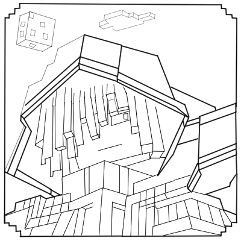
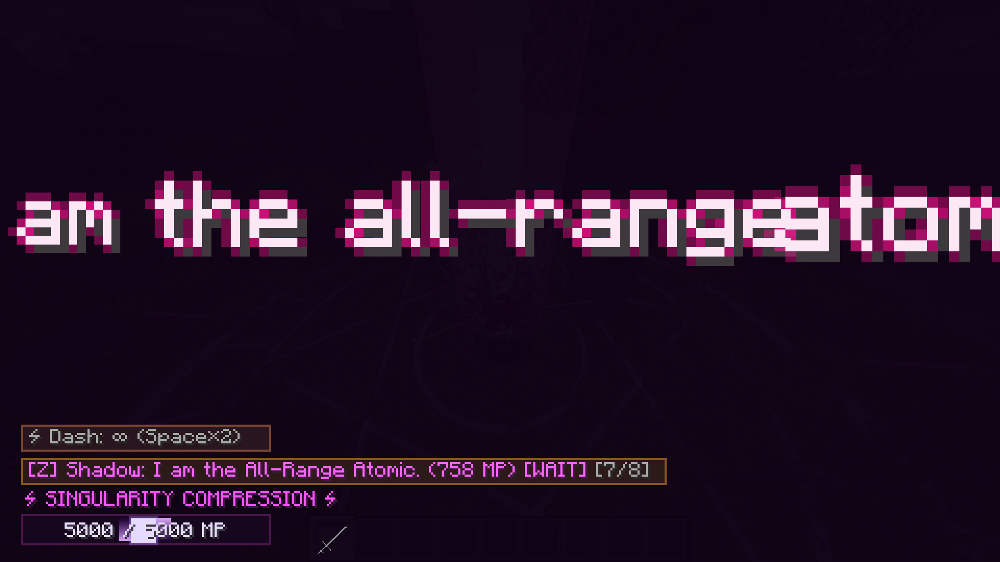

# 🌑 The Eminence in Shadow: Shadow Garden & Atomic
### Official Public Wiki & Master Specification Repository (`v1.0.5`)
### 『陰の実力者になりたくて！』MOD 公式公開Wiki・総合仕様書リポジトリ (`v1.0.5`)

[-D95B43?style=for-the-badge)](https://github.com/Khang202531/The-Eminence-in-Shadow-Shadow-Garden-Atomic)
[%20%7C%2017%20(1.20.1)-ED8B00?style=for-the-badge&logo=openjdk)](https://github.com/Khang202531/The-Eminence-in-Shadow-Shadow-Garden-Atomic)

> *"I lurk in the shadows and hunt the shadows..."*  
> **「陰に潜み、陰を狩る者――」**

[**🏠 Wiki Home**](wiki/Home.md) ｜ [**📖 全仕様書 (1ファイル完全版)**](WIKI_SPECIFICATION.md) ｜ [**🗡️ 全29種 武器＆アイテム図鑑**](wiki/05-Weapons-and-Artifacts.md) ｜ [**👑 全26体 ボス＆仲間化**](wiki/06-Bosses-and-Companions.md) ｜ [**🛠️ 全51種 レシピ**](wiki/07-Crafting-Recipes.md) ｜ [**📝 Changelog**](CHANGELOG.md)

---

> [!IMPORTANT]
> **About This Repository / このリポジトリについて**  
> This public repository is dedicated to the **Official Wiki, Complete Gameplay Specification, Crafting Recipes, and Release Changelogs** for **The Eminence in Shadow: Shadow Garden & Atomic** (`v1.0.5` — NeoForge 1.21.1 & Forge 1.20.1).  
> 本リポジトリは、Minecraft MOD『**The Eminence in Shadow: Shadow Garden & Atomic**』（NeoForge 1.21.1 版 ＆ Forge 1.20.1 版 共通仕様 `v1.0.5`）の**公式公開Wiki・完全仕様書・レシピ図鑑・更新履歴リポジトリ**です。

---

## 📚 Official Wiki Navigation / 公式Wiki 全章インデックス

以下のリンクから、すべての計算式・全29種の武器＆アイテムデータ・全26体ボス攻略・全51種クラフトレシピへ直接アクセスできます。

| 章 / Chapter | Wiki ページ / Page Link | 収録内容ハイライト / Highlights |
| :-: | :--- | :--- |
| **🏠 Home** | **[Wiki Home（公式Wikiトップ）](wiki/Home.md)** | 全体アーキテクチャ図・コンテンツ収録数サマリー・全章インデックス System architecture diagram, content summary, and chapter navigation |
| **01** | **[01. 導入・操作方法・推奨攻略チャート](wiki/01-Getting-Started-and-Controls.md)** | 対応環境（NeoForge 1.21.1 / Forge 1.20.1）、全キーバインド仕様、第7席イータからシャドウへ至る8ステップ攻略チャート Installation, keybindings (`Z`, `Shift`, `Space×2`, `V`), and 8-step boss progression |
| **02** | **[02. 魔力（MP）・魔力伝導率99%・スライムスーツ](wiki/02-Mana-and-Slime-Bodysuit.md)** | 魔力伝導率（`10% → 50% → 99%`）計算式、最大MP `7,000` スケーリング、魔力変換シールド（`1.0 DMG = 10.0 MP`）、3D物理演算コート＆日常服偽装（`V`）、『漆黒の剣』具現化（素手 `Shift + 右クリック`） 99% Mana Conductivity math, Mana Shield absorption, 3D Shadow coat physics, and Jet-Black Sword materialization |
| **03** | **[03. アクション戦闘・パリィ・体勢崩し・7大刻印](wiki/03-Combat-Parry-and-Status-Marks.md)** | スライムガード、**ジャストガード・パリィ（`7 ticks / 0.35秒`受付＆6大恩恵）**、【体勢崩し（Posture Break）】倍率計算、高速移動（瞬駆/連閃）、7大戦闘刻印（**双牙・出血・鋼糸・業火・絶禍・堕落・魔力阻害**） 7-tick Just-Guard Parry, Posture Break multipliers (`1.45x`–`2.00x`), high-speed dashes, and 7 Combat Marks |
| **04** | **[04. 究極奥義『I am Atomic.』全形態＆空間消滅エンジン](wiki/04-I-Am-Atomic.md)** | 詠唱タイムライン＆中西演出（爆発前静寂）、**発動姿勢による3形態（通常球体 / 第5話・指向性貫通ビーム / 第20話・天蓋昇華ピラー）**、全5種Atomic（Normal / All-Range / Recovery / Archetype / Catastrophe）比較表 3 canonical casting stances, 5 Atomic variants (`5,000`–`7,500` DMG & Recovery purification), and pre-blast silence |
| **05** | **[05. 全29種 3D武器・魔道具・消費アイテム完全図鑑](wiki/05-Weapons-and-Artifacts.md)** | シャドウ/シド系9種、**七陰専用武器7種（各5スキル収録）**、三英雄・魔女・血の女王・妖狐・剣聖・教団幹部武器11種、ミツゴシ商会アイテム2種の全ステータス＆全スキル数値 Complete stats & skill tables for all 27 custom 3D weapons/artifacts and 2 Mitsugoshi consumables |
| **06** | **[06. 全26体 ボス攻略データ＆シャドウガーデンの盟約](wiki/06-Bosses-and-Companions.md)** | **4段階覚醒ボス「シャドウ」**（半径44m結界ドーム）、**七陰7名**、**超精鋭「ジョン・スミス」**、**カゲマス英雄＆教団幹部17体**のパラメータ・固有弱点ギミック、**仲間化（盟約 全22名）・AI戦術3モード・模擬戦・ユニゾン連携** All 26 multi-phase bosses, Posture Break counters, 22 recruitable companions, tactical AI modes, and sparring |
| **07** | **[07. 全51種 クラフトレシピ完全一覧](wiki/07-Crafting-Recipes.md)** | スライムスーツ4部位、武器・魔道具・ミツゴシ食品21種、正典8ボス共鳴核、カゲマス＆教団18ボス共鳴核の3×3作業台レシピ図（素材入手によるデータ駆動レシピブック自動解放対応） All 51 survival 3×3 crafting recipes with automatic Recipe Book unlock advancements |
| **08** | **[08. 進捗13種・コマンド・コンフィグ＆最適化仕様](wiki/08-Commands-Config-and-Advancements.md)** | 進捗ツリー全13種、`/mana` コマンド構文、`eminence_shadow-common.toml` 全13項目リファレンス、非同期クレーター生成＆マルチプレイS2Cバッチ通信アーキテクチャ 13 advancements, `/mana` commands, all 13 config options, and zero-lag async crater excavation |
| **📄 全統合版** | **[1ファイル完全統合版 仕様書 (`WIKI_SPECIFICATION.md`)](WIKI_SPECIFICATION.md)** | 上記全8章のすべての数式・データ表・レシピ図を1つのMarkdownファイル（約123KB）に完全統合したマスター仕様書 Single-file master specification containing all 8 chapters in full detail |

---

## 📸 Screenshots Gallery / スクリーンショット

| クリエイティブタブ＆全3D武器・共鳴核一覧 | 魔力伝導率99%・スライムスーツ3D変身＆HUD |
| :---: | :---: |
|  |  |
| **『I am the All-Range Atomic.』特異点魔力圧縮＆詠唱演出** | **超広域クレーター消滅＆4段階覚醒ボス「シャドウ」決戦** |
|  |  |

---

## ✨ Key Features / 主な特徴

### 1. 3つの正典姿勢 × 全5種バリエーションの究極奥義『I am Atomic.』
- **通常球体（直立発動）**: 術者を中心に万象を消し飛ばす半径100mの青紫の球状クレーターを穿ちます（固定 `5,000` ダメージ、`Config.BLAST_DAMAGE` 連動）。
- **指向性貫通ビーム（`Shift` スニーク＋発動 / アニメ第5話再現）**: 術者の背後36m以内と味方を一切傷つけず、前方扇状コーンのみを貫通消滅させます。
- **天蓋昇華ピラー（上空 `Pitch <= -45°` を見上げて発動 / アニメ第20話再現）**: 周囲の地形を一切破壊せず、雨雲を吹き飛ばして快晴に変えながら天を貫く光の柱で敵のみを抹消します。
- **All-Range Atomic (`7,500` DMG / 半径125m) ＆ Recovery Atomic**: リカバリー・アトミックは味方全員の **HP＆満腹度100%回復＋全デバフ浄化＋MP `+500` 供給＋再生II＆耐性II＆移動速度上昇I＋村人ゾンビ蘇生** を行い、敵には衝撃波ダメージ（通常Mob `1,800` / ボス `180`）を与えます。さらに『開闢の漆黒剣』では **I am Archetype Atomic.**（`3,600` DMG・味方誤射なし・地形非破壊・クロノバースト＋自動パリィ3チャージ＋アルファ連動【アトミック・ユニゾン】）および **I am Catastrophe Atomic.**（`6,400` DMG）も行使可能です。

### 2. 魔力伝導率99%・スライムスーツ変身＆『漆黒の剣』具現化
- **スライムスーツ一式（4部位）**: 装備部位数に応じて魔力伝導率が **`10% → 32% → 55% → 77% → 99%`** へ上昇（『ミスリルの剣』所持時は最低 `50%` 保証）し、スキル消費MPを1/10に抑え、自然回復速度を最大 `+80%` 増幅します。
- **被ダメージ魔力変換シールド**: 防具・耐性・軽減エンチャント・格付けRank軽減（最大32%）・スライム防壁（75%軽減）を計算した後の最終ダメージを **`1.0 ダメージ = 10.0 MP`** で自動変換し、魔力が続く限りHPダメージを100%無効化（落下ダメージは一律 `10 MP` で完全吸収）。
- **3Dシャドウ変身＆日常服偽装（`V` キー）**: フル装備で物理演算コート付きのシャドウ姿へ変身。フルスーツ着用中に `V` キーで伝導率99%を維持したまま通常スキンへ擬態可能。
- **素手スニーク右クリック具現化＆技8収納**: ボス「シャドウ」を撃破後、フルスーツ着用時に **素手で `Shift + 右クリック`** するとスーツから『漆黒の剣』を具現化（`10 MP`）でき、**技8『スライム収納』** でスーツへ収納（`+150 MP` 回収）できます。

### 3. ジャストガード・パリィ、体勢崩し（Posture Break）＆ 7大戦闘刻印
- **ジャストガード・パリィ（武器所持またはスーツ着用で `Shift` 長押し）**: ガード開始から `7 ticks (0.35秒)` 以内に攻撃を受けるとパリィ成立！ **MP `+25` 回復**＋飛び道具1.75倍速跳ね返し＋武器固有カウンター追撃に加え、近接および24m以内の飛び道具攻撃に対してボスの黒鉄スライム硬化・空中歩法・霧化・隠密を打ち破る **【体勢崩し（被ダメ1.45〜2.00倍）】** を誘発します。
- **7大戦闘刻印システム**: **『双牙の刻印』『出血』『鋼糸（3秒スタン迎撃）』『業火（最大HP割合炎上）』『絶禍（ガード粉砕＆直接体勢崩し）』『堕落（攻撃-20%・被ダメ+25%）』『魔力阻害（回復-70%）』** が専用ダメージ種別 `eminence_shadow:combat_mark` とともに機能します。

### 4. 全26体の多段階覚醒ボス・格付けランク（Rank 0〜8）・仲間化（盟約）システム
- **正典8ボス攻略＆格付けランク**: **イータ → ガンマ → ベータ → イプシロン → ゼータ → デルタ → アルファ** を制覇し、最後に4段階覚醒＆半径44m結界ドームを持つ **陰の実力者「シャドウ」** に挑みましょう。撃破ごとにRankが上がり、攻撃力（最大 `+96%`）・最大MP（`+2,000`）・自然回復（`+48/s`）・防御軽減（`+32%`）が永続成長します。
- **カゲマス＆原作英雄・教団幹部（18体）**: 超精鋭 **ジョン・スミス**、**ジミナ・セーネン**、**切り裂きジャック**、ナンバーズ（**ウィクトーリア・ラムダ・ニュー**）、三英雄（**オリヴィエ・フレイヤ・リリ**）、**ユキメ**、**アウロラ**、**エリザベート**、**ベアトリクス**、**アンネローゼ**、**クレア**、そしてディアボロス教団（**第5席フェンリル・第四魔界の王ラグナロク・第11席ネルソン**）が固有3D衣装・武器・ブレイクギミック付きで参戦！
- **シャドウガーデンの盟約（仲間化 全22名）**: 教団幹部とシャドウ本人を除く全22名は、撃破後（またはHP 15%以下）にフルスライムスーツで右クリックすると仲間として契約可能！ 右クリックで **AIモード切替（護衛追従 / 積極索敵 / その場待機［アンカー座標永続化］）＆魔力供給ヒール**、`Shift + 右クリック` でいつでも **模擬戦（手合わせ）** が楽しめます。

---

## 🎮 Controls Quick Reference / 操作方法クイックリファレンス

| アクション / Action | デフォルト入力 / Default Input | 詳細仕様 / Description |
| :--- | :---: | :--- |
| **スキル / 射撃モード切替** Cycle Skill / Bow Mode | `Z`（逆順 `Shift + Z`） | 手に持っている本MOD武器・魔道具の選択中スキルを順送り／逆送りで切り替えます |
| **スキル発動** Activate Skill | `右クリック` (`Right-Click`) | 選択中のスキルをMPを消費して発動します（ベータ弓は1.6秒保持で過充填《フェイタリティ》） |
| **スライムガード ＆ パリィ** Slime Guard & Just-Guard Parry | `Shift` 長押し (`Hold Shift`) | 被ダメージ75〜85%軽減。着弾の瞬間（`7 ticks` 以内）に押すとパリィ反撃（`+25 MP` ＆ ボス体勢崩し） |
| **高速移動（瞬駆 / 連閃）** High-Speed Dash | 地上・空中で `Space × 2` | 『漆黒の剣』またはフルスーツ素手で無制限瞬駆、『陰の剣（アルファ）』で3チャージ連閃 |
| **『漆黒の剣』具現化 / 収納** Materialize / Absorb Sword | フルスーツ＋**素手で `Shift + 右クリック`** （収納は技8 `右クリック`） | シャドウ撃破後、フルスーツ＋空手で `Shift + 右クリック` すると『漆黒の剣』を具現化（`10 MP`）、技8「スライム収納」で吸収（`+150 MP`） |
| **シャドウ外装 / 日常服偽装切替** Toggle Slime Morph / Disguise | `V` キー | フルスーツ着用時の3Dシャドウ外装と通常スキン見た目を切替（魔力伝導率99%は維持） |
| **仲間AI切替 / ヒール / 模擬戦** Companion AI / Heal / Sparring | 仲間を `右クリック` / `Shift + 右クリック` | 右クリックでHP回復（負傷時）またはAI切替（追従/索敵/待機）、`Shift + 右クリック` で模擬戦開始 |

---

## 📦 Supported Environments / 対応環境・エディション (`v1.0.5`)

| エディション / Edition | Minecraft | Mod Loader | Java | 前提MOD / Dependencies |
| :--- | :---: | :---: | :---: | :--- |
| **NeoForge 1.21.1 版** | `1.21.1` | **NeoForge `21.1.252+`** (`[1.21.1,1.22)`) | **Java 21** | なし（レシピ閲覧に `JEI` 推奨） |
| **Forge 1.20.1 版** | `1.20.1` | **Forge `47.2.0+`** (`47.4.28` / `[47,)`) | **Java 17** | なし（レシピ閲覧に `JEI` 推奨） |

---

## ⚖️ License & Fan-Work Disclaimer / ライセンス・二次創作免責事項

- **License**: **All Rights Reserved**（詳細は [LICENSE](LICENSE) を参照）
  - **EN**: All Rights Reserved. Unauthorized re-uploading or redistribution on third-party sites and any commercial use are strictly prohibited. You may freely include this mod in non-commercial modpacks hosted on **CurseForge** or **Modrinth** with proper credit and a link back to the project page.
  - **JA**: **All Rights Reserved（全権利留保）** — 外部サイトへの無断転載・再配布および商用利用を固く禁じます（**CurseForge** または **Modrinth** 上で公開される非商用Modpackへの同梱は、本プロジェクトへのクレジット記載を条件に許可します）。
- **二次創作に関する免責・権利表記 (Fan-Work Disclaimer)**:
  - 本MODは逢沢大介先生・東西先生・KADOKAWA・株式会社Aimingおよび『陰の実力者になりたくて！』製作委員会とは一切関係のない、ファンによる非公式・非営利の二次創作MODです。原作のキャラクター・名称・世界観に関する著作権・商標権その他の知的財産権はすべて原著作者および各権利者様に帰属します。
  - 本MODにはアニメ本編からの抽出音声等の著作権保護音源は一切含まれておらず、すべての効果音はMinecraftバニラ音源およびプログラムによるリアルタイム波形合成（Procedural Audio Synthesis）で実装されています。
