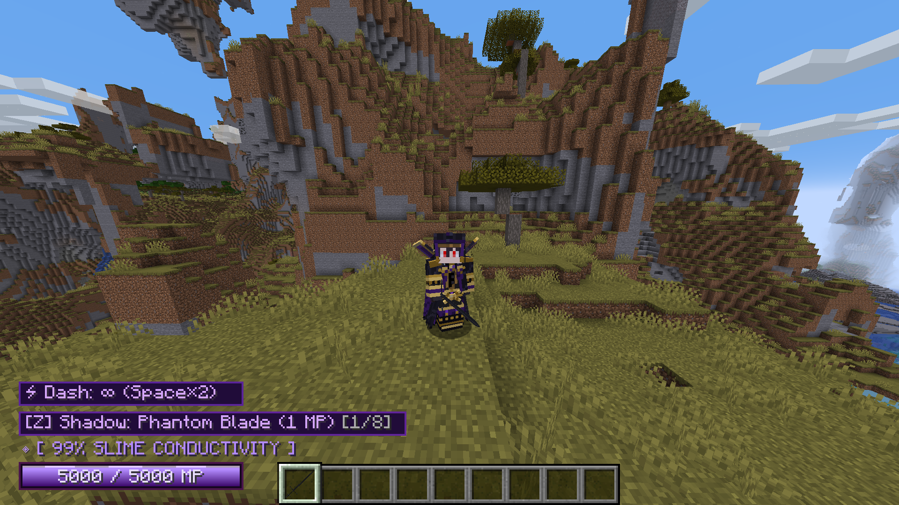
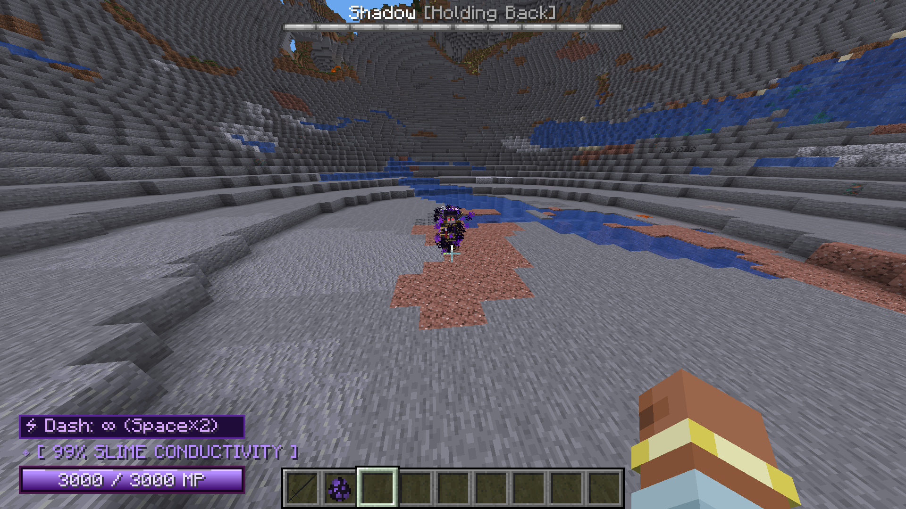

# 🌑 The Eminence in Shadow: Shadow Garden & Atomic
### Official Public Wiki & Master Specification Repository
### 『陰の実力者になりたくて！』MOD 公式公開Wiki・総合仕様書リポジトリ

> *"My name is Shadow. He who lurks in the shadows to hunt the shadows..."*
> **「我が名はシャドウ。陰に潜み、陰を狩る者――」**

[**🏠 Wiki Home**](wiki/Home.md) · [**📖 1-File Complete Specification (120KB)**](WIKI_SPECIFICATION.md) · [**⚔️ Weapons Arsenal**](wiki/05-Weapons-and-Artifacts.md) · [**👑 Bosses & Companions**](wiki/06-Bosses-and-Companions.md) · [**🛠️ Crafting Recipes**](wiki/07-Crafting-Recipes.md) · [**📝 Changelog**](CHANGELOG.md)

---

> [!IMPORTANT]
> **About This Repository / このリポジトリについて**
> This public repository is dedicated exclusively to the **Official Wiki, Gameplay Documentation, Crafting Recipes, and Release Changelogs** for **The Eminence in Shadow: Shadow Garden & Atomic** (`All Rights Reserved`).
> 本リポジトリは、Minecraft MOD『**The Eminence in Shadow: Shadow Garden & Atomic**』の**公式公開Wiki・仕様書・レシピ図鑑専用リポジトリ**です（MOD本体のソースコードとは分離して管理されています）。

---

## 📚 Official Wiki Navigation / 公式Wiki 全章インデックス

Click any chapter below to browse detailed formulas, skill tables, boss strategies, and 3×3 crafting grids:
以下のリンクから、各システムの正確な計算式・全武器スキル・全ボス攻略・クラフトレシピへ直接アクセスできます。

| Chapter / 章 | Wiki Page / ページリンク | Contents / 収録内容 |
| :---: | :--- | :--- |
| **🏠 Home** | [**Wiki Home Portal**](wiki/Home.md) | Overview, visual gallery, and master navigation index Wiki総合トップページ・機能一覧・ナビゲーション |
| **Chapter 01** | [**01. Getting Started & Controls**](wiki/01-Getting-Started-and-Controls.md) | Supported loaders (`NeoForge 1.21.1` / `Forge 1.20.1`), installation, and all keybindings (`G`, `X`, `R`, `V`, `C`) 導入手順・動作環境・全キー操作一覧 |
| **Chapter 02** | [**02. Mana System & 99% Slime Bodysuit**](wiki/02-Mana-and-Slime-Bodysuit.md) | Mana formulas, HUD overlay, 4-piece Slime Suit perks (`+150` Mana, `2.0x` Regen, `-20%` Atomic cost, Null Fall/Freeze), and `R` Key Camouflage Morph 魔力システム・99%魔力伝導スライムスーツ一式特典・`R`キー偽装着脱 |
| **Chapter 03** | [**03. Combat, Just-Parry & Status Marks**](wiki/03-Combat-Parry-and-Status-Marks.md) | Slime Guard (`C`), **7-tick (`0.35s`) Just-Guard Parry** & 6 counter benefits, Posture Break (`100` posture), High-Speed Dash (`V`), and 7 Combat Marks スライムガード・ジャストパリィ（受付0.35秒）・体幹ブレイク・7種の状態異常刻印 |
| **Chapter 04** | [**04. "I Am Atomic" Magic System**](wiki/04-I-Am-Atomic.md) | Anime-accurate *"Nakanishi Silence"* sequence, **3 Casting Stances** (Omnidirectional Sphere / Ep.5 Directional Beam / Ep.20 Skyward Pillar + Weather Clear), and **5 Atomic Variants** (`X` key) 無音演出タイムライン・姿勢による3形態撃ち分け・全5種アトミック派生比較 |
| **Chapter 05** | [**05. Weapons, Artifacts & Mitsugoshi Arsenal**](wiki/05-Weapons-and-Artifacts.md) | All **27 Custom 3D Weapons, Ancient Artifacts (`Eye of Avarice`), and Mitsugoshi Co. Treats** with passive, Right-Click, and Sneak+Right-Click skills 全27種の3D武器・強欲の瞳・三越マグロバーガー＆高級チョコの完全データ表 |
| **Chapter 06** | [**06. Bosses, Mastery Ranks & Companions**](wiki/06-Bosses-and-Companions.md) | **Shadow Mastery Ranks (`0–8`)**, 4-Phase **Lord Shadow** raid guide & Atomic chant interrupt, **Seven Shadows**, **John Smith**, **17 Kagemasu/Cult Bosses**, and **Shadow Garden Oath Companion Recruitment** 熟練度ランク（0〜8）・全26体ボス攻略・七陰コンパニオン勧誘＆共闘AI |
| **Chapter 07** | [**07. Complete Crafting Recipes (All 51)**](wiki/07-Crafting-Recipes.md) | All **51 Survival 3×3 Crafting Recipes**: Slime Core, Slime Suit, Weapons, Artifacts, Mitsugoshi Foods, and all 26 Boss Resonance Crystals サバイバルで作れる全51種の3×3クラフトレシピ完全図鑑 |
| **Chapter 08** | [**08. Advancements, Commands & Config**](wiki/08-Commands-Config-and-Advancements.md) | All **13 Advancements** tree, `/mana` commands (`info`, `full`, `set`, `max`, `rank`), all 13 `eminence_shadow-common.toml` settings, and TPS optimization architecture 全13種の実績ツリー・`/mana`コマンド・Config設定13項目・非同期クレーター技術仕様 |
| **📘 All-in-One** | [**Master Specification (`WIKI_SPECIFICATION.md`)**](WIKI_SPECIFICATION.md) | **Single-file complete encyclopedia (120 KB)** containing every chapter, formula, and table in one document 全章・全数値を1ファイルに統合した完全版マスター仕様書（約120KB） |

---

## 📸 Visual Gallery / ゲーム内スクリーンショット

| **3D Weapons, Artifacts & Resonance Crystals** | **99% Slime Bodysuit & Camouflage Morph (`R` Key)** |
| :---: | :---: |
|  |  |
| ***"I Am Atomic"* Geometric Magic Dome (`G` Key)** | **Async Multi-Tick Crater & Lord Shadow 4-Phase Raid** |
|  |  |

  

---

## 🎮 Quick Controls Reference / 基本操作クイックリファレンス

| Default Key / 初期キー | Action Name / 機能名 | Condition / 発動条件 | Effect Summary / 効果概要 |
| :---: | :--- | :--- | :--- |
| **`G`** | **Cast "I Am Atomic"** 奥義『I am Atomic』発動 | Hold **Slime Sword** + Enough Mana (`96`–`300`) | Unleashes the selected Atomic variant (`70-tick` invulnerable chant, Nakanishi silence, and detonation). • **Standing**: Omnidirectional Sphere (`48m` radius) • **Crouching (`Shift`)**: Ep.5 Directional Railgun Beam (`96m` range) • **Looking Straight Up (`Pitch < -65°`)**: Ep.20 Skyward Pillar + Weather Clear! |
| **`X`** | **Cycle Atomic Variant** アトミック派生切替 | Anytime | Cycles through: **1. Standard Atomic** → **2. All-Range Atomic** → **3. Recovery Atomic** → **4. Sword Atomic (No Block Break)** → **5. Cosmic Atomic (Rank 4+)**. |
| **`R`** | **Slime Suit Morph** スライムスーツ偽装解除／展開 | Equip **Full 4-Piece Slime Bodysuit** | Toggles visual disguise between **Concealed Mode (Mob Persona)** and **Shadow Combat Attire** while keeping 100% of armor stats and bonuses. |
| **`V`** | **Slime High-Speed Dash** スライム高速ステップ | `15 Mana` (`1.25s` CD) | High-speed shadow step (`1.85` speed w/ full suit) with **`10 ticks` (`0.5s`) invulnerability** and **`8.0 + (Rank × 1.5)` through-slash damage**. |
| **`C` (Hold)** | **Slime Guard & Just Parry** スライムガード＆ジャストパリィ | Anytime (`7-tick / 0.35s` Parry Window) | • **Hold**: Reduces incoming damage by **`80%`** (full suit) or **`50%`**. • **Press within `7 ticks` (`0.35s`) of impact**: **`[JUST PARRY!]`** — **100% damage nullified**, **`+25 Mana`**, counter damage, **`+35 Posture` + `[EXPOSED]`**, and **instant Dash CD reset**! |
| **Right-Click** | **Primary Weapon Skill** 武器固有スキル1 | Hold any Mod Weapon / Artifact | Executes the weapon's primary魔力 skill (`20`–`45` Mana). |
| **Sneak + Right-Click** | **Secondary Overdrive Skill** スニーク第2スキル／仲間回復 | Hold Core Weapon / Target Companion | Executes secondary ultimate weapon skill, or infuses `25 Mana` to heal a sworn Seven Shadows companion for `+80 HP`. |

---

## 📦 Installation & Supported Versions / 導入環境・対応バージョン

| Edition / エディション | Minecraft Version | Mod Loader & Minimum Version | Java Version | Config File Path |
| :--- | :---: | :---: | :---: | :--- |
| **NeoForge 1.21.1** | `1.21.1` | **NeoForge `21.1.219+`** | **Java 21** (`JDK 21`) | `config/eminence_shadow-common.toml` |
| **Forge 1.20.1** | `1.20.1` | **Minecraft Forge `47.3.0+`** | **Java 17** (`JDK 17`) | `config/eminence_shadow-common.toml` |

---

## 📜 License & Disclaimer / ライセンス・免責事項

- **License**: **All Rights Reserved** ([LICENSE](LICENSE)) — Copyright © 2026 **Khang / Shadow Garden Dev**.
  - Redistribution, re-uploading to third-party sites, or commercial use without permission is strictly prohibited.
  - **Modpacks**: Inclusion in public or private **CurseForge** and **Modrinth** modpacks is permitted provided the mod is downloaded directly through official CurseForge/Modrinth distribution channels and credit is given.
- **Fan Creation Disclaimer**: This is an unofficial, non-commercial fan-made documentation & mod project inspired by *"The Eminence in Shadow" (陰の実力者になりたくて！)* by Daisuke Aizawa / Kadokawa / Shadow Garden.
