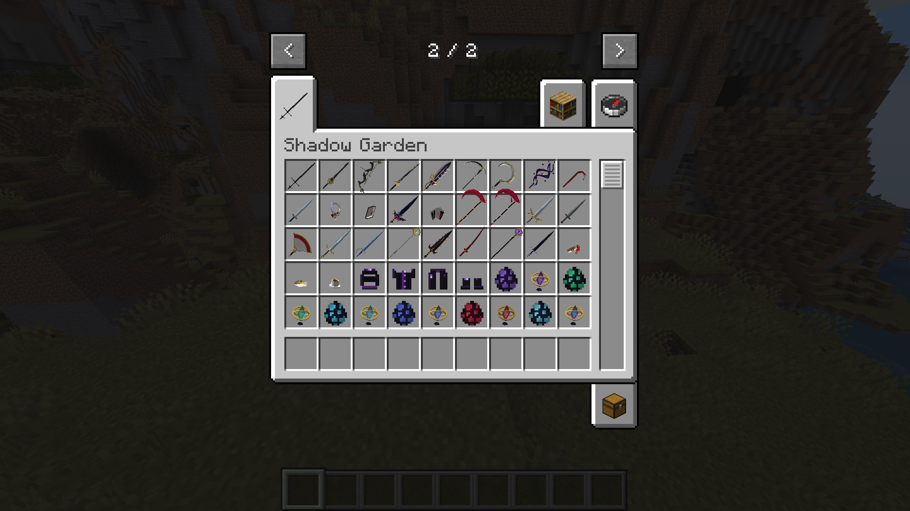
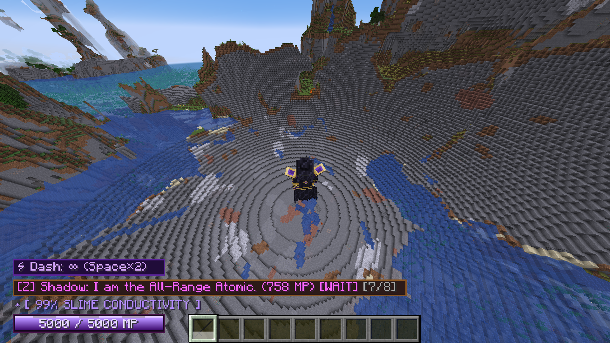

# 🌑 The Eminence in Shadow: Shadow Garden & Atomic
### Official Public Wiki & Master Specification Repository (`v1.0.8`)
### 『陰の実力者になりたくて！』MOD 公式公開Wiki・総合仕様書リポジトリ (`v1.0.8`)

[%20%7C%20NeoForge%2021.1.252%2B-D95B43?style=for-the-badge)](https://github.com/Khang202531/The-Eminence-in-Shadow-Shadow-Garden-Atomic)
[%20%7C%2021%20(1.21.1)-ED8B00?style=for-the-badge&logo=openjdk)](https://github.com/Khang202531/The-Eminence-in-Shadow-Shadow-Garden-Atomic)

> *"I lurk in the shadows and hunt the shadows..."*  
> **「陰に潜み、陰を狩る者――」**

[**🇯🇵 日本語 Wiki Home**](wiki/Home.md) ｜ [**🇺🇸 English Wiki Home**](wiki/Home-EN.md) ｜ [**📖 全仕様書 (1ファイル完全版)**](WIKI_SPECIFICATION.md) ｜ [**🗡️ 全30種 武器図鑑 (JA/EN)**](wiki/05-Weapons-and-Artifacts.md) ｜ [**👑 全26体 ボス＆仲間化 (JA/EN)**](wiki/06-Bosses-and-Companions.md) ｜ [**🛠️ 全52種 レシピ (JA/EN)**](wiki/07-Crafting-Recipes.md) ｜ [**📝 Changelog**](CHANGELOG.md)

---

> [!IMPORTANT]
> **About This Repository / このリポジトリについて**  
> This public repository hosts the **Official Japanese & English Wiki (20 separated pages), Complete Gameplay Specification, Crafting Recipes, and Release Changelogs** for **The Eminence in Shadow: Shadow Garden & Atomic** (`v1.0.8`).  
> 本リポジトリは、Minecraft MOD『**The Eminence in Shadow: Shadow Garden & Atomic**』（`v1.0.8`）の**公式公開Wiki（日本語版・英語版分離 全20ページ）・完全仕様書・レシピ図鑑・更新履歴リポジトリ**です。

---

## 📚 Official Wiki Navigation / 公式Wiki 全章インデックス（日本語版 ＆ 英語版）

以下のリンクから、**日本語版 Wiki** または **英語版 Wiki (English Wiki)** の各章へ直接アクセスできます。

| 章 / Chapter | 🇯🇵 日本語 Wiki (Japanese Pages) | 🇺🇸 English Wiki (English Pages) | 収録内容ハイライト / Highlights |
| :-: | :--- | :--- | :--- |
| **🏠 Home** | **[日本語 Wiki Home](wiki/Home.md)** | **[English Wiki Home](wiki/Home-EN.md)** | 全体アーキテクチャ図・`v1.0.8` ハイライト・全章ナビゲーション System architecture diagram, `v1.0.8` highlights, and chapter navigation |
| **01** | **[01. 導入・操作方法・推奨攻略チャート](wiki/01-Getting-Started-and-Controls.md)** | **[01. Getting Started & Controls](wiki/01-Getting-Started-and-Controls-EN.md)** | 対応環境、全キーバインド仕様、第7席イータからシャドウへ至る8ステップ攻略チャート Installation, keybindings (`Z`, `Shift`, `Space×2`, `V`), and 8-step boss progression |
| **02** | **[02. 魔力（MP）・伝導率99%・スライムスーツ](wiki/02-Mana-and-Slime-Bodysuit.md)** | **[02. Mana, 99% Conductivity & Suit](wiki/02-Mana-and-Slime-Bodysuit-EN.md)** | 魔力伝導率（`10% → 50% → 99%`）計算式、最大MP `7,000`、魔力変換シールド（`1.0 DMG = 10.0 MP`）、**`v1.0.6` 3D造形＆発光シャドウコート（3関節9パネル裾）**＆日常服偽装（`V`・`v1.0.8` ディメンション移動維持） 99% Mana Conductivity math, Mana Shield absorption, `v1.0.6` 3D sculpted/glowing Shadow Coat, and `v1.0.8` dimension-persistent disguise & resonance |
| **03** | **[03. アクション戦闘・パリィ・体勢崩し・7大刻印](wiki/03-Combat-Parry-and-Status-Marks.md)** | **[03. Combat, Parry & Status Marks](wiki/03-Combat-Parry-and-Status-Marks-EN.md)** | スライムガード、**ジャストガード・パリィ（`7 ticks / 0.35秒`受付＆6大恩恵）**、【体勢崩し（Posture Break）】倍率計算、高速移動（瞬駆/連閃）、7大戦闘刻印（**双牙・出血・鋼糸・業火・絶禍・堕落・魔力阻害**） 7-tick Just-Guard Parry, Posture Break multipliers (`1.45x`–`2.00x`), high-speed dashes, and 7 Combat Marks |
| **04** | **[04. 究極奥義『I am Atomic.』全形態＆空間消滅エンジン](wiki/04-I-Am-Atomic.md)** | **[04. Ultimate Art: "I am Atomic."](wiki/04-I-Am-Atomic-EN.md)** | 詠唱タイムライン＆中西演出（爆発前静寂）、**発動姿勢による3形態（通常球体 / 第5話・指向性貫通ビーム / `v1.0.7` 第20話・天頂ドーム＆地面魔法陣）**、全5種Atomic比較表 3 canonical casting stances (`v1.0.7` Ep. 20 Zenith Dome & Ground Magic Circle), 5 Atomic variants, and pre-blast silence |
| **05** | **[05. 全30種 3D武器・魔道具・消費アイテム完全図鑑](wiki/05-Weapons-and-Artifacts.md)** | **[05. All 30 3D Weapons & Artifacts](wiki/05-Weapons-and-Artifacts-EN.md)** | シャドウ/シド系9種、**七陰専用武器7種（各5〜6スキル収録、`v1.0.8` イータ第6技追加）**、三英雄・魔女・血の女王・妖狐・武神・教団幹部・ラムダ武器12種（`v1.0.8` 魔剣『血牙』大太刀刷新＆ラムダの黒鞭＆アウロラオーブ増量）、ミツゴシ商会アイテム2種の全スペック表 Complete stats & skill tables for all 28 custom 3D weapons/artifacts (`v1.0.8` Demon Sword: Bloodfang odachi, Lambda's Black Whip, Eta 6th skill & Aurora orb boost) and 2 Mitsugoshi consumables |
| **06** | **[06. 全26体 ボス攻略データ＆シャドウガーデンの盟約](wiki/06-Bosses-and-Companions.md)** | **[06. All 26 Bosses & Companions](wiki/06-Bosses-and-Companions-EN.md)** | **4段階覚醒ボス「シャドウ」**（半径44m結界ドーム）、**七陰7名**（`v1.0.8` イータ地裂落剣AI）、**超精鋭「ジョン・スミス」**、**専用3D衣装＆発光モデル対応のカゲマス英雄＆教団幹部17体**のパラメータ・固有弱点（`v1.0.8` ラムダ黒鞭・フェンリル血牙刷新）、**仲間化（盟約 全22名）・AI戦術3モード・模擬戦** All 26 multi-phase bosses with dedicated 3D models & glow maps (`v1.0.8` Eta Slime Eruption AI, Lambda Whip & Fenrir Bloodfang), Posture Break counters, and 22 recruitable companions |
| **07** | **[07. 全52種 クラフトレシピ完全一覧](wiki/07-Crafting-Recipes.md)** | **[07. All 52 Crafting Recipes](wiki/07-Crafting-Recipes-EN.md)** | スライムスーツ4部位、武器・魔道具・ミツゴシ食品22種、正典8ボス共鳴核、カゲマス＆教団18ボス共鳴核の3×3作業台レシピ図 All 52 survival 3×3 crafting recipes with automatic Recipe Book unlock advancements |
| **08** | **[08. 進捗13種・コマンド・コンフィグ＆最適化仕様](wiki/08-Commands-Config-and-Advancements.md)** | **[08. Advancements, Commands & Config](wiki/08-Commands-Config-and-Advancements-EN.md)** | 進捗ツリー全13種、`/mana` コマンド構文、`eminence_shadow-common.toml` 全13項目リファレンス、**`v1.0.6` 三角関数LUT＆ゼロアロケーション描画最適化**・`v1.0.8` WCAG AAA HUD＆軽量化 13 advancements, `/mana` commands, all 13 config options, LUT rendering, zero-lag async crater excavation & `v1.0.8` WCAG AAA HUD |
| **📄 全統合版** | **[1ファイル完全統合版 仕様書 (`WIKI_SPECIFICATION.md`)](WIKI_SPECIFICATION.md)** | **[Master Spec (`WIKI_SPECIFICATION.md`)](WIKI_SPECIFICATION.md)** | 上記全8章のすべての数式・データ表・レシピ図を1つのMarkdownファイルに完全統合したマスター仕様書 Single-file master specification containing all 8 chapters in full detail |

---

## 📸 Screenshots Gallery / スクリーンショット

| クリエイティブタブ＆全3D武器・共鳴核一覧 | 魔力伝導率99%・スライムスーツ3D変身＆HUD |
| :---: | :---: |
|  |  |
| **『I am the All-Range Atomic.』特異点魔力圧縮＆詠唱演出** | **超広域クレーター消滅＆4段階覚醒ボス「シャドウ」決戦** |
|  |  |

---

## ⚖️ License & Fan-Work Disclaimer / ライセンス・二次創作免責事項

- **License**: **All Rights Reserved**（詳細は [LICENSE](LICENSE) を参照）
  - **EN**: Distributed free of charge. No unauthorized redistribution or commercial sale. Inclusion in CurseForge / Modrinth modpacks and use in videos or livestreams are permitted with credit and a link back.
  - **JA**: **All Rights Reserved**（無断転載・再配布・商用販売禁止／完全無料配布）。クレジット表記と配布元リンクの明記を条件に、CurseForge / Modrinth のMODパックへの収録および動画投稿・ライブ配信での利用を許可します。
- **二次創作に関する免責・権利表記**:
  - **EN**: Unofficial, non-commercial fan-made work inspired by *The Eminence in Shadow* (Daisuke Aizawa / Touzai / KADOKAWA / Aiming Inc.). No official anime or game assets (audio, textures, or 3D models) are included. Some character textures are based on an existing Minecraft skin pack. The mod code is original, and all sound effects are synthesized using vanilla Minecraft sound events. The mod will be removed immediately upon request from rights holders.
  - 本MODは逢沢大介先生・東西先生・KADOKAWA・株式会社Aimingおよび『陰の実力者になりたくて！』製作委員会とは一切関係のない、ファンによる非公式・非営利の二次創作MODです。原作のキャラクター・名称・世界観に関する著作権・商標権その他の知的財産権はすべて原著作者および各権利者様に帰属します。
  - アニメやゲームの公式素材（音声・テクスチャ・3Dモデル等）は同梱していません。一部のキャラクターテクスチャには既存のMinecraft用スキンパックを使用しています。MODのコードは独自制作で、効果音はすべてバニラ音源の合成で実装しています。
  - 権利者様からの削除・修正要請があった場合は速やかに対応いたします。
