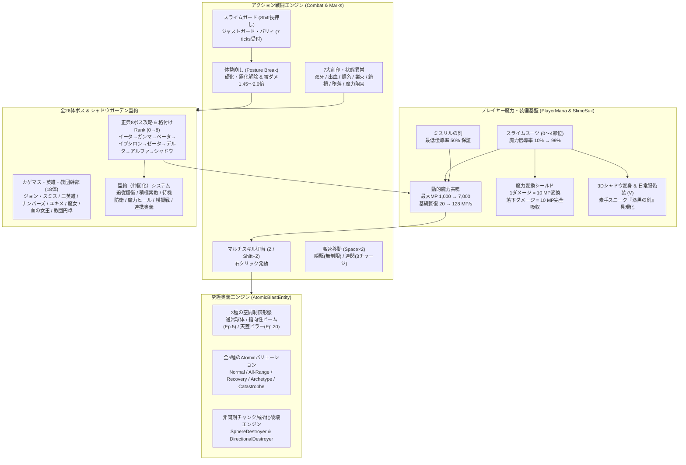
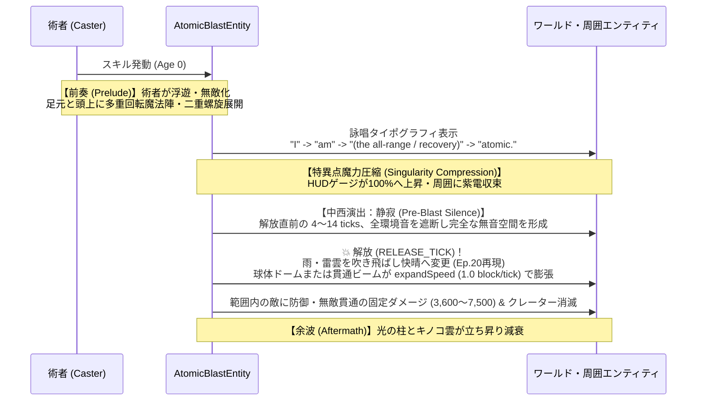
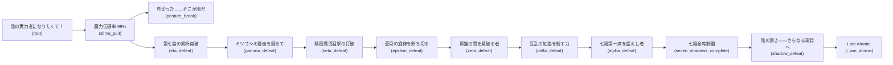

# 『陰の実力者になりたくて！』MOD 公式Wiki完全仕様書
## The Eminence in Shadow: Shadow Garden & Atomic — Complete Wiki Specification (`v1.0.0`)

> *「陰に潜み、陰を狩る者――」*
> *"I lurk in the shadows and hunt the shadows..."*

本ドキュメントは、Minecraft MOD **『The Eminence in Shadow: Shadow Garden & Atomic』**（MOD ID: `eminence_shadow`）の全システム・数値計算式・全27種の3D武器＆魔道具スキル・全26体の多段階覚醒ボス・仲間化（盟約）システム・全51種のクラフトレシピ・コマンド・コンフィグ設定を網羅した、**Wiki公開用の完全仕様書**です。

---

## 📑 目次（Table of Contents）

1. [プロジェクト基本情報（Overview & Metadata）](#1-プロジェクト基本情報overview--metadata)
2. [システム全体アーキテクチャ（System Architecture）](#2-システム全体アーキテクチャsystem-architecture)
3. [操作方法・キーバインド仕様（Controls & Keybindings）](#3-操作方法キーバインド仕様controls--keybindings)
4. [魔力（MP）・魔力伝導率・スライムスーツ仕様（Mana & Slime Bodysuit）](#4-魔力mp魔力伝導率スライムスーツ仕様mana--slime-bodysuit)
5. [アクション戦闘システム仕様（Guard, Parry, Posture Break, Dash & Marks）](#5-アクション戦闘システム仕様guard-parry-posture-break-dash--marks)
6. [究極奥義『I am Atomic.』全形態＆空間消滅エンジン仕様](#6-究極奥義i-am-atomic全形態空間消滅エンジン仕様)
7. [シャドウガーデン格付けランク（Mastery Rank 0〜8）＆推奨攻略ルート](#7-シャドウガーデン格付けランクmastery-rank-08推奨攻略ルート)
8. [全27種 武器・魔道具・消費アイテム完全図鑑（Weapons & Artifacts Catalog）](#8-全27種-武器魔道具消費アイテム完全図鑑weapons--artifacts-catalog)
9. [全26体 ボスエンティティ完全データ＆攻略ガイド（Boss Encyclopedia）](#9-全26体-ボスエンティティ完全データ攻略ガイドboss-encyclopedia)
10. [シャドウガーデンの盟約（仲間化・AI戦術・模擬戦・シナジー仕様）](#10-シャドウガーデンの盟約仲間化ai戦術模擬戦シナジー仕様)
11. [全51種 クラフトレシピ完全一覧（Complete Crafting Recipes）](#11-全51種-クラフトレシピ完全一覧complete-crafting-recipes)
12. [進捗（Advancements）一覧（全13種）](#12-進捗advancements一覧全13種)
13. [コマンド＆コンフィグ設定仕様（Commands & Configuration）](#13-コマンドコンフィグ設定仕様commands--configuration)
14. [技術仕様・マルチプレイ最適化（Technical & Performance Architecture）](#14-技術仕様マルチプレイ最適化technical--performance-architecture)
15. [二次創作免責事項・ライセンス（Disclaimer & License）](#15-二次創作免責事項ライセンスdisclaimer--license)

---

## 1. プロジェクト基本情報（Overview & Metadata）

| 項目 | 仕様・設定値 |
| :--- | :--- |
| **MOD名称** | The Eminence in Shadow: Shadow Garden & Atomic |
| **MOD ID** | `eminence_shadow` |
| **バージョン** | `1.0.0` |
| **対応エディション** | **NeoForge 1.21.1**（`21.1.252+` / Java 21）および **Forge 1.20.1**（`47.2.0+` / Java 17） |
| **動作環境** | Client & Server（シングルプレイ／マルチプレイサーバー完全対応） |
| **前提MOD** | **なし（単体で完全動作）** ※レシピ確認用として `Just Enough Items (JEI)` の併用を推奨 |
| **クリエイティブタブ** | `シャドウガーデン`（`Shadow Garden`）＋ バニラ `戦闘（Combat）` タブ |
| **収録コンテンツ規模** | 専用3D武器・魔道具・消費アイテム **27種** / ボス共鳴核 **26種** / スポーンエッグ **26種** / スライムスーツ防具 **4部位** / 多段階覚醒ボス **26体**（＋自律ドローン・複製体・魔力弾エンティティ） / クラフトレシピ **51種** / 進捗 **13種** |

---

## 2. システム全体アーキテクチャ（System Architecture）

---

## 3. 操作方法・キーバインド仕様（Controls & Keybindings）

すべての専用キーは Minecraft の **「設定 → 操作設定 → キー割り当て → 陰の実力者になりたくて！（The Eminence in Shadow）」** カテゴリから自由に変更可能です。

| アクション | デフォルト入力 | 発動条件・詳細仕様 |
| :--- | :--- | :--- |
| **技・射撃モード切替（順送り）** | `Z` キー | 手に持っている本MOD武器・魔道具の選択中スキルを次の技へ切り替えます。 |
| **技・射撃モード切替（逆送り）** | `Shift + Z` | 手に持っている本MOD武器・魔道具の選択中スキルを前の技へ逆順で切り替えます。 |
| **スキル発動 / 魔導弓チャージ** | `右クリック` | 選択中のスキルをMPを消費して発動します（『スナイプボウ』は長押しでチャージ、1.6秒で過充填《フェイタリティ》発動）。 |
| **スライムガード** | `Shift`（スニーク）長押し | 本MODの武器を所持またはスライムスーツを1部位以上着用時に発動。被ダメージを最大 **85%軽減**（`1.5 MP/hit` 消費）。 |
| **ジャストガード・パリィ反撃** | 攻撃着弾直前に `Shift` | ガード開始から **7 ticks（0.35秒）以内** に攻撃を受けると発動。ダメージ完全無効化＋**MP 25回復**＋飛び道具反射＋武器固有カウンター＋ボスの **【体勢崩し】** を誘発。 |
| **高速移動（瞬駆 / 連閃）** | 空中で `Space × 2` | 2段ジャンプ入力（8 ticks以内）。『漆黒の剣』またはフルスライムスーツ素手時は **回数無制限の瞬駆**、『陰の剣（アルファ専用）』所持時は **3チャージ式の連閃** が発動。発動後 `36 ticks（1.8秒）` は落下ダメージ完全無効。 |
| **漆黒の剣の具現化 / 収納** | フルスーツ＋**素手で `Shift`** | ボス「シャドウ」を1回以上撃破してマスタリーを解放後、フルスライムスーツ着用状態でメインハンドを空にしてスニークすると、`10 MP`（伝導率補正あり）でスーツから『漆黒の剣』を直接生成、または既存の剣を吸収・収納します。 |
| **スライム外装 / 日常服偽装切替** | `V` キー | フルスライムスーツ着用時、**3D物理演算コート付きのシャドウ外装** と **プレイヤー本来のスキン（日常服偽装）** を切り替えます。偽装中も **魔力伝導率99%および全防御機能は完全に維持** されます。 |
| **仲間のAI切替 / 魔力供給ヒール** | 仲間を `右クリック` | 仲間（盟約締結済みキャラ）のHPが92%未満の場合は `20 MP` を分け与えて **最大HPの25%（最低40 HP）を回復**。HP満タン時はAIモード（**護衛追従 → 積極索敵 → その場待機**）を切り替えます。 |
| **仲間との模擬戦（手合わせ）** | 仲間を `Shift + 右クリック` | 仲間のHPを全快させ、一時的にボス状態へ戻して **模擬戦（スパーリング）** を開始します。 |

---

## 4. 魔力（MP）・魔力伝導率・スライムスーツ仕様（Mana & Slime Bodysuit）

### 4.1 魔力伝導率（Mana Conductivity）と実消費MP計算式

原作における「通常の肉体・鉄剣（伝導率約10%）、ミスリル（約50%）、スライム（99%）」の設定を忠実に数式化しています。

$$\text{実消費MP (Actual Cost)} = \frac{\text{スキルの基礎消費MP (Base Cost)}}{\max(0.05,\ \text{魔力伝導率 } C)}$$

- **スライムスーツ装着部位数 $N \in \{0, 1, 2, 3, 4\}$ による伝導率 $C_{\text{slime}}$**:
  $$C_{\text{slime}}(N) = 0.10 + (0.99 - 0.10) \times \frac{N}{4}$$
- **ミスリルの剣所持時の有効伝導率 $C_{\text{eff}}$**:
  $$C_{\text{eff}} = \max(C_{\text{slime}}(N),\ 0.50)$$

| スライムスーツ部位数 | 魔力伝導率 $C$ | 消費MP倍率（通常比） | 『I am Atomic.』（基礎500 MP）の実消費MP | 小技（基礎0.99 MP）の実消費MP |
| :---: | :---: | :---: | :---: | :---: |
| **0部位（通常肉体）** | **10%** (`0.1000`) | 10.00倍（90%魔力拡散ロス） | `5,000 MP` | `10 MP` |
| **1部位** | **32%** (`0.3225`) | 約3.10倍 | `1,550 MP` | `3 MP` |
| **0〜1部位 ＋ ミスリルの剣** | **50%** (`0.5000`) | 2.00倍 | `1,000 MP` | `2 MP` |
| **2部位** | **55%** (`0.5450`) | 約1.83倍 | `917 MP` | `2 MP` |
| **3部位** | **77%** (`0.7675`) | 約1.30倍 | `651 MP` | `1 MP` |
| **4部位（フルスライムスーツ）** | **99%** (`0.9900`) | **1.01倍（ロス1%のみ）** | **`505 MP`** | **`1 MP`** |

---

### 4.2 最大MP・魔力自然回復速度の動的共鳴スケーリング

プレイヤーの最大MPおよび毎秒の自然回復量（MP/s）は、**① 基礎値**、**② スライムスーツ部位数**、**③ 所持武器の共鳴**、**④ シャドウガーデン格付けランク（Rank 0〜8）** の合計によってリアルタイムに変動します（装備切替時は現在のMP割合 `%` が保持されます）。

$$\text{Max MP} = \text{Base (1,000)} + 500 \times N_{\text{slime}} + \text{WeaponBonus} + 250 \times \text{Rank}$$

$$\text{Base Regen (MP/s)} = \text{Base (20.0)} + 8.0 \times N_{\text{slime}} + \text{WeaponRegen} + 6.0 \times \text{Rank}$$

- **武器共鳴ボーナス（$\text{WeaponBonus}$ / $\text{WeaponRegen}$）**:
  - **『漆黒の剣』所持時**: 最大MP **`+2,000`** / 基礎自然回復 **`+28.0 MP/s`**
  - **その他の本MODスキル武器所持時**: 最大MP **`+1,000`** / 基礎自然回復 **`+16.0 MP/s`**
- **伝導率による自然回復増幅（最大 `+80%`）**:
  $$\text{Effective Regen (MP/s)} = \text{Base Regen} \times \left(1.0 + 0.80 \times \frac{C - 0.10}{0.99 - 0.10}\right)$$

#### 状態別の自然回復倍率補正

| 状態・バフ / デバフ | 回復倍率 | 発動条件 |
| :--- | :---: | :--- |
| **通常時（フルスライムスーツ着用）** | **$\times 1.80$** | 魔力伝導率99%による常時共鳴ボーナス |
| **瞑想（静止スニーク） / 睡眠中** | **$\times 2.50$** | 被弾直後でない状態でその場にしゃがんで静止、またはベッドで睡眠中 |
| **クロノバースト（Chrono Burst）** | **$\times 1.50$** | 『開闢の漆黒剣』の *I am Archetype Atomic.* 発動後15秒間 |
| **鋼糸・魔力循環阻害（Mana Suppressed）** | **$\times 0.15$（-85%）** | ボス「ジョン・スミス」の魔力撹乱波を受けた後6秒間 |
| **仲間の共鳴オーラ（Companion Aura）** | **毎秒 `+2.5 MP` 固定加算** | 半径20m以内に盟約を結んだ仲間がいる場合（1体につき） |

> [!TIP]
> **最大到達ステータス例（Rank 8 ＋ フルスライムスーツ ＋ 漆黒の剣）**:
> - **最大MP**: $1,000 + 2,000 (\text{スーツ}) + 2,000 (\text{漆黒の剣}) + 2,000 (\text{Rank 8}) =$ **`7,000 MP`**
> - **実効自然回復速度**: $(20 + 32 + 28 + 48) \times 1.80 =$ **`230.4 MP/秒`**（静止瞑想時は **`576.0 MP/秒`**！）

---

### 4.3 スライムスーツ（Slime Bodysuit）の防具性能と特殊機能

| 部位 | アイテムID | 日本語名 / 英語名 | 防御力 | 防具強度 | ノックバック耐性 | 耐久値 | エンチャント適性 |
| :--- | :--- | :--- | :---: | :---: | :---: | :---: | :---: |
| **頭** | `slime_suit_helmet` | スライムスーツのフード / Slime Bodysuit Hood | `3` | `3.0` | `0.2` (20%) | `407` | `25`（金防具並み） |
| **胴** | `slime_suit_chestplate` | スライムスーツのコート / Slime Bodysuit Coat | `8` | `3.0` | `0.2` (20%) | `592` | `25` |
| **脚** | `slime_suit_leggings` | スライムスーツのタイツ / Slime Bodysuit Leggings | `6` | `3.0` | `0.2` (20%) | `555` | `25` |
| **足** | `slime_suit_boots` | スライムスーツのブーツ / Slime Bodysuit Boots | `3` | `3.0` | `0.2` (20%) | `481` | `25` |
| **合計** | **4部位フル装備** | *(ネザライト同等の基礎防御・耐火属性付き)* | **`20`** | **`12.0`** | **`0.8` (80%)** | — | **`25`** |

#### スライムスーツ固有メカニズム
1. **被ダメージ魔力変換シールド（Mana Shield Absorption）**:
   - 被弾時、まずバニラの**防具防御力・防具強度・耐性エフェクト・ダメージ軽減エンチャント（Protection IV等）・格付けRank軽減（最大32%）・スライムガード軽減（最大85%）**をすべて適用した後の最終ダメージを算出します。
   - フルスーツ（4部位）着用時は被ダメージの **100%**（1〜3部位時は $25\% \times \text{部位数}$）を **`1.0 ダメージ（ハート0.5個） = 10.0 MP`** のレートでMP消費へ変換し、**HPダメージおよびノックバックを完全無力化**します。
   - MPが枯渇した場合のみ、吸収しきれなかった残余ダメージがHPに通ります（シールドブレイク音と警告フラッシュが発生）。
2. **落下ダメージのゲル緩衝（Fall Cushion）**:
   - スライムスーツを1部位以上着用している場合、どんな高所からの落下ダメージも **一律 `10.0 MP`** を消費するだけで **100%完全無効化** します。
3. **生体魔力アシスト＆リビングゲル自動修復**:
   - フルスーツ着用中は常時 **移動速度上昇I（Speed I）** と **チラつきゼロの暗視（Night Vision）** が付与されます。
   - 残MPが `50 MP` 以上ある場合、スーツ4部位および所持しているスライム系武器の耐久値が **`1 MP` 消費で自動的に修復** されます。
4. **3Dシャドウ変身＆日常服偽装（Toggle Morph `V` キー）**:
   - フルスーツを装備すると、プレイヤーの移動ベクトル・落下速度・スニーク・抜刀状態に応じて裾やフードがリアルタイムに揺れる **3D物理演算コート付きの「シャドウ」モデル** に変身します。
   - `V` キーを押すと、性能（伝導率99%・魔力シールド）を維持したまま外見だけを通常のプレイヤースキン（日常服）へ擬態できます。

---

## 5. アクション戦闘システム仕様（Guard, Parry, Posture Break, Dash & Marks）

### 5.1 スライムガード＆ジャストガード・パリィ（Just-Guard Parry）

| 項目 | 数値・仕様 |
| :--- | :--- |
| **発動操作** | 本MODのスキル武器を所持、またはスライムスーツを1部位以上着用して **`Shift`（スニーク）** |
| **通常スライムガード軽減率** | 武器所持時：**`85%` ダメージ軽減** / 素手スーツ時：**`75%` ダメージ軽減**（1ヒットにつき `1.5 MP` 消費。MP枯渇時は `50%` 軽減） |
| **ジャストガード受付時間** | スニークを開始してから **`7 ticks（0.35秒）`** の間（HUDに `⚡ ジャストガード待機 (パリィ)` と表示） |
| **パリィ再構えクールダウン** | `14 ticks（0.70秒）` ※パリィ成功時はクールダウンが即座に `0` にリセットされ、連続パリィが可能！ |
| **自動パリィチャージ** | 『開闢の漆黒剣』の *I am Archetype Atomic.*（3チャージ）や『英雄の剣（オリヴィエ）』の *始祖聖騎士・業火解放*（2チャージ）発動中は、**Shiftを押さなくても被弾時に自動でジャストガード・パリィが発動**します。 |

#### ジャストガード・パリィ成功時の6大効果
1. **被ダメージ100%無効化 ＆ 無敵フレーム付与**（通常攻撃に対し `12 ticks`、敵の *I am Atomic* 波に対しては `24 ticks` の無敵時間を付与）。
2. **MP即時回復**: **`+25.0 MP`** を即座に回復し、自身に **耐性II（0.7秒）＋ 移動速度上昇II（2.0秒）** を付与。
3. **飛び道具の超高速跳ね返し**: 敵の矢や魔力弾をパリィした場合、所有権をプレイヤーに書き換え、速度を **1.75倍（最低速度 1.8）** に加速して射手へ跳ね返します（さらに威力 `90.0` の魔力斬撃で追撃）。
4. **武器固有のパリィカウンター追撃**: 所持している武器に応じて専用の反撃技（回復・背後瞬間移動・状態異常付与・クロス斬撃など）が自動炸裂します。
5. **敵へのデバフ＆ノックバック**: 近接攻撃者を後方へ弾き飛ばし、移動速度低下III（2.25秒）・弱体化II（3.0秒）・発光（2.0秒）を付与。
6. **ボスに対する【体勢崩し（Posture Break）】誘発**: シャドウおよび七陰・英雄ボスの体勢を **`60 ticks（3.0秒）`** にわたって完全に崩壊させます！

---

### 5.2 【体勢崩し（Posture Break）】の内部仕様

ボスに対して **ジャストガード・パリィ** を決めるか、**『絶禍（Zekka）』** バフ状態で攻撃を当てると、ボスは **【体勢崩し】** 状態になります（ボスバーが黄色に変化し `[体勢崩し!]` タグが表示されます）。

- **霧化（Mist Form）および完全隠密（Stealth）の即時強制解除・発動封印**
- **残像回避（Sway Evade）・飛び道具の斬り落とし（Projectile Slicing）・カウンターパリィの完全封印**
- **自然再生（Slime Coat Regeneration）の停止**
- **スライム硬化ダメージ軽減率の半減 ＆ 最終被ダメージ `1.45倍`（第四魔界の王ラグナロクは `2.00倍`）**
- **単発ダメージ上限キャップの緩和**（通常の最大HP `20%` キャップが `28%` まで拡大）
- **ボス「シャドウ」に対する追加ペナルティ**: 体勢崩し中はさらに防御力（Armor）が **`-24.0`** 低下し、Phase 2〜3の「黒鉄スライム硬化（ダメージ無効化閾値）」が完全に無効化されます。

---

### 5.3 7大戦闘刻印・特殊状態異常仕様（Combat Marks & Status Engine）

ターゲットに付与された刻印・状態異常は、画面上のターゲットインジケーター（`双牙:X 出血:Y 鋼糸:Z [火:ON 堕:ON 阻:ON]`）およびイータの魔導解析HUDにリアルタイム同期されます。

| 刻印・状態名 | 最大スタック / 効果時間 | 付与手段 | 詳細効果・計算式 |
| :--- | :---: | :--- | :--- |
| **双牙の刻印** *(Twin Fang Stamp)* | 最大 `5` スタック （`160 ticks / 8.0秒`） | デルタ（陰の爪）、ゼータ（影の双剣）の近接攻撃・スキル | デルタの *デストラクション* やゼータの *シャドウ・ダンス*（またはボス時の3スタック蓄積）で起爆し、防御35%貫通の爆発ダメージ $\text{Damage} = \text{Base} \times (1.0 + 0.32 \times \text{Stacks})$（最大 **2.60倍**）＋移動速度低下IV（2秒）を与える。 |
| **出血** *(Bleed)* | 最大 `5` スタック （`120〜180 ticks`） | アウロラ、エリザベート、切り裂きジャック、フェンリルの武器・スキル | ① `25 ticks` 毎に $\min(12.0,\ 1.5 \times \text{Stacks})$ の継続魔法ダメージ。 ② 出血共鳴武器（魔女の大鎌・血の女王の鎌・血染トランプ・妖刀空蝉）のスキル＆追撃威力を **$(1.0 + 0.16 \times \text{Stacks})$ 倍（5スタックで 1.80倍）** に増幅！ |
| **鋼糸** *(Steel Thread)* | 最大 `3` スタック | 『シャドウの暗号メモ』右クリック、ボス「ジョン・スミス」 | 自身に付与される迎撃スタック。敵から近接攻撃を受けた瞬間に1スタック消費し、その攻撃を完全無効化すると同時に攻撃者へ **`28.0` ダメージ（防御35%貫通）＋ `60 ticks（3.0秒）` の完全スタン（移動速度低下VI・弱体化III・盲目）** を与える。 |
| **業火** *(Hellfire / Gouka)* | `100〜140 ticks` （5.0〜7.0秒） | 『英雄の剣（オリヴィエ）』の会心攻撃・スキル、ボス「オリヴィエ」「ラグナロク」 | `20 ticks（1.0秒）` 毎に対象の **最大HPの `3.5%`**（最低 `2.0` 〜 上限 `20.0`）の割合炎上ダメージを与える。高HPボスに対して極めて有効。 |
| **絶禍** *(Calamity Break / Zekka)* | `60〜180 ticks` （3.0〜9.0秒） | 『開闢の漆黒剣』、『我執の楔（フレイヤ）』、『英雄の剣（オリヴィエ）』 | 自身に付与される破砕バフ。 ① 与ダメージ常時 **`1.18倍`**（ガード中の敵には **`1.45倍` ＋ 盾を強制無力化**）。 ② 攻撃命中時、**ボスの【体勢崩し】（45〜90 ticks）をパリィなしで直接誘発**する（ラグナロクのBreak装甲を唯一正面から粉砕可能）。 |
| **堕落** *(Depravity / Daraku)* | `80〜140 ticks` （4.0〜7.0秒） | 『妖狐の鉄扇（ユキメ）』の会心・奥義、ボス「イータ」「ラグナロク」 | 対象に弱体化Iを付与した上で、**対象の与ダメージを `-20%（0.80倍）` に低下**させ、**対象の被ダメージを `+25%（1.25倍）` に増加**させる。 |
| **魔力阻害** *(Magic Inhibition)* | `60〜160 ticks` （3.0〜8.0秒） | 『魔女の大鎌』、『血の女王の鎌』、『聖域の魔導杖』 | 対象が受ける **あらゆるHP回復（自然再生・吸血・ヒールスキル・ポーション）の回復量を `-70%（0.30倍）` に激減**させる。 |

---

## 6. 究極奥義『I am Atomic.』全形態＆空間消滅エンジン仕様

### 6.1 詠唱・演出タイムライン仕様

『I am Atomic.』を発動すると、術者は空中に浮遊し、**詠唱完了（解放）まで完全無敵状態**（耐性V＋被ダメージ完全キャンセル）になります。

---

### 6.2 発動姿勢による3つの正典空間制御（Normal `I am Atomic.`）

『漆黒の剣』で通常の **`I am Atomic.`** を発動する際、プレイヤーの **姿勢（スニーク / 視点ピッチ角）** によって自動的に3つの原作再現モードに分岐します。

| 発動モード | 発動時の操作条件 | 原作再現元 | 空間破壊・ダメージ判定の仕様 |
| :--- | :--- | :--- | :--- |
| **① 通常球体形態** *(Standard Sphere)* | **直立状態**（スニークせず、真上を向かない）で右クリック | 王都決戦・標準形態 | 術者を中心に半径 `100ブロック`（設定値）の真球状に青紫の特異点が膨張し、周囲360°の地形と敵対者をすべて消滅させます。 |
| **② 指向性貫通ビーム形態** *(Directional Beam)* | **`Shift`（スニーク）しながら** 右クリック | **アニメ第5話**（アイリス＆アレクシアの前での対ゼノン戦） | 術者の視線方向（前方コーン領域）のみを長さ `100ブロック` にわたって円錐状に抉り抜きます。**術者の背後（内積 `< -0.5`、距離36m以内）の地形・建物およびすべての味方エンティティは一切傷つきません。** |
| **③ 天蓋昇華ピラー形態** *(Zenith Skyward Pillar)* | **上空（視点ピッチ角 `Pitch <= -45°`）を見上げて** 右クリック | **アニメ第20話**（聖域消滅・王都上空の雨雲一掃） | 敵への `5,000` ダメージおよび悪天候の快晴化はそのままに、**地上のブロックを一切破壊せず** 天を貫く極大の光の柱として昇華させます。拠点付近での戦闘に最適です。 |

---

### 6.3 全5種のAtomicバリエーション性能比較表

| 奥義名 | 使用武器 | 基礎消費MP *(99%スーツ時)* | チャージ時間 *(静寂時間)* | クールダウン | 最大半径 | 固定ダメージ / 効果 | ブロック破壊 |
| :--- | :--- | :---: | :---: | :---: | :---: | :--- | :---: |
| **`I am Atomic.`** | 『漆黒の剣』 | `500 MP` *(`505 MP`)* | `100 ticks` (5.0s) *(静寂 8t)* | `600 ticks` (30.0秒) | `100m` *(Config準拠)* | **固定 `5,000` ダメージ**（距離減衰なし・無敵/防具/硬化完全貫通） | **あり** *(天蓋形態のみなし)* |
| **`I am the All-Range Atomic.`** | 『漆黒の剣』 | `750 MP` *(`758 MP`)* | `130 ticks` (6.5s) *(静寂 14t)* | `600 ticks` (30.0秒) | **`125m`** *(通常の125%)* | **固定 `7,500` ダメージ**（聖域すら消し飛ばす最大規模の全方位抹消） | **あり** |
| **`I am Recovery Atomic.`** | 『漆黒の剣』 | `350 MP` *(`354 MP`)* | `70 ticks` (3.5s) *(静寂 4t)* | `160 ticks` (8.0秒) | `40m` | **【味方】** HP 100%完全回復＋全デバフ浄化＋満腹度全快＋**MP `+500` 供給**＋再生II＆耐性II付与。 **【村人ゾンビ】** 即座に通常の村人へ浄化・蘇生（2期3話再現）。 **【敵】** 通常Mobに **`1,800`**（ボスに **`180`**）ダメージ＋弾き飛ばし。 | **なし** *(完全非破壊)* |
| **`I am Archetype Atomic.`** | 『開闢の漆黒剣』 | `260 MP` *(`263 MP`)* | `70 ticks` (3.5s) *(静寂 4t)* | `100 ticks` (5.0秒) | `24〜48m` | **固定 `3,600` ダメージ**＋敵の吸収障壁剥奪＆弱体化II（8秒）。**味方への誤射ダメージなし**。 **【術者特典】** HP 25%回復＋**クロノバースト（15秒）**＋**自動パリィ3チャージ（15秒）**＋**スライム防壁（7秒）**＋味方アルファ連動 **【アトミック・ユニゾン】** 発動！ | **なし** *(完全非破壊)* |
| **`I am Catastrophe Atomic.`** | 『開闢の漆黒剣』 | `420 MP` *(`424 MP`)* | `70 ticks` (3.5s) *(静寂 4t)* | `120 ticks` (6.0秒) | `24〜48m` | **固定 `6,400` ダメージ**。高速詠唱（3.5秒）で地形ごと粉砕する魔人化シャドウの深紅黒紫アトミック。 | **あり** |

---

## 7. シャドウガーデン格付けランク（Mastery Rank 0〜8）＆推奨攻略ルート

正典の8ボス（**七陰7名 ＋ 陰の実力者「シャドウ」**）をそれぞれ初撃破するごとに、プレイヤーの **シャドウガーデン格付けランク（Mastery Rank）** が `Rank 0` から最大 `Rank 8` まで上昇します。

### 7.1 ランク別永続ボーナス一覧

| 格付けランク | 撃破した正典ボス数 | スキル＆攻撃ダメージ倍率 | 最大MPボーナス | MP自然回復ボーナス | スライムスーツ被ダメ軽減ボーナス |
| :---: | :---: | :---: | :---: | :---: | :---: |
| **Rank 0** | 0体（初期状態） | `1.00倍` (+0%) | `+0 MP` | `+0.0 MP/s` | `+0%` |
| **Rank 1** | 1体（推奨：イータ） | `1.12倍` (+12%) | `+250 MP` | `+6.0 MP/s` | `+4%` |
| **Rank 2** | 2体（推奨：ガンマ） | `1.24倍` (+24%) | `+500 MP` | `+12.0 MP/s` | `+8%` |
| **Rank 3** | 3体（推奨：ベータ） | `1.36倍` (+36%) | `+750 MP` | `+18.0 MP/s` | `+12%` |
| **Rank 4** | 4体（推奨：イプシロン） | `1.48倍` (+48%) | `+1,000 MP` | `+24.0 MP/s` | `+16%` |
| **Rank 5** | 5体（推奨：ゼータ） | `1.60倍` (+60%) | `+1,250 MP` | `+30.0 MP/s` | `+20%` |
| **Rank 6** | 6体（推奨：デルタ） | `1.72倍` (+72%) | `+1,500 MP` | `+36.0 MP/s` | `+24%` |
| **Rank 7** | 7体（推奨：アルファ） | `1.84倍` (+84%) | `+1,750 MP` | `+42.0 MP/s` | `+28%` |
| **Rank 8** | **8体（七陰全席＋シャドウ制覇）** | **`1.96倍` (+96%)** | **`+2,000 MP`** | **`+48.0 MP/s`** | **`+32%`** |

> [!IMPORTANT]
> **シャドウ初撃破特典（Shadow Mastery Unlock）**:
> ボス「シャドウ」を撃破（または『漆黒の剣』を入手）すると、**「漆黒の剣の具現化」マスタリー**が永続解放され、以後フルスライムスーツ着用中に**素手でスニーク（Shift）**するだけで、いつでもどこでも『漆黒の剣』を具現化・収納できるようになります。

---

## 8. 全27種 武器・魔道具・消費アイテム完全図鑑（Weapons & Artifacts Catalog）

> [!NOTE]
> - 表中の **「攻撃力」** はプレイヤー基礎攻撃力（1.0）を含めたゲーム内表示の合計近接物理攻撃力、**「攻撃速度」** はプレイヤー基礎値（4.0）からの実効値です。
> - **「通常攻撃追撃」** は近接攻撃命中時に `1 MP`（99%スーツ時）を消費して物理無敵時間を貫通して与える追加魔法ダメージです。
> - スキルの **「消費MP」** は基礎値（99%フルスライムスーツ着用時はほぼ同値）を表記しています。

---

### 8.1 シャドウ / シド・カゲノー系武器・魔道具（8種）

#### ① 『漆黒の剣』（Jet-Black Sword）
- **アイテムID**: `eminence_shadow:atomic_sword`
- **入手方法**: ボス「シャドウ」撃破ドロップ / シャドウ撃破後にフルスライムスーツ＋素手スニークで具現化
- **基本性能**: 攻撃力 **`40.0`** ｜ 攻撃速度 **`2.15`** ｜ 射程 **`+1.25`** ｜ 移動速度 **`+8%`** ｜ 通常攻撃追撃 **`+35.0` 魔法ダメージ**
- **パッシブ効果**: 最大MP `+2,000` ＆ 自然回復 `+28.0 MP/s` 共鳴 / 空中で `Space × 2` による **無制限高速移動（瞬駆）** / フルスーツ時自動修復

| 技番号 | スキル名（日 / 英） | 消費MP | CT (硬直) | 詳細効果・威力 |
| :---: | :--- | :---: | :---: | :--- |
| **1** | **ファントムブレード** *(Phantom Blade)* | `1 MP` | `0.4s` (8t) | 前方へ最大5体貫通する漆黒の三日月魔力斬撃（威力 **`120.0`**）を高速発射する主力牽制技。 |
| **2** | **オーバーロード連斬** *(Overload Barrage)* | `3 MP` | `0.8s` (16t) | 前方扇状に7枚の漆黒魔力斬撃（**`84.0 × 7枚`** ＝ 最大 **`588.0`**）を同時掃射する広域弾幕技。 |
| **3** | **陰に潜む閃撃** *(Shadow Lurker Blitz)* | `45 MP` | `1.2s` (14t) | **霧化無敵（0.9秒 / 18 ticks）** を得ると同時に半径18m以内の敵の背後へ瞬間移動し、至近距離から直接魔法撃（**`180.0`**）＋3連扇状斬撃（**`120.0 × 3`**）を叩き込む。 |
| **4** | **スライム防壁展開** *(Slime Barrier)* | `90 MP` | `3.0s` (10t) | **`10.0秒間（200 ticks）`** スライム防壁と耐性IIを展開。効果中は **全被ダメージを75%軽減**（スーツのMP消費も75%節約）し、**飛来するすべての飛び道具を完全遮断**する。 |
| **5** | **I am Recovery Atomic.** | `350 MP` | `8.0s` (20t) | 半径40mの浄化波動。自身と味方全員のHP・満腹度を100%全快＋全デバフ解除＋味方に `+500 MP` 供給＋村人ゾンビを村人へ即時蘇生。敵には **`1,800`**（ボス **`180`**）ダメージ。地形非破壊。 |
| **6** | **I am Atomic.** | `500 MP` | `30.0s` (10t) | 5.0秒詠唱の究極奥義。姿勢により **通常球体 / 指向性ビーム(Shift) / 天蓋ピラー(真上)** に分岐。半径100mに **固定 `5,000` ダメージ**。 |
| **7** | **I am the All-Range Atomic.** | `750 MP` | `30.0s` (10t) | 6.5秒詠唱の超広域抹消奥義。通常の1.25倍（半径125m）の空間を削り取り、範囲内の全敵対者に **固定 `7,500` ダメージ** を与える。 |
| **8** | **スライム収納** *(Absorb into Suit)* | `0 MP` | 即時 | *(フルスライムスーツ着用時のみ選択可)* 漆黒の剣をスーツへ吸収して消し、**MPを `+150.0` 即時回復**する。 |

---

#### ② 『開闢の漆黒剣』（Archetype Shadow Blade）
- **アイテムID**: `eminence_shadow:archetype_slime_blade`
- **入手方法**: クラフト（ネザースター ＋ エンダーパール×2 ＋ 漆黒の剣 ＋ スライムブロック）
- **基本性能**: 攻撃力 **`36.0`** ｜ 攻撃速度 **`2.10`** ｜ 射程 **`+1.10`** ｜ 移動速度 **`+10%`** ｜ 通常攻撃追撃 **`+28.0`（会心 `+48.0`）**
- **パッシブ効果**: カゲマス『[開闢を告げし陰]＆[魔人化実力者]』連動武器。味方の第一席アルファが半径16m以内にいる状態で奥義（技3・技5）を放つと、アルファが5連斬撃（`62.0 × 5`、防御35%貫通）で追撃する **【アトミック・ユニゾン】** が発動！

| 技番号 | スキル名（日 / 英） | 消費MP | CT (硬直) | 詳細効果・威力 |
| :---: | :--- | :---: | :---: | :--- |
| **1** | **ファントム・ストライク** *(Phantom Strike)* | `18 MP` | `1.2s` (10t) | 高速突進しつつ周囲6mの敵の **吸収（Absorption）と耐性（Resistance）バフを完全剥奪＆盾を破壊** し、自身に **『絶禍』（4秒）** を付与して **`95.0`** 魔法ダメージを与える。 |
| **2** | **プレ・アトミック** *(Pre-Atomic)* | `24 MP` | `1.7s` (12t) | 6方向へ防御45%貫通の紫電斬撃（**`82.0 × 6`**）を放ちつつ、周囲8.5mの敵に **`68.0`** ダメージ＋**移動速度低下VI（3秒・実質麻痺）＆弱体化II（5秒）** を付与する。 |
| **3** | **I am Archetype Atomic.** | `260 MP` | `5.0s` (16t) | 3.5秒高速詠唱・**ブロック非破壊・味方誤射なし** の戦術アトミック。敵に **固定 `3,600` ダメージ**＋吸収剥奪＆弱体化IIを与え、術者の **HPを25%回復 ＋ クロノバースト（15秒：MP回復1.5倍）＋ 自動パリィ3チャージ（15秒）＋ スライム防壁（7秒）** を同時付与！ |
| **4** | **I am Catastrophe Atomic.** | `420 MP` | `6.0s` (18t) | 3.5秒高速詠唱・**ブロック破壊あり** の魔人化深紅アトミック。半径最大48mを消し飛ばし **固定 `6,400` ダメージ** を叩き込む。 |
| **5** | **アポカリプス・ドライブ** *(Apocalypse Drive)* | `48 MP` | `2.0s` (14t) | 自身に **『絶禍』（9秒）＋ 攻撃力上昇II（10秒）** を付与し、前方に防御50%貫通の巨大十文字魔人斬撃（**`145.0 × 2`**）を放つ（アルファとの【アトミック・ユニゾン】対応）。 |

---

#### ③ 『ジョン・スミスの極細鋼糸』（John Smith's Steel Micro-Threads）
- **アイテムID**: `eminence_shadow:micro_threads`
- **入手方法**: ボス「ジョン・スミス」撃破ドロップ / クラフト
- **基本性能**: 攻撃力 **`20.0`** ｜ 攻撃速度 **`2.40`** ｜ 射程 **`+0.75`** ｜ 移動速度 **`+8%`** ｜ 通常攻撃追撃 **`+28.0`（会心 `+48.0`）**
- **パッシブ効果**: ホットバーまたはオフハンドに『シャドウの暗号メモ』を所持していると、**全スキルの実質消費MPが15%還元**され、技2の一斉切断ダメージが `135.0 → 162.0` に強化＆**3秒間の鋼糸完全スタン**が追加されます。

| 技番号 | スキル名（日 / 英） | 消費MP | CT (硬直) | 詳細効果・威力 |
| :---: | :--- | :---: | :---: | :--- |
| **1** | **鋼糸・偽りの防御態勢** *(Steel Threads: False Stance)* | `6 MP` | `0.5s` (4t) | 視線方向へ15mの鋼糸ワイヤーを射出して立体機動グラップル跳躍を行い、36 ticksの落下ダメージ無効を得る。 |
| **2** | **スーパーエリートエージェント** *(Super-Elite Agent)* | `24 MP` | `1.1s` (10t) | **【2段階発動】** ・**1回目**: 周囲15mの敵（最大10体）に不可視の鋼糸を張り巡らせて捕縛（移動速度低下IV 5秒）する。 ・**2回目**: 指を ＊パチン＊ と鳴らし、捕縛した敵全員を距離無制限で同時切断して **`135.0`**（暗号メモ所持時 **`162.0` ＋ 3秒スタン**）の必中ダメージを与える！ |
| **3** | **鋼糸・魔力撹乱波** *(Disruptor Thread Wave)* | `14 MP` | `0.7s` (6t) | 5連の極細鋼糸・紙幣ダート（**`52.0 × 5`**、防御30%貫通）を扇状に高速連射する。 |

---

#### ④ 『シャドウの暗号メモ』（Shadow's Encrypted Memo）
- **アイテムID**: `eminence_shadow:shadow_encrypted_memo`
- **入手方法**: ボス「ジョン・スミス」固有ドロップ / クラフト
- **種別**: SS+魔道具（メインハンド・オフハンド・ホットバー0〜8番のどこに置いていてもパッシブ発動）
- **パッシブ効果**: 『ジョン・スミスの極細鋼糸』の消費MP `-15%` ＆ 糸檻一斉切断の威力強化（`162.0`）＋3秒間の鋼糸スタン付与。
- **アクティブ効果（右クリック）**: 消費 **`18 MP`** / CT **`7.0秒 (140t)`**。自身に **スライム防壁（4.5秒 / 90t）＋ 『鋼糸』迎撃カウンター 2スタック ＋ 移動速度上昇I（5秒）** を付与する。

---

#### ⑤ 『地味な剣』（Mundane Iron Sword — ジミナ・セーネン）
- **アイテムID**: `eminence_shadow:plain_sword`
- **入手方法**: ボス「ジミナ・セーネン」撃破ドロップ / クラフト（鉄インゴット×2 ＋ 棒）
- **基本性能**: 攻撃力 **`20.0`** ｜ 攻撃速度 **`2.15`** ｜ 射程 **`+0.40`** ｜ 移動速度 **`+6%`** ｜ 通常攻撃追撃 **`+8.0`（会心時 `+48.0`！）**
- **パッシブ効果**: **リミッター隠蔽** ── 一見するとただの鉄剣だが、ジャンプ会心攻撃時に極限圧縮された魔力が炸裂し、追撃魔法ダメージが6倍（`+48.0`）に跳ね上がる。

| 技番号 | スキル名（日 / 英） | 消費MP | CT (硬直) | 詳細効果・威力 |
| :---: | :--- | :---: | :---: :---: | :--- |
| **1** | **無銘の剣閃** *(Nameless Slash)* | `10 MP` | `0.5s` (5t) | 目に見えぬ速さで防御38%貫通の漆黒斬撃（威力 **`64.0`**）を飛ばす。 |
| **2** | **……残像だ** *(Afterimage Step)* | `26 MP` | `1.3s` (10t) | **霧化無敵（0.7秒 / 14t）** で敵の攻撃をすり抜けつつ14m以内の敵の背後へ回り込み、防御45%貫通の3連斬撃（**`74.0 × 3`**）を叩き込む。 |

---

#### ⑥ 『切り裂きジャックの血染トランプ』（Jack the Ripper's Blood Cards）
- **アイテムID**: `eminence_shadow:jack_cards`
- **入手方法**: ボス「切り裂きジャック」撃破ドロップ / クラフト

| 技番号 | スキル名（日 / 英） | 消費MP | CT (硬直) | 詳細効果・威力 |
| :---: | :--- | :---: | :---: :---: | :--- |
| **1** | **真紅トランプ乱擲** *(Crimson Card Fan)* | `10 MP` | `0.5s` (4t) | 5枚の血染めカミソリトランプ（**`48.0 × 5`**、防御32%貫通）を扇状に高速投擲し、前方6mの敵に **『出血』+1スタック** を刻む。 |
| **2** | **血霧の背後執行** *(Jester Red-Mist Ambush)* | `32 MP` | `1.2s` (8t) | **霧化無敵（0.9秒 / 18t）** と共に16m以内の敵の背後へ瞬間移動し、**『出血』+2スタック** を付与して出血倍率乗算の **`105.0 × (1 + 0.16×出血)`** ダメージを与える。対象が既に出血2スタック以上の場合は血霧爆発（半径4.5mに **`48.0 × 出血倍率`**）が追加炸裂する。 |

---

#### ⑦ 『ミスリルの剣（魔力伝導率50%）』（Mithril Conductor Blade）
- **アイテムID**: `eminence_shadow:mithril_sword`
- **入手方法**: クラフト（ラピスラズリ×2 ＋ アメジストの欠片×3 ＋ 鉄インゴット ＋ 棒）
- **基本性能**: 攻撃力 **`13.0`** ｜ 攻撃速度 **`1.80`** ｜ 射程 **`+0.25`** ｜ 移動速度 **`+2%`** ｜ 通常攻撃追撃 **`+9.0`（会心 `+16.0`）**
- **パッシブ効果**: 所持中はスライムスーツ未着用でも **魔力伝導率が最低 `50%` に引き上げられる** 入門〜中堅用魔導剣。
- **収録スキル**:
  1. **蒼銀魔力斬**（`12 MP` / CT `0.6s`）：前方に魔力斬撃（威力 **`48.0`**）を発射。
  2. **魔力突進閃**（`20 MP` / CT `1.3s`）：前方へ高速突進し、周囲の敵に **`62.0`** 魔法ダメージ。

---

#### ⑧ 『シャドウの愛用のバール』（Shadow's Iron Crowbar）＆『モブ式奥義四十八手』（48 Mob-Fu Secret Arts）
- **『シャドウの愛用のバール』** (`eminence_shadow:crowbar`):
  - **基本性能**: 攻撃力 **`8.0`** ｜ 攻撃速度 **`1.80`** ｜ クラフト（鉄インゴット×3 ＋ 赤色の染料）
  - **特殊効果**: 命中時に重厚な鉄塊打撃音を響かせ、対象を強く吹き飛ばすと同時に **ガード中のプレイヤーの盾を100%強制解除** する。
- **『モブ式奥義四十八手』** (`eminence_shadow:mob_secret_arts`):
  - **入手方法**: クラフト（本 ＋ 羽根×2 ＋ レッドストーン×2）
  - **技1：モブ式奥義：10分間臨死体験**（`12 MP` / CT `5.0s`）：血糊を噴き出して5秒間（100 ticks）の **仮死無敵状態＋透明化＋耐性IV** に入り、**周囲26m以内のすべての敵Mobのターゲット（敵対心）を完全に強制解除**する究極のヘイト切り技。
  - **技2：モブ式奥義：スピン血飛沫**（`8 MP` / CT `1.8s`）：**霧化無敵（0.7秒 / 14t）** を得ながら華麗に血飛沫を撒き散らして後方へ大跳躍離脱する緊急回避技。

---

### 8.2 七陰（Seven Shadows）専用3D武器（全7種・各5技収録）

#### ① 第一席 アルファ：『陰の剣（アルファ専用）』（Shadow Sword (Alpha)）
- **アイテムID**: `eminence_shadow:alpha_sword` （ボス「アルファ」撃破ドロップ）
- **基本性能**: 攻撃力 **`32.0`** ｜ 攻撃速度 **`2.25`** ｜ 射程 **`+1.50`** ｜ 移動速度 **`+14%`** ｜ 通常攻撃追撃 **`+10.0`（会心 `+16.0`）**
- **パッシブ効果**: 最大MP `+1,000` ＆ 自然回復 `+16.0 MP/s` 共鳴 / 空中で `Space × 2` による **3チャージ式高速移動（連閃）** / **固有パリィ反撃**（攻撃者に `90.0` ダメージ＋プレイヤーHP `3.0` 回復＋威力 `90.0` の黄金斬撃発射）

| 技番号 | スキル名（日 / 英） | 消費MP | CT (硬直) | 詳細効果・威力 |
| :---: | :--- | :---: | :---: | :--- |
| **1** | **クレセントムーン** *(Crescent Moon)* | `1 MP` | `0.35s` (7t) | 4段階の角度（`18° → -32° → 60° → 0°`）に変化する連撃斬撃波（威力 **`100.0`**）を超高速連射する。 |
| **2** | **霧化・瞬歩** *(Mist Step)* | `15 MP` | `1.3s` (10t) | **霧化無敵（0.9秒 / 18t）** と共に14m以内の敵の背後へ瞬間移動し、至近距離から三日月斬撃（威力 **`120.0`**）を放つ（敵不在時は前方へ高速ブリンク）。 |
| **3** | **エンチャントワルツ** *(Enchant Waltz)* | `7 MP` | `1.1s` (16t) | 前方扇状に7連の黄金・紫電斬撃波（**`80.0 × 7枚`** ＝ 最大 **`560.0`**）を一斉射出する。 |
| **4** | **スライム変幻・拘束鞭** *(Slime Whip Tempest)* | `18 MP` | `1.8s` (14t) | **霧化無敵（0.6秒 / 12t）** を得ながら3本の黄金スライム鞭槍（**`105.0 × 3`**）を放ち、周囲6.5mの敵に **`140.0`** ダメージ＋移動速度低下II＆弱体化I（4.5秒）を与えて **術者の目の前へ強制的に引き寄せる**。 |
| **5** | **ラストバーンアウト** *(Last Burnout)* | `180 MP` | `7.0s` (22t) | **【第一席究極奥義】** **霧化無敵（1.2秒 / 24t）** ＋ **自身の全デバフ（弱体化・毒・ウィザー・鈍足・盲目・暗闇）完全浄化** ＋ 18m以内の敵の背後へ閃光転移し、9連の収束斬撃（**`115.0 × 9`**）と半径7.5mの黄金爆発（**`280.0`**）を同時炸裂させる。 |

---

#### ② 第二席 ベータ：『スナイプボウ（ベータ専用）』（Snipe Bow (Beta)）
- **アイテムID**: `eminence_shadow:beta_bow` （ボス「ベータ」撃破ドロップ）
- **基本性能**: 魔導複合弓（耐久値 `2,500` / フルスーツ時自動修復）｜ **物理の矢を一切消費せず純粋な魔力の矢を発射** ｜ フルチャージ `16 ticks (0.8秒)`
- **パッシブ効果**: **『無限（Infinity）』エンチャントを付与すると全射撃モードの消費MPが `35%` 軽減**される / **固有パリィ反撃**（周囲4.5mに `80.0` 衝撃波ダメージ＋3連クリティカル魔力矢を同時逆射）

| 技番号 | 射撃モード名（日 / 英） | 消費MP *(無限付与時)* | CT (硬直) | 詳細効果・威力 |
| :---: | :--- | :---: | :---: | :--- |
| **1** | **パラライズショット** *(Paralyze Shot / Overcharge Fatality)* | 通常: `5 MP` *(3 MP)* 過充填: `15 MP` *(10 MP)* | なし (8t) | 高速・低重力の精密魔力狙撃矢（基礎威力 `24.0`、貫通Lv2）。 ⚡ **1.6秒（32 ticks）以上引き絞ると過充填《フェイタリティ》** に変化し、弾速4.2・基礎威力 `34.0`・貫通Lv3＋着弾時に半径4.2mの魔力爆発を伴う超貫通狙撃矢となる！ |
| **2** | **スラッシュ＆ストライク** *(Slash & Strike)* | `14 MP` *(9 MP)* | なし (12t) | 水平5連の魔力矢（基礎威力 `18.0 × 5本`）を扇状に同時斉射する制圧射撃モード。 |
| **3** | **ヒーリングレイン** *(Healing Rain)* | `22 MP` *(14 MP)* | なし (14t) | 着弾地点に治癒の魔力ドームを展開する支援矢を放ち、自身と範囲内の味方に **再生II（6.0秒）** とHP回復を付与する。 |
| **4** | **銀霧離脱・狙撃矢** *(Silver Fog Snipe)* | `18 MP` *(12 MP)* | なし (14t) | 後方へアクロバティックに跳躍離脱しつつ **移動速度上昇II（4.0秒）** を得て、空中でクリティカル確定・貫通Lv2の銀霧狙撃矢（基礎威力 `24.0`）を放つ。 |
| **5** | **エンジェリックレイン** *(Angelic Rain)* | `160 MP` *(104 MP)* | `5.0s` (20t) | **【第二席究極奥義】** 過充填《フェイタリティ》仕様の貫通爆発矢を **9本同時に扇状斉射** しつつ、**自身と半径16m以内の味方全員のHPを `+16.0` 即時回復 ＋ 再生II（9秒）＋ 移動速度上昇II（9秒）** を付与する攻防一体の戦術奥義。 |

---

#### ③ 第三席 ガンマ：『陰の大太刀（ガンマ専用）』（Shadow Odachi (Gamma)）
- **アイテムID**: `eminence_shadow:gamma_greatsword` （ボス「ガンマ」撃破ドロップ）
- **基本性能**: 攻撃力 **`21.0`** ｜ 攻撃速度 **`1.10`** ｜ 射程 **`+0.50`** ｜ 通常攻撃追撃 **`+8.0`（会心 `+12.0`）**
- **パッシブ効果**: 通常攻撃時、**25%の確率で足がもつれて前方に転倒し、半径3.8mに威力 `22.0`（会心時 `28.0`）の偶発的な魔力爆発衝撃波** を発生させる / **固有パリィ反撃**（周囲4.5mに `85.0` 爆発＋前方へ威力 `75.0` の大太刀斬撃）

| 技番号 | スキル名（日 / 英） | 消費MP | CT (硬直) | 詳細効果・威力 |
| :---: | :--- | :---: | :---: | :--- |
| **1** | **ロックブラスト** *(Rock Blast)* | `1 MP` | `0.5s` (8t) | 前方へ踏み込みつつ大太刀を叩きつけ、周囲4.5mに **`80.0`** ダメージ＋鈍足IIと魔力球（`60.0`）を放つ。**25%の確率で派手に転倒し、爆発半径5.5m・威力 `120.0`（魔力球 `90.0`）に大暴走する！** |
| **2** | **無軌道魔力斬** *(Erratic Mana Wave)* | `12 MP` | `1.1s` (14t) | 剣筋が乱れた3連の不規則な巨大魔力波（**`70.0 × 3`**、各5体貫通）を前方広角に飛ばす。 |
| **3** | **アクティベーション** *(Activation)* | `28 MP` | `1.8s` (22t) | 莫大な魔力を全開放し、**自身のHPを最大値の10%回復 ＋ MPを `+40.0` 回復（実質収支 +12 MP！）** しつつ、攻撃力上昇II・耐性II・衝撃吸収II（7秒）を得て周囲6.5mの敵を **`110.0`** ダメージ＋弱体化IIで吹き飛ばす。 |
| **4** | **アサルトオーダー** *(Assault Order)* | `52 MP` | `3.6s` (26t) | **【第三席究極奥義】** 全魔力を込めて前方に突っ込み、**半径12.0mの超広域に威力 `300.0` の大爆発** を起こすと同時に、全方位8方向へ魔力斬撃（**`85.0 × 8`**）を撒き散らす。自身には耐性III（5秒）と衝撃吸収III（7秒）が付与される。 |
| **5** | **過剰魔力防壁** *(Mitsugoshi Mana Aegis)* | `20 MP` | `3.5s` (18t) | 自身に衝撃吸収III（8秒）＆耐性II（6秒）、周囲12mの味方に耐性I＆再生Iを付与しつつ、半径6mの敵対飛び道具をすべて消滅させ、接近する敵を **`130.0`** ダメージで弾き飛ばす。 |

---

#### ④ 第四席 デルタ：『陰の爪（デルタ専用）』（Shadow Claws (Delta)）
- **アイテムID**: `eminence_shadow:delta_greatblade` （ボス「デルタ」撃破ドロップ）
- **基本性能**: 攻撃力 **`38.0`**（七陰最高） ｜ 攻撃速度 **`1.75`** ｜ 射程 **`+1.15`** ｜ 移動速度 **`+12%`** ｜ 通常攻撃追撃 **`+9.0`（会心 `+14.0` ＋ ウィザーII 3秒）**
- **パッシブ効果**: 通常攻撃命中毎に **HPを `+1.5`（会心時 `+3.5`）吸血回復** し、対象に **『双牙の刻印』+1** を付与 / **固有パリィ反撃**（攻撃者に `95.0` ダメージ＋プレイヤーHP `+4.0` 回復＋X字クロス斬撃 `75.0 × 2`）

| 技番号 | スキル名（日 / 英） | 消費MP | CT (硬直) | 詳細効果・威力 |
| :---: | :--- | :---: | :---: | :--- |
| **1** | **シャドウラッシュ** *(Shadow Rush)* | `1 MP` | `0.35s` (6t) | 自身に移動速度上昇Iを付与しながら、左右交差する二連の紅き獣爪斬撃波（**`75.0 × 2`**）を高速発射する。 |
| **2** | **猛獣跳躍** *(Predator's Pounce)* | `10 MP` | `1.0s` (12t) | 耐性IIを得ながら獲物へ向かって獰猛に大跳躍し、着地地点（半径5.0m）に **`120.0`** ダメージ＋ウィザーII（3秒）＆移動速度低下IIを叩きつける。 |
| **3** | **暴天双牙** *(Twin Fangs)* | `24 MP` | `1.4s` (18t) | 自身に攻撃力上昇II＆移動速度上昇II（5秒）を付与し、前方に巨大な深紅のX字処刑斬撃（**`115.0 × 2`**、各6体貫通）を放つ。 |
| **4** | **デストラクション** *(Destruction)* | `48 MP` | `3.0s` (22t) | **【第四席究極奥義】** 攻撃力上昇II・移動速度上昇II・再生II（8秒）を纏って前方へ跳躍叩きつけを行い、半径6.8mの敵に **`320.0`** ダメージ＋**『双牙の刻印』起爆（最大 `169.0` 追加）**＋1体につき **HP `+5.0` 回復（最大 `+25.0`）**＋巨大双牙斬撃（**`135.0 × 2`**）を叩き込む！ |
| **5** | **エンハンスロア** *(Enhance Roar)* | `16 MP` | `2.75s` (14t) | 獣人の咆哮と嗅覚で **半径16m以内の敵の透明化（Invisibility）をすべて強制解除** して発光＆弱体化II＆鈍足IIを付与し、周囲9mに **`110.0`** ダメージを与えつつ移動速度上昇III＆攻撃力上昇II（5.5秒）を得て獲物へ飛びかかる。 |

---

#### ⑤ 第五席 イプシロン：『陰の大鎌（イプシロン専用）』（Shadow Scythe (Epsilon)）
- **アイテムID**: `eminence_shadow:epsilon_rapier` （ボス「イプシロン」撃破ドロップ）
- **基本性能**: 攻撃力 **`25.0`** ｜ 攻撃速度 **`2.35`** ｜ 射程 **`+1.25`** ｜ 通常攻撃追撃 **`+7.0`（会心 `+11.0`）**
- **パッシブ効果**: ジャンプ会心攻撃時に **MPが `+4.0` 回復** し、対象に弱体化Iを付与 / **固有パリィ反撃**（追加で **MP `+15.0` 回復**［合計 `+40 MP`！］＋攻撃者に `75.0` ダメージ＋3連ソニックリング `60.0 × 3` 発射）

| 技番号 | スキル名（日 / 英） | 消費MP | CT (硬直) | 詳細効果・威力 |
| :---: | :--- | :---: | :---: | :--- |
| **1** | **クレス・プレスト** *(Cres. Presto)* | `1 MP` | `0.3s` (5t) | 弾速3.5・最大6体貫通の超高速圧縮魔力円盤（威力 **`90.0`**）をピンポイント射出する。 |
| **2** | **クレス・コンブリオ** *(Cres. Con Brio)* | `9 MP` | `0.8s` (12t) | 美しい和音と共に3連の蒼銀斬撃波（**`65.0 × 3`**）を扇状に同時発射する。 |
| **3** | **月光魔力斬** *(Moonlight Mana Slash)* | `22 MP` | `1.3s` (18t) | 自身に耐性II（4秒）＆衝撃吸収I（5秒）を付与し、前方広角に7連の月光斬撃アーク（**`72.0 × 7枚`** ＝ 最大 **`504.0`**）を一斉展開する。 |
| **4** | **クレス・フィナーレ** *(Cres. Finale)* | `42 MP` | `2.6s` (20t) | **【第五席究極奥義】** 99%極限圧縮された防御65%貫通の極細レーザー斬撃5連（**`95.0 × 5`**）と大口径ソニックブーム球（半径5.5mに **`220.0`**）を同時発射し、精密魔力還流によって **MPを `+25.0` 即時回収** する（耐性II・吸収II・落下速度低下も付与）。 |
| **5** | **99%緻密制御・空中歩法** *(99% Control: Feather Step)* | `16 MP` | `1.9s` (16t) | 空中に魔力の足場を作って華麗に飛翔跳躍（落下速度低下4秒＆移動速度上昇II 4.5秒）しつつ、周囲5.2mに **`70.0`** ダメージを与え、眼下へ3連ソニックリング（**`85.0 × 3`**）を撃ち下ろす。 |

---

#### ⑥ 第六席 ゼータ：『影の双剣（ゼータ専用）』（Twin Shadow Blades (Zeta)）
- **アイテムID**: `eminence_shadow:zeta_dagger` （ボス「ゼータ」撃破ドロップ）
- **基本性能**: 攻撃力 **`28.0`** ｜ 攻撃速度 **`2.60`**（全武器最速） ｜ 移動速度 **`+16%`**（全武器最速） ｜ 通常攻撃追撃 **`+7.0`（会心 `+11.0`）**
- **パッシブ効果**: **敵の背後からの攻撃、または自身の透明化中の攻撃時、追撃魔法ダメージが `2.25倍`（通常 `+15.75` / 会心 `+24.75`）に跳ね上がり、毒II（3秒）＆暗闇（2秒）＆『双牙の刻印』+1を付与** / **固有パリィ反撃**（即座に透明化3秒を得て攻撃者の背後へ瞬間移動し、`100.0` バックスタブダメージ＋毒IIを付与）

| 技番号 | スキル名（日 / 英） | 消費MP | CT (硬直) | 詳細効果・威力 |
| :---: | :--- | :---: | :---: | :--- |
| **1** | **影牙連撃** *(Shadow Fang Flurry)* | `1 MP` | `0.3s` (5t) | 高速の暗殺ファントムダート（威力 **`80.0`**、4体貫通）を音もなく射出する。 |
| **2** | **隠密奇襲** *(Phantom Ambush)* | `10 MP` | `1.1s` (12t) | **透明化（5.0秒）＋ 移動速度上昇III（5.0秒）** に入り、前方14m以内の敵の背後へ瞬間移動して **`105.0`** ダメージ＋毒II（4秒）を刻む。 |
| **3** | **暴天双牙・影刃** *(Twin Fangs: Shadow Edge)* | `22 MP` | `1.3s` (16t) | 双剣を交差させ、黄金と漆黒の高速クロス斬撃（**`90.0 × 2`**）を放つ。 |
| **4** | **シャドウ・ダンス** *(Shadow Dance)* | `44 MP` | `2.8s` (20t) | **【第六席究極奥義】** **霧化無敵（1.0秒 / 20t）＋ 透明化（6秒）＋ 移動速度上昇III（6秒）** と共に半径20m以内の敵の死角へ瞬間移動し、**`360.0` の確定処刑ダメージ ＋ 『双牙の刻印』起爆（最大 `221.0` 追加）＋ 二連斬撃（`110.0 × 2`）＋ 暗闇・移動速度低下IV・毒II** を一撃で叩き込む！ |
| **5** | **霧化・毒霧攪乱** *(Mist Decoy: Venom Cyclone)* | `16 MP` | `2.2s` (14t) | **霧化無敵（0.7秒 / 14t）＋ 透明化（4秒）＋ 移動速度上昇III（4秒）** を得て後方へ離脱しつつ、残像地点から全方位8方向へ毒霧ダート（**`85.0 × 8`**）を放射する。 |

---

#### ⑦ 第七席 イータ：『イータの秘密実験器具』（Eta's Secret Lab Apparatus）
- **アイテムID**: `eminence_shadow:eta_artifact` （ボス「イータ」撃破ドロップ）
- **基本性能**: 攻撃力 **`19.0`** ｜ 攻撃速度 **`1.80`** ｜ 射程 **`+1.75`**（全近接武器最長） ｜ 通常攻撃追撃 **`+5.0`（会心 `+8.0` ＋ 発光4秒＆弱体化I 3秒）**
- **パッシブ効果**: 手に持っている間、照準を合わせた敵の **リアルタイム魔導解析HUD（現在HP / 最大HP / 防御力 / 付与中の状態異常・刻印数）** が画面上に表示される / **固有パリィ反撃**（攻撃者に `75.0` ダメージ＋浮遊II 1.5秒＆発光5秒＋解析ビーム `70.0` で追撃）

| 技番号 | スキル名（日 / 英） | 消費MP | CT (硬直) | 詳細効果・威力 |
| :---: | :--- | :---: | :---: | :--- |
| **1** | **じゃま……** *(In the way...)* | `1 MP` | `0.35s` (6t) | 高速の魔導解析パルスビーム（威力 **`70.0`**、5体貫通）を発射する。 |
| **2** | **がんばる……** *(I'll try...)* | `11 MP` | `1.0s` (14t) | 周囲18mの敵を自動ロックオンして4連の解析レーザー（**`60.0 × 4`**）を撃ち下ろすと同時に、プレイヤーの周囲を護衛飛行して自動射撃を行う **自律実体『魔導スライムドローン』（HP 28 / 射撃威力 36.0 / 13秒間稼働）を2機召喚** する（最大4機まで同時展開可能）。 |
| **3** | **フレンジーテスト** *(Frenzy Test)* | `25 MP` | `1.6s` (20t) | 周囲8.0mの敵に **`95.0`** ダメージ＋**浮遊I（2.25秒）＆移動速度低下IV（4.5秒）＆採掘速度低下II** を付与する重力異常フィールドを展開し、前方にも重力球（半径6.5mに **`95.0`**）を発射する。 |
| **4** | **きえて……** *(Disappear...)* | `46 MP` | `3.2s` (22t) | **【第七席究極奥義】** 半径12.0m以内の敵全員の **あらゆる有利なバフ（攻撃上昇・耐性・吸収・再生等）を完全消去** した上で **`190.0`** ダメージ＋浮遊I・弱体化III・移動速度低下III（7秒）を与え、さらに6発のホーミング重力球（**`65.0 × 6`**）で包囲爆撃する。 |
| **5** | **古代遺物・魔力遮断実験** *(Ancient Artifact: Mana Seal)* | `20 MP` | `2.8s` (16t) | 半径14mの敵の透明化を全解除して発光・弱体化・鈍足を刻み、展開中の全スライムドローンに即時オーバークロック斉射を行わせ（2機未満の場合はドローンを自動補充）、前方へ2連高出力ビーム（**`95.0 × 2`**）を放ちつつ **自身のMPを `+18.0` 回収** する（実質消費 `2 MP`！）。 |

---

### 8.3 三英雄・伝説・カゲマス・教団幹部武器（全10種）

すべての武器は固有3Dモデル（＋発光グロウレイヤー）と固有パリィカウンターを備えています。

| 武器名（アイテムID） | 攻撃力 | 速度 | 射程 / 移動 | 通常追撃（会心） | 技1（消費MP / CT / 効果） | 技2（消費MP / CT / 効果） |
| :--- | :---: | :---: | :---: | :---: | :--- | :--- |
| **『英雄の剣（オリヴィエ）』** `holy_sword_olivier` | `29.0` | `2.00` | `+0.85` `+7%` | `+24.0` (`+40.0` + 業火) | **聖剣一閃・オーバードライブ** (`16 MP` / `0.7s`) 自身に『絶禍』(4秒)付与＋3連聖剣波(`76.0×3`、防御42%貫通)＋前方敵に`56.0`ダメージ＆『業火』(5秒)付与。 | **始祖聖騎士・業火解放** (`36 MP` / `1.4s`) **スライム防壁(5秒) ＋ 自動パリィ2チャージ(11秒) ＋『絶禍』(5秒)** を得て周囲8mに`96.0`ダメージ＆『業火』(6秒)付与。 |
| **『我執の楔』（フレイヤ）** `freya_wedge_blade` | `31.0` | `1.85` | `+0.95` `+6%` | `+24.0` (`+42.0` + 絶禍) | **ブレイク強襲** (`16 MP` / `0.7s`) 高速突進しつつ楔斬撃(`72.0`、防御40%貫通)＋周囲敵の盾を強制破壊し`58.0`ダメージ＆弱体化II付与。 | **絶禍解放** (`40 MP` / `1.5s`) 自身に**『絶禍』(7秒・ボスの体勢を直接崩す)**を付与し、全方位6方向へ破砕波(`76.0×6`、防御55%貫通)＋周囲7mに`90.0`ダメージ＆盾破壊。 |
| **『古の聖杖』（リリ）** `lili_holy_staff` | `26.0` | `2.00` | `+0.85` `+7%` | `+18.0` (`+32.0` + HP1.5回復) | **聖女の祈り** (`18 MP` / `0.9s`) 自身と周囲14mの味方全員の **HPを最大値の22%（最低6.0）回復 ＋ デバフ最大8個浄化 ＋ 衝撃吸収II（9秒）** 付与。 | **救世の聖光** (`32 MP` / `1.3s`) 前方に4連の聖光輪斬撃(`68.0×4`、防御40%貫通)を放ち、自身と周囲14mの味方全員に **攻撃力上昇II＆移動速度上昇I（8秒）** を付与。 |
| **『魔女の大鎌』（アウロラ）** `calamity_witch_scythe` | `29.5` | `2.10` | `+0.90` `+8%` | `+22.0×出血` (`+40.0×出血` + 魔力阻害) | **赤き槍の強襲** (`16 MP` / `0.7s`) 3連血閃(`68.0×3`)＋前方敵に『出血』+2＆`52.0×出血倍率`ダメージ。自身のHPが55%以下の時は追加の紫電大鎌(`92.0`、防御50%貫通)が自動発動。 | **災厄の一端・暗き大鎌** (`40 MP` / `1.5s`) 全方位8方向へ血鎌波(`72.0×8`)＋周囲8.5mの敵に **『出血』+3 ＆『魔力阻害』(6秒) ＆ `68.0×出血倍率`** ダメージ＋自身に移動速度上昇II。 |
| **『血の女王の鎌』（エリザベート）** `crimson_queen_blade` | `30.0` | `2.00` | `+0.85` `+7%` | `+22.0×出血` (`+38.0×出血` + HP1.5回復) | **血の驟雨** (`16 MP` / `0.7s`) 3連血斬撃(`64.0×3`)＋周囲12mの敵最大4体の頭上から血の槍(`56.0`)を降らせ『出血』+2付与＆自身のHP `+2.0` 回復。 | **血の双影** (`38 MP` / `1.4s`) **霧化無敵(0.9秒)** と共に周囲14mの敵最大6体に **『魔力阻害』(7秒)＆『出血』+2** を刻み、頭上から処刑血槍(`88.0`、防御45%貫通)を降らせ自身のHP `+4.0` 回復。 |
| **『妖狐の鉄扇』（ユキメ）** `yukime_iron_fan` | `28.0` | `2.15` | `+0.75` `+9%` | `+20.0` (`+36.0` + 堕落) | **雪狐扇舞** (`14 MP` / `0.6s`) 3連の黄金扇舞斬撃(`66.0×3`、防御35%貫通)を放ち、自身に移動速度上昇II（6秒）を付与。 | **金毛九尾・堕落の舞** (`36 MP` / `1.4s`) 9連の九尾黄金斬撃(`56.0×9`＝最大`504.0`)を扇状に放ちつつ、周囲7mの敵全員に **`62.0` ダメージ ＋『堕落』(7秒：敵攻撃-20%・被ダメ+25%)** を刻む。 |
| **『剣聖の大剣』（ベアトリクス）** `beatrix_greatsword` | `30.5` | `1.95` | `+1.00` `+8%` | `+23.0` (`+40.0`) | **蒼閃連撃** (`16 MP` / `0.7s`) 3連の蒼き剣聖斬撃(`72.0×3`、防御40%貫通)を放ち、前方の敵に弱体化II（6秒）を付与。 | **神速一閃** (`38 MP` / `1.4s`) 14m以内の敵の背後へ神速転移し、防御55%貫通の3連斬撃(`82.0×3`)を叩き込んで周囲の敵を弾き飛ばす。 |
| **『アンネローゼの剣』** `annerose_sword` | `27.5` | `2.20` | `+0.85` `+9%` | `+20.0` (`+36.0`) | **七武剣・迅雷突き** (`14 MP` / `0.6s`) 移動速度上昇II（6秒）を得て前方へ鋭く踏み込み、防御48%貫通の二連蒼閃(`68.0×2`)を突き刺す。 | **蒼穹天翔** (`34 MP` / `1.3s`) 上方へ飛翔しつつ前方敵の **有利な強化バフを最大5個強制解除** して`64.0`ダメージを与え、防御60%貫通の縦断斬撃(`92.0`)を振り下ろす。 |
| **『妖刀・空蝉』（フェンリル）** `fenrir_katana` | `30.5` | `2.15` | `+0.95` `+9%` | `+22.0×出血` (`+40.0×出血`) | **血牙斬** (`16 MP` / `0.6s`) 3連の暗紅斬撃(`72.0×3`、防御40%貫通)を放ち、前方の敵に『出血』+2を刻む。 | **秘剣・空蝉** (`40 MP` / `1.4s`) **霧化無敵(0.8秒)** と共に14m以内の標的を五角形に取り囲む5体の残像から、標的の中心へ向けて **5方向同時収束斬撃(`74.0×5`＝`370.0`、防御45%貫通)＋『出血』+2** を叩き込む！ |
| **『聖域の魔導杖』（ネルソン）** `sanctuary_staff` | `27.0` | `1.90` | `+0.90` `+5%` | `+19.0` (`+34.0` + 魔力阻害) | **聖域・魔力吸収** (`16 MP` / `0.8s`) 周囲8mの敵に`48.0`ダメージ＋**『魔力阻害』(7秒)＆鈍足II＆弱体化II**を与え、**自身のMPを `30 + (15 × 命中数)`［最大 `90 MP`！］吸収回復** する（実質MP黒字回復スキル）。 | **英雄の残滓** (`38 MP` / `1.4s`) 全方位6方向へ重力干渉球(`68.0×6`)を放ちつつ、周囲7mに`74.0`ダメージ＋『魔力阻害』(6秒)を付与する。 |
| **『制式スライム剣（ナンバーズ）』** `numbers_slime_sword` | `28.0` | `2.10` | `+0.85` `+8%` | `+20.0` (`+36.0`) | **漆黒連斬** (`14 MP` / `0.6s`) 前方に3連の制式漆黒斬撃(`68.0×3`、防御38%貫通)を放つ。 | **断罪の剣** (`34 MP` / `1.3s`) 自身に攻撃力上昇II（7秒）を付与し、防御55%貫通の5連扇状断罪斬撃(`80.0×5`＝`400.0`)を放つ。 |

---

### 8.4 ミツゴシ商会 特製消費アイテム（2種）

満腹時でもいつでも食べることができ（`alwaysEdible`）、即座にMPとバフを補給できる実戦用レーションです。

| アイテム名（ID） | MP即時回復量 | 満腹度 / 隠し満腹度 | 付与されるバフ効果 |
| :--- | :---: | :---: | :--- |
| **『ミツゴシ特製チョコレート』** `mitsugoshi_chocolate` | **`+60.0 MP`** | `5` (肉2.5個分) / `0.8` | **移動速度上昇I（10秒）＋ 再生I（5秒）** |
| **『ミツゴシ焙煎ブレンド珈琲』** `mitsugoshi_coffee` | **`+90.0 MP`** | `4` (肉2.0個分) / `0.6` | **採掘速度上昇I（15秒）＋ 暗視（20秒）** |

---

## 9. 全26体 ボスエンティティ完全データ＆攻略ガイド（Boss Encyclopedia）

すべてのボスは対応する **『共鳴核（Resonator）』** を右クリックするとプレイヤーの前方6ブロックに召喚されます（クリエイティブ用のスポーンエッグも全26種完備）。
また、全ボス共通の特性として以下の耐性を持ちます：
- **環境ハメ完全耐性**: 窒息・溺水・落下・火炎・溶岩・凍結・サボテン・スイートベリー・壁激突ダメージ無効。さらに高所ブロック積み上げ（ピラー）や水流・蜘蛛の巣ハメを検知すると **シャドウステップ（戦術転移）** で死角へ回り込みます。
- **ワンパン防止ダメージキャップ**: `I am Atomic` 以外の単発攻撃は、1ヒットあたり **ボスの最大HPの `20%`（体勢崩し中は `28%`）** が上限となります（`eminence_shadow-common.toml` で変更・無効化可能）。

---

### 9.1 最終決戦ボス：陰の実力者「シャドウ」（Lord Shadow）

- **エンティティID**: `eminence_shadow:shadow` ｜ **召喚アイテム**: 『漆黒の共鳴核』（`shadow_resonator`）
- **最大HP**: **`1,000.0`**（ハート500個分） ｜ **ノックバック耐性**: `100%` ｜ **経験値**: `5,000 XP`
- **確定ドロップ**: **『漆黒の剣』×1**、**『スライムスーツのコート』×1**、ネザライトインゴット×2、エメラルドブロック×2、エンチャントされた金のリンゴ×1 ＋ **「漆黒の剣の具現化」マスタリー永続解放**

#### シャドウの全4段階覚醒（Phase 0 〜 Phase 3）ステータステーブル

| フェーズ（ボスバー表記） | 移行HP閾値 | 装備武器 | 防御力 (強度) | 近接攻撃力 | 移動速度 | 魔力斬撃威力 | 物理 / 魔法ダメージ減衰 | 無効化閾値 (黒鉄硬化) | 残像回避 / 矢斬り率 |
| :--- | :---: | :--- | :---: | :---: | :---: | :---: | :---: | :---: | :---: |
| **Phase 0: `[手加減]`** *(Holding Back)* | `100% 〜 80%` | 愛用のバール | `12.0` (`4.0`) | `16.0` | `0.39` | `18.0` | 物理 `1.00x` 魔法 `1.00x` | `0.0` (なし) | 回避 `18%` 矢斬り `35%` |
| **Phase 1: `[本気]`** *(Serious)* | `<= 80%` (800 HP) | 漆黒の剣 | `40.0` (`20.0`) | `40.0` | `0.44` | `40.0` | 物理 `0.80x` 魔法 `0.50x` | `4.0` 未満無効 | 回避 `22%` 矢斬り `65%` |
| **Phase 2: `[硬化・黒鉄]`** *(Hardened)* | `<= 55%` (550 HP) | 漆黒の剣 **（二刀流）** | `64.0` (`30.0`) | `76.0` | `0.49` | `72.0` | 物理 `0.65x` 魔法 `0.35x` | **`8.0` 未満完全無効** | 回避 `26%` 矢斬り `72%` |
| **Phase 3: `[深淵覚醒]`** *(Abyssal Awakening)* | `<= 25%` (250 HP) | 漆黒の剣 **（二刀流）** | **`80.0`** (`40.0`) | **`115.0`** | **`0.54`** | **`100.0`** | 物理 `0.55x` 魔法 `0.28x` | **`12.0` 未満完全無効** | 回避 `30%` 矢斬り `78%` |

#### シャドウの固有ギミックと攻略法
1. **Phase 0（手加減・バール体術）**: 近接攻撃に対して42 ticksごとに **バールによるジャストパリィ反撃（`26.0` ダメージ＋暗闇2秒＋強ノックバック）** を繰り出します。3連撃目にはバール衝撃波（`28.0`）を放ちます。
2. **Phase 1（漆黒の剣抜刀）**: 落雷と共に『漆黒の剣』を具現化。背後への縮地閃光ステップから **3体の残像による同時三日月斬撃（`38.0 × 3`）** や、プレイヤーを引き寄せる **漆黒スライム触手槍＋4連スライム針** を放ちます。
3. **Phase 2（二刀流・黒鉄硬化・空中メテオ・Normal / Recovery Atomic）**:
   - 天候が雷雨へ変化し、二刀流へ移行。上空を旋回しながら斬撃を降らせた後、急降下してクレーター爆発＋6方向衝撃波を放つ **「スカイコマンド・メテオダイブ（威力 `82.0〜115.0`）」** を使用します。
   - **『I am Atomic.』（威力 5,000）** を詠唱するほか、HPが `42%` 以下になると一度だけ **『I am Recovery Atomic.』** を詠唱し、**自身のHPを最大値の30%（`+300 HP`）回復** します。
4. **Phase 3（深淵覚醒・半径44m結界ドーム監禁・All-Range Atomic）**:
   - 戦場を中心に **半径44mの脱出不能な紫黒結界ドーム** を展開！ ドーム外へ出ようとすると内側へ強制転移させられ、**エンダーパールによる脱出も空中で撃ち落とされ、エリトラ飛行も強制解除**されます。
   - この結界内で **『I am the All-Range Atomic.』（威力 7,500 ＋ プレイヤーの盾強制解除＆MP `-320` 衝撃）** を詠唱します。
5. **🎯 対シャドウ必勝攻略法**:
   - Phase 2〜3のシャドウは防御力64〜80＋黒鉄スライム硬化を持つため、そのまま殴っても硬いですが、**シャドウの近接攻撃や触手・斬撃に対して『ジャストガード・パリィ』を決めると【体勢崩し（3秒間）】が発生し、防御力 `-24` ＆ 硬化軽減半減 ＆ 被ダメ `1.45倍` ＆ 残像回避封印** の大チャンスが生まれます。
   - シャドウの *I am Atomic* 解放の瞬間は、**① 解放の瞬間にジャストガード・パリィ（24 ticks無敵）**、**② 霧化無敵スキル（陰に潜む閃撃／霧化・瞬歩／ラストバーンアウト等）**、または **③ スライム防壁（75%軽減）＋フルスライムスーツのMP変換シールド** で凌ぎましょう！

---

### 9.2 七陰（The Seven Shadows）全7名ステータス＆攻略データ

七陰は撃破時に **それぞれの専用3D武器×1**、ネザライトの欠片×1、ダイヤモンド×2、アメジストの欠片×6、金のリンゴ×1 を確定ドロップし、**シャドウガーデン格付けランク（Rank）** を上昇させます。

| 席次・名前（ID） | 推奨攻略順 | 最大HP | 攻撃力 *(覚醒時)* | 防御力 (強度) | 移動速度 | 矢反射率 | スライム軽減率 | 覚醒移行HP | 固有ギミック・タッグ連携・弱点（攻略法） |
| :--- | :---: | :---: | :---: | :---: | :---: | :---: | :---: | :---: | :--- |
| **第七席 イータ** `eta` | **Step 1** (Rank 0+) | `600` | `26.0` | `16.0` (`4.0`) | `0.27` | `15%` | `25%` | `<= 60%` (360 HP) | **【重力解析＆自律ドローン】** 最大4機の破壊可能な『魔導スライムドローン（HP 28）』を展開し、重力浮遊球と **魔力遮断領域（プレイヤーのMP `-80` 吸収＋堕落＋魔力阻害＋覚醒時は全バフ消去）** を放つ。 💡 **攻略**: 移動が遅いため、ドローンを範囲斬撃で巻き込んで破壊しつつ接近戦で押し切ろう。 |
| **第三席 ガンマ** `gamma` | **Step 2** (Rank 1+) | `950` | `20.0` | `24.0` (`10.0`) | `0.25` | **`0%`** | `45%` *(転倒中15%)* | `<= 55%` (522 HP) | **【魔力暴走＆転倒隙】** 定期的に吸収障壁とプロジェクト消去防壁を展開。通常攻撃の **55%が空振り転倒** し、**半径8.5〜9.5mに威力 `72〜96` の特大魔力爆発** を起こす！ 💡 **攻略**: 飛び道具を一切弾けないため遠距離攻撃が有効。また、**転倒爆発の直後に `40 ticks（2秒間）` の `[体勢転倒!]` 状態（軽減率が45%→15%へ激減＆行動不能）** になるため、爆発をガードして直後に全力コンボを叩き込もう！ |
| **第二席 ベータ** `beta` | **Step 3** (Rank 2+) | `720` | `34.0` | `20.0` (`6.0`) | `0.38` | `25%` | `28%` | `<= 60%` (432 HP) | **【戦術狙撃＆観測ロック】** 接近すると銀霧バックステップ障壁で距離を取り、HPが減るとヒーリングレインで自己・味方回復を行う。射撃3回ごとに `[観測ロック完了]` となり連射速度上昇。 💡 **攻略**: 狙撃の `10 ticks（0.5秒）` 前に **赤いレーザー照準線と予告音** が出るため、それにタイミングを合わせて `Shift` でジャストガード・パリィすると矢をそのままベータへ跳ね返せる！ 🤝 **タッグ連携**: イプシロンが近くにいると **【阿吽の好敵手】コンチェルト（盲目＆弱体化＋貫通音波弾）** が発動。 |
| **第五席 イプシロン** `epsilon` | **Step 4** (Rank 3+) | `800` | `42.0` | `24.0` (`8.0`) | `0.40` | `40%` | `35%` | `<= 58%` (464 HP) | **【空中歩法＆99%圧縮音波刃】** 空中に浮遊滑空（`[空中制御]`）しながら円軌道で距離を保ち、防御45%貫通の高速ソニックリングや7連月光交響曲を放つ。 💡 **攻略**: 高速音波弾をジャストガード・パリィで跳ね返すか、接近時のパリィで体勢を崩すと **固有セリフと共にスライムが飛び散る特別演出** が発生し地上へ撃墜できる！ |
| **第六席 ゼータ** `zeta` | **Step 5** (Rank 4+) | `880` | `50.0` | `26.0` (`10.0`) | `0.50` | `35%` | `32%` | `<= 55%` (484 HP) | **【完全隠密＆死角奇襲】** 霧化と透明化で **パーティクル・足音すら完全に消去（`[完全隠密]`）** し、背後から **2.6倍威力のバックスタブ（`130.0`）＋暗闇＆ウィザーII** を狙う。 💡 **攻略**: 奇襲斬撃の **`8 ticks（0.4秒）` 前にプレイヤーの背後で「キラーン（アメジストチャイム音）」と赤い眼光パーティクル** が必ず発生する！ 音を聴いた瞬間に `Shift` を押せば完封パリィが可能。また、デルタの『エンハンスロア』やイータの解析スキルで透明化を強制解除できる。 |
| **第四席 デルタ** `delta` | **Step 6** (Rank 5+) | `1,050` | `62.0` *(`82.0`)* | `28.0` (`12.0`) | **`0.52`** *(`0.62`)* | `18%` | `30%` | `<= 60%` (630 HP) | **【紅狼狂乱＆MP破砕＆吸血】** 七陰最速・最高火力のインファイター。プレイヤーの **透明化を嗅覚で常時強制解除** し、命中時に自己HP回復（`+8〜14`）＋**プレイヤーのMPを `-45〜-65` 直接削り取る**！ 🤝 **タッグ連携**: ゼータと共に **【暴天双牙】刻印** を共有し、3スタック溜まると大爆発を起こす。 💡 **攻略**: 直線的な跳躍（猛獣跳躍）と連撃が多いため、ジャストガード・パリィのカモにしやすい。パリィで体勢を崩して一気に削ろう。 |
| **第一席 アルファ** `alpha` | **Step 7** (Rank 6+) | **`1,350`** | `58.0` *(`78.0`)* | **`34.0`** (`16.0`) | `0.45` | **`50%`** | **`40%`** | `<= 55%` (742 HP) | **【七陰筆頭・三形態変幻・模倣Atomic】** 双剣・黄金重刃・細剣の3つのスライム武器形態を毎撃切り替え、霧化無敵からの背後急襲、7連ワルツ＋全方位9連終撃、拘束スライム鞭を操る。さらに覚醒後は6秒ごとにデバフ浄化＆全方位斬撃を放ち、**HP 35%以下で模倣奥義『I am Atomic!』（28 ticks圧縮＋半径7.5m雷光爆発）** を行使する！ 💡 **攻略**: 霧化中（半透明の黒霧状態）は一切の攻撃がすり抜けるため、アルファが攻撃に転じる瞬間にジャストガード・パリィを決めて霧化を強制解除（体勢崩し）させるのが鍵。 |

---

### 9.3 超精鋭エージェント「ジョン・スミス」（John Smith）

- **エンティティID**: `eminence_shadow:john_smith` ｜ **召喚アイテム**: 『ジョン・スミスの偽造契約書』（`john_smith_resonator`）
- **ステータス**: 最大HP **`1,150.0`** ｜ 攻撃力 **`38.0`** ｜ 防御力 **`32.0`**（強度 `16.0`） ｜ 移動速度 **`0.45`**
- **射撃反射率**: `45%`（仮面破壊後 **`65%`**） ｜ **スライム軽減率**: `40%`（仮面破壊後 **`55%`**）
- **確定ドロップ**: **『ジョン・スミスの極細鋼糸』×1** ＋ **『シャドウの暗号メモ（SS+魔道具）』×1**（固有ドロップ！）
- **固有ギミック＆原作再現シナジー**:
  1. **【鋼糸カウンター展開】**: 偽りの防御態勢で『鋼糸』スタック（最大3）と耐性IIを纏い、近接攻撃してきた相手を **3秒間（60 ticks）完全スタン拘束＋`28.0` ダメージ** で迎撃します（ただし霧化状態のアルファだけは糸を見切ってカウンターを無効化します）。
  2. **【魔力撹乱波（MP回復85%阻害）】**: 8方向の鋼糸波を放ち、命中したプレイヤーに **`6.0秒間（120 ticks）` のMP自然回復 `-85%` 阻害** を付与します。
  3. **【時限ワイヤーケージ（十本の鋼糸）】**: 標的の周囲に金の囮リングを展開し、`22〜24 ticks` 後に鋼糸の檻を一斉収束させて **`58.0`** ダメージ＋鈍足を叩き込みます（**獣人系［デルタ・リリ・ユキメ・フェンリル］には特効 `1.35倍` ダメージ＋重度拘束！** デルタが巻き込まれると *「……んっ!? この糸の匂い……ボスなのか！？」* と専用セリフが発生）。
  4. **【仮面破壊（Mask Shattered）】**: HPが `50%` 以下になるか、**アルファの攻撃を受ける**とガラス破壊音と共に仮面が砕け散り、3Dモデルの仮面が消失して本気回避（紙一重サイドステップ＋金貨ダート反撃）モードへ覚醒します。
  5. **【ユキメ共闘シナジー】**: 半径18m以内に同じ陣営の「ユキメ」がいると、互いに **攻撃力上昇I ＆ 移動速度上昇I** が常時付与されます。

---

### 9.4 カゲマス・三英雄・ナンバーズ・ディアボロス教団幹部（全17体）完全データ

| カテゴリ | ボス名（エンティティID） | 最大HP | 攻撃力 | 防御力 | 移動速度 | 矢反射 / 軽減率 | ドロップ武器 | 仲間化 | 固有ギミック・覚醒・特効仕様 |
| :--- | :--- | :---: | :---: | :---: | :---: | :---: | :--- | :---: | :--- |
| **シド別名義** | **ジミナ・セーネン** `jimina_seinen` | `900` | `24.0` *(覚醒 `60.0`)* | `22.0` | `0.30` *(覚醒 `0.48`)* | 反射 `35%` 軽減 `25%` | 『地味な剣』 | **可能** | Phase 1は自ら鈍足を掛けて28%で情けなく後退回避する「モブ演技」を行うが、**HP 50%以下で【リミッター解除】し、攻撃力が `2.5倍 (60.0)`・移動速度が `0.48` へ激増** して背後瞬間移動3連斬撃を放つ！ |
| **シド別名義** | **切り裂きジャック** `jack_ripper` | `1,050` | `46.0` | `26.0` | `0.48` | 反射 `48%` 軽減 `50%` | 『切り裂きジャックの血染トランプ』 | **可能** | 右手にトランプ、左手にバールを二刀流装備。霧化無敵から背後へ回り込み、5連血閃＋『出血』付与＋**`18 ticks` 後に時間差で炸裂する処刑トランプ爆弾（`64.0 × 出血倍率`）** を仕掛ける。 |
| **ナンバーズ** | **559番 ウィクトーリア** `victoria` | `950` | `44.0` *(狂信時 `59.4`)* | `26.0` | `0.44` | 反射 `45%` 軽減 `48%` | 『制式スライム剣（ナンバーズ）』 | **可能** | **【狂信の闘気】** 半径20m以内に「シャドウ」「ジョン・スミス」または **フルスライムスーツ着用のプレイヤー** がいると、闘気が暴走して **攻撃力が `1.35倍 (59.4)` ＋ 移動速度上昇II** に強化される！ |
| **ナンバーズ** | **鬼教官 ラムダ（11番）** `lambda` | `880` | `34.0` | `28.0` | `0.40` | 反射 `42%` 軽減 `44%` | 『制式スライム剣（ナンバーズ）』 | **可能** | **【鬼教官の号令】** 周囲12〜14mの味方全員に **常時 攻撃力上昇I〜II ＆ 移動速度上昇I** を付与する優秀な指揮官バッファー。敵には出血＋盲目＋引き寄せスライム鞭を放つ。 |
| **ナンバーズ** | **13番 ニュー** `nu` | `840` | `32.0` | `22.0` | `0.42` | 反射 `40%` 軽減 `42%` | 『制式スライム剣（ナンバーズ）』 | **可能** | **【変装の達人】** 非戦闘時は穏やかな日常姿に偽装し、開戦と同時に瞬時にスライム戦闘服へ変貌。奥義で **敵の全有利バフを100%完全剥奪** しつつ、味方の毒・ウィザー・弱体化・盲目を全解除する。 |
| **無法都市** | **伝説の金毛九尾 ユキメ** `yukime` | `1,020` | `42.0` | `24.0` | `0.46` | 反射 `40%` 軽減 `45%` | 『妖狐の鉄扇』 | **可能** | 9本の金毛尻尾を持つ3Dモデル。9連の黄金扇舞と共に **『堕落』（攻撃-20%・被ダメ+25%）** を付与する。ジョン・スミスと共闘時に攻撃力上昇シナジー発動。 |
| **無法都市** | **紅き血の女王 エリザベート** `elisabeth` | `1,450` | `54.0` | `32.0` | `0.44` | 反射 `55%` 軽減 `55%` | 『血の女王の鎌』 | **可能** | 始祖の吸血鬼。霧化無敵（1.8秒）に入りつつ周囲14mの全敵に **『魔力阻害』（回復-70%）＆『出血』** を刻み、頭上から血の槍（`68.0`）の豪雨と双影クロス斬撃を降らせる。 |
| **古の伝説** | **災厄の魔女 アウロラ** `aurora` | `1,300` | `48.0` | `28.0` | `0.41` | 反射 `50%` 軽減 `50%` | 『魔女の大鎌』 | **可能** | 血の拘束（鈍足IV 3秒）と猛毒II・『出血』累積乗算の3連血閃を操る。近くにフルスライムスーツのプレイヤーがいると紫電の波長に共鳴して特殊セリフが発生。 |
| **三英雄** | **始まりの聖騎士 オリヴィエ** `olivier` | `1,250` | `50.0` | **`34.0`** | `0.44` | 反射 `58%` 軽減 `52%` | 『英雄の剣（オリヴィエ）』 | **可能** | Phase 1は聖騎士パリィ構え（近接攻撃を受けると即座に `52.0` の蒼閃カウンターで反撃）＆広域挑発を行い、覚醒後は7連の聖剣波と割合炎上 **『業火』** で敵を焼き尽くす。 |
| **三英雄** | **不可逆の英雄 フレイヤ** `freya` | `1,180` | **`56.0`** | `30.0` | `0.44` | 反射 `45%` 軽減 `48%` | 『我執の楔』 | **可能** | 自身に **『絶禍』** を付与して突進し、周囲6mに防御45%貫通の **`74.0`** 破砕撃を叩き込むガードクラッシャー。 |
| **三英雄** | **救世の聖女 リリ** `lili` | `980` | `36.0` | `26.0` | `0.45` | 反射 `42%` 軽減 `46%` | 『古の聖杖』 | **可能** | 周囲14mの味方全員の **HPを最大値の18%回復 ＋ デバフ浄化 ＋ 衝撃吸収II付与** を行う最強のヒーラーサポーター。 |
| **剣聖・強者** | **白銀の剣聖 ベアトリクス** `beatrix` | `1,220` | `52.0` | `30.0` | `0.47` | 反射 **`62%`** 軽減 `48%` | 『剣聖の大剣』 | **可能** | 全ボス中トップクラスの矢反射率（62%）と機動力を誇り、死角への神速転移から弱体化II＋3連蒼閃（`52.0 × 3`）を放つ。 |
| **剣聖・強者** | **放浪の魔剣士 アンネローゼ** `annerose` | `960` | `40.0` | `24.0` | `0.46` | 反射 `50%` 軽減 `40%` | 『アンネローゼの剣』 | **可能** | 跳躍斬撃「蒼穹天翔」により、**標的の有利なバフを最大5個一気に斬り払う** バフ解除スペシャリスト。 |
| **メインヒロイン** | **クレア・カゲノー** `claire` | `940` | `38.0` | `24.0` | `0.42` | 反射 `35%` 軽減 `42%` | Phase 1:『ミスリルの剣』 覚醒後:『魔女の大鎌』 | **可能** | 左手に紫の魔力印が輝く。Phase 1はミスリルの剣で6連の『賽の目斬り』を放ち、**HP 50%以下で左手のアウロラが覚醒して『魔女の大鎌』へ持ち替え、55%の確率で『……アイ・アム・アトミック』（半径7m雷光爆発 `88.0`）を暴発させる！** |
| **教団円卓第5席** | **フェンリル** `fenrir` | `1,500` | `58.0` | `34.0` | `0.50` | 反射 `45%` 軽減 `52%` | 『妖刀・空蝉』 | **不可** *(教団敵対)* | **【秘剣・空蝉（五連残像包囲）】** 標的を五角形に囲む5方向から同時に血牙斬（`46.0 × 5`）を放つ。 🎯 **弱点ギミック**: 空蝉展開中（`90 ticks / 4.5秒` の間）に **魔力斬撃・範囲スキル・爆発などを2発以上当てて残像をまとめて薙ぎ払うと、空蝉が破れて `100 ticks（5.0秒）` の特大【体勢崩し】に陥る！** |
| **第四魔界の王** | **ラグナロク** `ragnarok` | **`2,200`** *(全ボス最大)* | **`72.0`** | **`46.0`** | `0.36` | 反射 `20%` 軽減 `62%` | *(素材＆大量経験値)* | **不可** *(魔界王)* | 1.45倍の巨躯を誇る第四魔界の王。全方位8連災厄波と『業火』＋『堕落』咆哮を放つ。 🎯 **弱点ギミック（魔界殲滅戦争ブレイク装甲）**: 通常時は強固な魔界装甲により **全被ダメージを `0.35倍`（65%カット）** するが、**ジャストガード・パリィまたは『絶禍』スキル（開闢の漆黒剣・フレイヤの楔・オリヴィエの聖剣）を当てると一撃で装甲が砕け散り、`90 ticks（4.5秒）` の間、被ダメージが `2.00倍`（通常の約5.7倍！）に激増する！** |
| **教団円卓第11席** | **ネルソン（聖域）** `nelson` | `1,350` | `38.0` | `32.0` | `0.34` | 反射 `35%` 軽減 `50%` | 『聖域の魔導杖』 | **不可** *(教団敵対)* | **【聖域の魔力吸収＆英雄オリヴィエ複製体召喚】** 戦闘中《聖域》フィールドを展開し、**魔力伝導率が99%未満（フルスライムスーツ未着用）のプレイヤーから2秒ごとに `35.0 MP` を強制吸収し、さらに非99%攻撃のダメージを `0.25倍`（75%カット）に減衰**させる！ また最大2体の **『英雄オリヴィエ複製体』（HP 687）** を召喚する（ネルソン本体を倒すと複製体も消滅）。 🎯 **弱点ギミック**: **フルスライムスーツ（伝導率99%）** を着用すればMP吸収を完全無効化＆等倍ダメージが通り、**『I am Atomic.』を撃ち込むと《聖域》の許容量がオーバーロードして完全粉砕（`80 ticks` 体勢崩し）** できる！ |

---

## 10. シャドウガーデンの盟約（仲間化・AI戦術・模擬戦・シナジー仕様）

ディアボロス教団側の敵対ボス3体（フェンリル・ラグナロク・ネルソン）およびボス「シャドウ」本人を除く **全22名のキャラクター（七陰7名 ＋ ジョン・スミス ＋ カゲマス英雄・ナンバーズ14名）** は、プレイヤーの忠実な仲間（Companion）として迎え入れることができます。

### 10.1 盟約（仲間化）の2つの方法
1. **戦闘中／撃破後の直接勧誘**:
   - 対象キャラクターを **一度でも撃破したことがある**（または現在の戦闘で **HPを `15%` 以下まで削った**）状態で、**フルスライムスーツ（4部位）を着用して対象を `右クリック`** すると、その場でシャドウガーデンの盟約が結ばれ、HPが100%全快して仲間になります。
2. **共鳴核からの直接味方召喚**:
   - 一度撃破したキャラクターの **『共鳴核（Resonator）』** を、**フルスライムスーツ（4部位）を着用して `Shift（スニーク）+ 右クリック`** すると、最初から仲間（盟約締結済み）状態で直接召喚できます！

---

### 10.2 仲間の操作・AI戦術モード・連携仕様

| 操作・機能 | 仕様詳細 |
| :--- | :--- |
| **戦術AIモード切替** *(HP 92%以上の時に `右クリック`)* | 右クリックするごとに以下の3モードが循環します： 1. 🟢 **護衛追従モード（Follow & Guard）**: プレイヤーから6.5m以上離れると追従（26m以上で安全転移）し、プレイヤーが攻撃した敵・プレイヤーを攻撃した敵・周囲のモンスターを迎撃します。 2. 🔴 **積極索敵モード（Aggressive Hunt）**: 交戦距離を半径28mまで拡大し、視界内の敵対Mobや他MODのボスを積極的に殲滅します。 3. 🟡 **その場待機・防衛モード（Hold Position）**: 現在位置に留まり、ワープ追従を行わず拠点周辺を防衛します。 |
| **魔力供給ヒール** *(HP 92%未満の時に `右クリック`)* | 本MODのアイテムを所持した状態で傷ついた仲間を右クリックすると、プレイヤーのMPを **`20.0 MP`** 分け与え、仲間のHPを **最大HPの `25%`（最低 `40 HP`）即時回復** します。 |
| **模擬戦（スパーリング）** *(`Shift + 右クリック`)* | いつでも仲間と本気のボス戦として手合わせが可能です。模擬戦中にHPを15%以下まで削って再度フルスーツで右クリックすれば、いつでも仲間に戻せます。 |
| **主への魔力共鳴オーラ** | 盟約を結んだ仲間が半径20m以内にいると、1体につき **毎秒 `+2.5 MP`** がプレイヤーへ自然供給されます。 |
| **ペア掛け合いセリフ（Banter）** | 非戦闘時に仲間同士が近くにいると、原作・カゲマス再現の専用掛け合い会話（**アルファ＆ベータ、ベータ＆イプシロン、デルタ＆ゼータ、ガンマ＆イータ、アルファ＆ガンマ** 等）がチャット欄に展開されます。 |

---

## 11. 全51種 クラフトレシピ完全一覧（Complete Crafting Recipes）

すべてのレシピはワールド参加時・素材入手時にレシピブックへ自動解放され、JEIでも閲覧可能です。

### 11.1 スライムスーツ防具（4種）

| 完成品 | クラフト配置（3×3 作業台） | 必要素材合計 |
| :--- | :--- | :--- |
| **スライムスーツのフード** `slime_suit_helmet` | 上段：`[スライムボール][黒色の染料][スライムボール]` 中段：`[スライムボール][　空　][スライムボール]` | スライムボール ×4 黒色の染料 ×1 |
| **スライムスーツのコート** `slime_suit_chestplate` | 上段：`[スライムボール][　空　][スライムボール]` 中段：`[スライムボール][黒色の染料][スライムボール]` 下段：`[スライムボール][スライムボール][スライムボール]` | スライムボール ×7 黒色の染料 ×1 |
| **スライムスーツのタイツ** `slime_suit_leggings` | 上段：`[スライムボール][黒色の染料][スライムボール]` 中段：`[スライムボール][　空　][スライムボール]` 下段：`[スライムボール][　空　][スライムボール]` | スライムボール ×6 黒色の染料 ×1 |
| **スライムスーツのブーツ** `slime_suit_boots` | 中段：`[黒色の染料][　空　][黒色の染料]` 下段：`[スライムボール][　空　][スライムボール]` | スライムボール ×2 黒色の染料 ×2 |

---

### 11.2 武器・魔道具・ミツゴシ商会アイテム（21種）

| 完成品（アイテムID） | クラフト配置（上段 / 中段 / 下段）または不定形素材 | 必要素材合計 |
| :--- | :--- | :--- |
| **『開闢の漆黒剣』** `archetype_slime_blade` | `[ 空 ][ネザースター][ 空 ]` `[エンダーパール][漆黒の剣][エンダーパール]` `[ 空 ][スライムブロック][ 空 ]` | 漆黒の剣 ×1、ネザースター ×1、エンダーパール ×2、スライムブロック ×1 |
| **『ジョン・スミスの極細鋼糸』** `micro_threads` | `[ 糸 ][鉄インゴット][ 糸 ]` `[スライムボール][アメジストの欠片][スライムボール]` `[ 糸 ][鉄インゴット][ 糸 ]` | 糸 ×4、鉄インゴット ×2、スライムボール ×2、アメジストの欠片 ×1 |
| **『シャドウの暗号メモ』** `shadow_encrypted_memo` | `[ 空 ][金インゴット][ 空 ]` `[アメジストの欠片][ 紙 ][アメジストの欠片]` `[ 空 ][鉄インゴット][ 空 ]` | 金インゴット ×1、アメジストの欠片 ×2、紙 ×1、鉄インゴット ×1 |
| **『ミスリルの剣』** `mithril_sword` | `[ラピスラズリ][アメジストの欠片][ラピスラズリ]` `[アメジストの欠片][鉄インゴット][アメジストの欠片]` `[ 空 ][ 棒 ][ 空 ]` | アメジストの欠片 ×3、ラピスラズリ ×2、鉄インゴット ×1、棒 ×1 |
| **『シャドウの愛用のバール』** `crowbar` | `[ 空 ][赤色の染料][鉄インゴット]` `[ 空 ][鉄インゴット][ 空 ]` `[鉄インゴット][ 空 ][ 空 ]` | 鉄インゴット ×3、赤色の染料 ×1 |
| **『地味な剣』** `plain_sword` | `[ 空 ][ 空 ][鉄インゴット]` `[ 空 ][鉄インゴット][ 空 ]` `[ 棒 ][ 空 ][ 空 ]` | 鉄インゴット ×2、棒 ×1 *(斜め配置でバニラ鉄剣と競合回避)* |
| **『モブ式奥義四十八手』** `mob_secret_arts` | `[ 空 ][レッドストーン][ 空 ]` `[ 羽根 ][ 本 ][ 羽根 ]` `[ 空 ][レッドストーン][ 空 ]` | 本 ×1、羽根 ×2、レッドストーン ×2 |
| **『切り裂きジャックの血染トランプ』** `jack_cards` | `[ 空 ][赤色の染料][ 空 ]` `[ 紙 ][鉄インゴット][ 紙 ]` `[ 空 ][赤色の染料][ 空 ]` | 紙 ×2、赤色の染料 ×2、鉄インゴット ×1 |
| **『英雄の剣（オリヴィエ）』** `holy_sword_olivier` | `[ 空 ][ダイヤモンド][ 空 ]` `[金インゴット][アメジストの欠片][金インゴット]` `[ 空 ][ネザライトインゴット][ 空 ]` | ネザライトインゴット ×1、ダイヤモンド ×1、金インゴット ×2、アメジストの欠片 ×1 |
| **『我執の楔』（フレイヤ）** `freya_wedge_blade` | `[ブレイズパウダー][金インゴット][ブレイズパウダー]` `[レッドストーンブロック][ネザライトインゴット][レッドストーンブロック]` `[ 空 ][ネザライトインゴット][ 空 ]` | ネザライトインゴット ×2、レッドストーンブロック ×2、ブレイズパウダー ×2、金インゴット ×1 |
| **『古の聖杖』（リリ）** `lili_holy_staff` | `[金ブロック][ネザライトインゴット][金ブロック]` `[ 空 ][アメジストの欠片][ 空 ]` `[ 空 ][ブレイズロッド][ 空 ]` | ネザライトインゴット ×1、金ブロック ×2、アメジストの欠片 ×1、ブレイズロッド ×1 |
| **『魔女の大鎌』（アウロラ）** `calamity_witch_scythe` | `[レッドストーンブロック][アメジストの欠片][レッドストーンブロック]` `[レッドストーンブロック][ネザライトインゴット][レッドストーンブロック]` `[ 空 ][ブレイズロッド][ 空 ]` | ネザライトインゴット ×1、レッドストーンブロック ×4、アメジストの欠片 ×1、ブレイズロッド ×1 |
| **『血の女王の鎌』（エリザベート）** `crimson_queen_blade` | `[ 空 ][レッドストーンブロック][ 空 ]` `[レッドストーンブロック][ネザライトインゴット][レッドストーンブロック]` `[ 空 ][ブレイズロッド][ 空 ]` | ネザライトインゴット ×1、レッドストーンブロック ×3、ブレイズロッド ×1 |
| **『妖狐の鉄扇』（ユキメ）** `yukime_iron_fan` | `[ 羽根 ][金インゴット][ 羽根 ]` `[白色の羊毛][鉄インゴット][白色の羊毛]` `[ 空 ][金インゴット][ 空 ]` | 金インゴット ×2、鉄インゴット ×1、羽根 ×2、白色の羊毛 ×2 |
| **『剣聖の大剣』（ベアトリクス）** `beatrix_greatsword` | `[エメラルド][ダイヤモンド][エメラルド]` `[ 空 ][ネザライトインゴット][ 空 ]` `[ 空 ][金インゴット][ 空 ]` | ネザライトインゴット ×1、ダイヤモンド ×1、エメラルド ×2、金インゴット ×1 |
| **『アンネローゼの剣』** `annerose_sword` | `[ 空 ][ラピスラズリ][ 空 ]` `[ラピスラズリ][ネザライトインゴット][ラピスラズリ]` `[ 空 ][鉄インゴット][ 空 ]` | ネザライトインゴット ×1、ラピスラズリ ×3、鉄インゴット ×1 |
| **『妖刀・空蝉』（フェンリル）** `fenrir_katana` | `[ 空 ][ 空 ][ネザライトインゴット]` `[ 空 ][レッドストーンブロック][ 空 ]` `[黒曜石][ 空 ][ 空 ]` | ネザライトインゴット ×1、レッドストーンブロック ×1、黒曜石 ×1 |
| **『聖域の魔導杖』（ネルソン）** `sanctuary_staff` | `[エンダーパール][アメジストブロック][エンダーパール]` `[黒曜石][ネザライトインゴット][黒曜石]` `[ 空 ][ブレイズロッド][ 空 ]` | ネザライトインゴット ×1、アメジストブロック ×1、エンダーパール ×2、黒曜石 ×2、ブレイズロッド ×1 |
| **『制式スライム剣（ナンバーズ）』** `numbers_slime_sword` | `[ 空 ][スライムボール][ 空 ]` `[スライムボール][ネザライトインゴット][スライムボール]` `[ 空 ][黒曜石][ 空 ]` | ネザライトインゴット ×1、スライムボール ×3、黒曜石 ×1 |
| **『ミツゴシ特製チョコレート』×2** `mitsugoshi_chocolate` | **不定形レシピ（Shapeless）** | カカオ豆 ×1、砂糖 ×1、ミルク入りバケツ ×1、金塊 ×1 |
| **『ミツゴシ焙煎ブレンド珈琲』×2** `mitsugoshi_coffee` | **不定形レシピ（Shapeless）** | カカオ豆 ×2、砂糖 ×1、ガラス瓶 ×1 |

---

### 11.3 ボス召喚用・共鳴核レシピ一覧（全26種）

#### A. 正典8ボス（シャドウ ＋ 七陰7名）の共鳴核
共通フレームとして、**中央に『スライムブロック』、左右に『黒色の染料』** を置き、**上段と下段に各キャラクターの象徴素材** を配置します：
- 上段：`[ 空 ][ 上段触媒 ][ 空 ]`
- 中段：`[黒色の染料][スライムブロック][黒色の染料]`
- 下段：`[ 空 ][ 下段触媒 ][ 空 ]`

| 共鳴核名（アイテムID） | 召喚対象 | 上段触媒 | 下段触媒 |
| :--- | :--- | :--- | :--- |
| **紫星魔導の共鳴核** (`eta_resonator`) | 第七席 イータ | アメジストの欠片 | レッドストーン |
| **青金ミツゴシの共鳴核** (`gamma_resonator`) | 第三席 ガンマ | 金ブロック | ラピスラズリ |
| **蒼銀魔導の共鳴核** (`beta_resonator`) | 第二席 ベータ | アメジストの欠片 | 本 |
| **蒼月旋律の共鳴核** (`epsilon_resonator`) | 第五席 イプシロン | アメジストの欠片 | プリズマリンクリスタル |
| **影猫隠密の共鳴核** (`zeta_resonator`) | 第六席 ゼータ | 金インゴット | エンダーパール |
| **紅狼狩猟の共鳴核** (`delta_resonator`) | 第四席 デルタ | ブレイズロッド | 骨 |
| **白銀緑宝の共鳴核** (`alpha_resonator`) | 第一席 アルファ | ダイヤモンド | エメラルド |
| **漆黒の共鳴核** (`shadow_resonator`) | 陰の実力者 シャドウ | エンダーアイ | ネザライトインゴット |

#### B. カゲマス・三英雄・ナンバーズ・教団幹部（18名）の共鳴核
共通フレームとして、**上段に『エンダーパール』、下段に『アメジストの欠片』、中段左右に『スライムボール』** を置き、**中央（C）に各キャラクターの象徴触媒** を配置します：
- 上段：`[ 空 ][エンダーパール][ 空 ]`
- 中段：`[スライムボール][ 中央触媒 (C) ][スライムボール]`
- 下段：`[ 空 ][アメジストの欠片][ 空 ]`

| 共鳴核名（アイテムID） | 召喚対象 | 中央触媒 (C) |
| :--- | :--- | :--- |
| **ジョン・スミスの偽造契約書** (`john_smith_resonator`) | 超精鋭エージェント ジョン・スミス | **糸** (`minecraft:string`) |
| **ジミナ・セーネンの共鳴器** (`jimina_seinen_resonator`) | ジミナ・セーネン | **木の剣** (`minecraft:wooden_sword`) |
| **切り裂きジャックの共鳴器** (`jack_ripper_resonator`) | 切り裂きジャック | **紙** (`minecraft:paper`) |
| **ナンバーズ559 ウィクトーリアの共鳴器** (`victoria_resonator`) | ナンバーズ559 ウィクトーリア | **金インゴット** (`minecraft:gold_ingot`) |
| **鬼教官 ラムダの共鳴器** (`lambda_resonator`) | 鬼教官 ラムダ（11番） | **レッドストーン** (`minecraft:redstone`) |
| **ナンバーズ13 ニューの共鳴器** (`nu_resonator`) | ナンバーズ13 ニュー | **鉄インゴット** (`minecraft:iron_ingot`) |
| **伝説の金毛九尾 ユキメの共鳴器** (`yukime_resonator`) | 伝説の金毛九尾 ユキメ | **金塊** (`minecraft:gold_nugget`) |
| **始まりの聖騎士 オリヴィエの共鳴器** (`olivier_resonator`) | 始まりの聖騎士 オリヴィエ | **ダイヤモンド** (`minecraft:diamond`) |
| **不可逆の英雄 フレイヤの共鳴器** (`freya_resonator`) | 不可逆の英雄 フレイヤ | **ブレイズパウダー** (`minecraft:blaze_powder`) |
| **救世の聖女 リリの共鳴器** (`lili_resonator`) | 救世の聖女 リリ | **金のリンゴ** (`minecraft:golden_apple`) |
| **災厄の魔女 アウロラの共鳴器** (`aurora_resonator`) | 災厄の魔女 アウロラ | **発酵したクモの目** (`minecraft:fermented_spider_eye`) |
| **紅き血の女王 エリザベートの共鳴器** (`elisabeth_resonator`) | 紅き血の女王 エリザベート | **レッドストーンブロック** (`minecraft:redstone_block`) |
| **白銀の剣聖 ベアトリクスの共鳴器** (`beatrix_resonator`) | 白銀の剣聖 ベアトリクス | **プリズマリンの欠片** (`minecraft:prismarine_shard`) |
| **放浪の魔剣士 アンネローゼの共鳴器** (`annerose_resonator`) | 放浪の魔剣士 アンネローゼ | **ラピスラズリ** (`minecraft:lapis_lazuli`) |
| **クレア・カゲノーの共鳴器** (`claire_resonator`) | クレア・カゲノー | **真紅のキノコ** (`minecraft:crimson_fungus`) |
| **ディアボロス教団第5席 フェンリルの共鳴器** (`fenrir_resonator`) | 教団第5席 フェンリル | **ネザーウォート** (`minecraft:nether_wart`) |
| **第四魔界の王 ラグナロクの共鳴器** (`ragnarok_resonator`) | 第四魔界の王 ラグナロク | **マグマクリーム** (`minecraft:magma_cream`) |
| **ディアボロス教団第11席 ネルソンの共鳴器** (`nelson_resonator`) | 教団第11席 ネルソン | **黒曜石** (`minecraft:obsidian`) |

---

## 12. 進捗（Advancements）一覧（全13種）

| 進捗ID | タイトル（日 / 英） | 達成条件 | フレーム種別 |
| :--- | :--- | :--- | :---: |
| `root` | **陰の実力者になりたくて！** / *The Eminence in Shadow* | スライムスーツを纏い、世界に潜む陰の伝説へ足を踏み入れる | Task |
| `slime_suit` | **魔力伝導率 99%** / *99% Mana Conductivity* | スライムスーツ4部位をフル装備する | Goal |
| `posture_break` | **見切った……そこが隙だ** / *Read Like an Open Book* | ジャストガード・パリィで七陰またはシャドウの体勢を崩す | Goal |
| `eta_defeat` | **第七席の解析突破** / *Deconstruction Denied* | 第七席「イータ」を撃破する | Task |
| `gamma_defeat` | **ミツゴシの暴走を鎮めて** / *Mitsugoshi Implosion* | 第三席「ガンマ」を撃破する | Task |
| `beta_defeat` | **精密魔導狙撃の打破** / *Counter-Snipe Mastery* | 第二席「ベータ」を撃破する | Task |
| `epsilon_defeat` | **蒼月の旋律を断ち切る** / *Silencing the Moonlight* | 第五席「イプシロン」を撃破する | Task |
| `zeta_defeat` | **影猫の闇を見破る者** / *Catching the Phantom* | 第六席「ゼータ」を撃破する | Task |
| `delta_defeat` | **狂乱の紅狼を制す力** / *Taming the Red Wolf* | 第四席「デルタ」を撃破する | Task |
| `alpha_defeat` | **七陰第一席を超えし者** / *Surpassing the First Seat* | 第一席「アルファ」を撃破する | Challenge |
| `seven_shadows_complete` | **七陰全席制覇** / *Conqueror of the Seven Shadows* | 七陰7名全員をすべて撃破する | Challenge |
| `shadow_defeat` | **陰の頂き――さらなる深淵へ** / *The Pinnacle of Shadow* | 陰の実力者「シャドウ」を撃破する | Challenge |
| `i_am_atomic` | **I am Atomic.** / *I am Atomic.* | 自らの手で究極奥義『I am Atomic.』を放つ | Challenge |

---

## 13. コマンド＆コンフィグ設定仕様（Commands & Configuration）

### 13.1 `/mana` コマンド一覧

デバッグやサーバーイベント管理用の専用コマンドです。

| コマンド構文 | 必要OP権限 | 機能・出力内容 |
| :--- | :---: | :--- |
| `/mana get` | レベル `0`（全員可） | 現在のMP / 最大MP、現在の魔力伝導率（`%`）、実効自然回復速度（`MP/s`）を表示します。 |
| `/mana fill` | レベル `2`（OP） | 実行プレイヤーの現在MPを最大値まで即座に100%全回復します。 |
| `/mana set <amount>` | レベル `2`（OP） | 実行プレイヤーの現在MPを指定値（`0.0 〜 MaxMP`）に設定します。 |
| `/mana max <amount>` | レベル `2`（OP） | 実行プレイヤーの基礎最大MPを指定値（`>= 10.0`）に変更します（その上にスーツ・武器・Rankボーナスが加算されます）。 |
| `/mana regen <rate>` | レベル `2`（OP） | 実行プレイヤーの基礎MP自然回復速度（`MP/秒`、`>= 0.0`）を変更します。 |

---

### 13.2 コンフィグ設定（`config/eminence_shadow-common.toml`）

サーバーおよびシングルプレイの `config/eminence_shadow-common.toml` で以下の全13項目を細かくチューニング可能です。

| 設定キー | 型 | デフォルト値 | 許容範囲 | 詳細説明 |
| :--- | :---: | :---: | :---: | :--- |
| `blastRadius` | Int | `100` | `8 〜 100` | 通常『I am Atomic.』の爆発・消滅半径（ブロック数）。*All-Range Atomic* はこの値の125%（最大 `125`、ハードキャップ `127`）になります。 |
| `expandSpeed` | Double | `1.0` | `0.1 〜 4.0` | 『I am Atomic.』の球体ドームが1 tickあたりに膨張するブロック数（`1.0` = 1 tickに1層ずつ消去）。 |
| `blastDamage` | Double | `5000.0` | `0.0 〜 1000000.0` | 基準アトミックダメージ参照値（実ダメージは Normal=`5,000` / All-Range=`7,500` / Catastrophe=`6,400` / Archetype=`3,600`）。 |
| `destroyBlocks` | Boolean | `true` | `true / false` | 『I am Atomic.』でブロックを消去するかどうか（`false` にすると全形態で地形非破壊になります。またゲームルール `mobGriefing` が `false` の場合も破壊されません）。 |
| `blocksPerTick` | Int | `40000` | `100 〜 500000` | クレーター生成時に **1 tickあたりに消去する最大ブロック数**。低スペックサーバーでMSPT負荷を抑えたい場合は `10000〜20000` に下げるとさらに滑らかになります。 |
| `cooldownTicks` | Int | `600` | `0 〜 72000` | 『I am Atomic.』発動後のクールダウン時間（単位：ticks。`600 ticks = 30.0秒`）。 |
| `casterImmune` | Boolean | `true` | `true / false` | 術者自身が自分の放った『I am Atomic.』のダメージを受けないかどうか。 |
| `fastCraterMode` | Boolean | `true` | `true / false` | クレーター内部のブロック消去時に不要な隣接ブロック更新通知（Neighbor Updates）を省略し、半径100m超の消滅でもサーバーラグ（MSPTスパイク）をゼロに抑えます。 |
| `crossModNonPlayerScale` | Double | `3.0` | `1.0 〜 20.0` | シャドウ、七陰、スライムドローンが **非プレイヤー（ウォーデン、ウィザー、他MODの大型ボス等）** を攻撃する際のダメージ倍率。対プレイヤーのバランスを保ったまま他MODボスとの頂上決戦を成立させます。 |
| `bossPowerMultiplier` | Double | `1.0` | `0.5 〜 10.0` | 敵対時のシャドウ・七陰・各ボスの最大HPおよび攻撃力に掛かるグローバル倍率。インフレ系大型Modpackに組み込む際に引き上げることで歯応えを調整できます。 |
| `bossSingleHitDamageCapRatio` | Double | `0.20` | `0.0 〜 1.0` | 『I am Atomic.』以外の単発攻撃が1ヒットでボスに与えられる最大HP割合キャップ（デフォルト `0.20 = 最大HPの20%`）。他MODの超火力武器によるワンパンを防止します（`0.0` で上限解除）。 |
| `challengeModdedBosses` | Boolean | `true` | `true / false` | 敵対状態のシャドウや七陰が、周囲にいる高HPの他MODボスや敵対モンスターへ自ら積極的に戦いを挑むかどうか。 |
| `clientAuraDensity` | Double | `1.0` | `0.0 〜 2.0` | クライアント側で描画されるシャドウ・七陰の常時オーラパーティクルの密度倍率（`0.0` で無効化）。 |

---

## 14. 技術仕様・マルチプレイ最適化（Technical & Performance Architecture）

1. **非同期スライス事前計算＆16×16チャンクセクション局所化クレーター生成（`SphereDestroyer` & `DirectionalDestroyer`）**:
   - 『I am Atomic.』の詠唱開始時（爆発の5秒前）に、`CompletableFuture` バックグラウンドスレッドで球体シェルまたは指向性ビームの座標オフセット配列を事前計算・キャッシュします。
   - 消去実行時は `LevelChunkSection`（16×16×16）単位でメモリアクセスを局所化し、内部ブロックの不要な光照度・隣接更新を抑止（`fastCraterMode`）することで、半径100〜125ブロック（数百万ブロック規模）のクレーター生成でもサーバーTPSを落とさず滑らかに掘削します。
2. **マルチプレイS2Cバッチパケット通信（`ParticleFxPayload` & `SyncEntityMarksPayload`）**:
   - 従来のMODのようにサーバーから数千個のバニラパーティクルパケットを個別送信するのではなく、円環（Ring）・二重円環（Alternating Ring）・爆発（Ring Burst）・直線レーザー（Dust Line）のパラメータのみを **単一の軽量ペイロード（数十バイト）** で送信し、クライアント側で三角関数テーブルを用いて展開描画します。
   - 戦闘刻印（双牙・出血・鋼糸・業火・絶禍・堕落・魔力阻害）も1つの `int` ビットマスクにパッキングし、値が変化した瞬間のみデルタ同期します。
3. **プロシージャル合成音響＆著作権クリーン設計**:
   - アニメ本編の抽出音源（MP3/OGG）などの著作物は一切同梱しておらず、バニラ音源のピッチ・ボリューム・位相タイミングをプログラム制御して「魔力圧縮の唸り → 詠唱の共鳴 → 爆発直前の完全無音（ClientboundStopSoundPacket） → 大気破砕雷鳴」をリアルタイム合成しています。

---

## 15. 二次創作免責事項・ライセンス（Disclaimer & License）

- **ライセンス（License）**: **All Rights Reserved（全権利留保）**
  - 外部サイトへの無断転載・再配布および商用利用を固く禁じます。
  - **Modpackへの同梱**: **CurseForge** または **Modrinth** 上で公開される非商用Modpackへの同梱は、配布ページへのクレジットおよびリンク記載を条件に自由に許可します。
- **二次創作に関する免責・権利表記**:
  - 本MODは逢沢大介先生・東西先生・KADOKAWA・株式会社Aimingおよび『陰の実力者になりたくて！』製作委員会とは一切関係のない、ファンによる非公式・非営利の二次創作MODです。
  - 原作のキャラクター・名称・世界観に関する著作権・商標権その他の知的財産権はすべて原著作者および各権利者様に帰属します。
