# 01. Getting Started, Controls & Progression Guide

🌐 **Language / 言語切替**: **[🇯🇵 日本語版はこちら](01-Getting-Started-and-Controls.md)** ｜ **🇺🇸 English (Current)**

[🏠 Return to English Wiki Home](Home-EN.md) ｜ [Next Chapter: 02. Mana, 99% Conductivity & Slime Bodysuit ➔](02-Mana-and-Slime-Bodysuit-EN.md)

---

## 1. System Requirements & Installation

| Requirement | Forge edition | NeoForge edition |
| --- | --- | --- |
| Mod version | `1.0.7` | `1.0.7` |
| Minecraft | `1.20.1` | `1.21.1` |
| Loader | Forge `47.2.0` or later (built with `47.4.28`) | NeoForge `21.1.252` or later |
| Java | **17** | **21** |
| Required mods | None | None |

Put the JAR that matches your Minecraft version and loader in the `mods` folder. Use the same build on both sides in multiplayer. A compatible version of JEI can display recipes in-game.

---

## 2. Complete Controls & Keybindings Reference

All custom keybindings can be rebound freely in Minecraft under **Options → Controls → Key Binds → The Eminence in Shadow**.

| Action | Default Input | Trigger Conditions & Detailed Mechanics |
| :--- | :---: | :--- |
| **Cycle Weapon Skill / Mode (Next)** | `Z` Key | Cycles the active skill or firing mode of the held mod weapon/artifact forward. The active skill name and effective MP cost are displayed on the bottom-left HUD and action bar. |
| **Cycle Weapon Skill / Mode (Previous)** | `Shift + Z` | Cycles the active skill or firing mode of the held mod weapon/artifact backward in reverse order. |
| **Activate Skill / Charge Magic Bow** | `Right-Click` | Spends MP to execute the currently selected skill. For Beta's *Jet-Black Snipe Bow*, hold `Right-Click` in Snipe Mode for **1.6 seconds (32 ticks)** to overcharge into **Overcharged Fatality**. |
| **Slime Guard** | Hold `Shift` (Sneak) | Active while holding any mod skill weapon or wearing at least 1 Slime Bodysuit piece. Mitigates incoming damage by **`85%` (with weapon)** or **`75%` (unarmed in suit)** at a cost of `1.5 MP` per hit. |
| **Just-Guard Parry Counter** | Press `Shift` right before impact | Triggered when hit within **`7 ticks (0.35 seconds)`** of starting a guard. Completely nullifies damage (**100% immunity**), restores **`+25 MP`**, reflects projectiles at **1.75× speed**, fires a weapon-specific counter slash, and inflicts **[Posture Break]** on bosses! |
| **High-Speed Movement (Shadow Dash / Rapid Dash)** | `Space × 2` (Ground or Air) | Double-tap jump within `8 ticks`. Triggers **unlimited Shadow Dash** while holding the *Jet-Black Sword* or unarmed in a full Slime Bodysuit, or **3-charge Rapid Dash** while holding Alpha's *Blade of Shadow*. Grants `36 ticks (1.8s)` of complete fall damage immunity. |
| **Materialize / Absorb "Jet-Black Sword"** | Full Suit + **Empty-Hand `Shift + Right-Click`** (Skill 9 to absorb) | Once you have defeated Lord Shadow at least once to unlock mastery, wearing all 4 Slime Bodysuit pieces and pressing **`Shift + Right-Click` with an empty main hand** spends `10 MP` to materialize the *Jet-Black Sword* directly out of your suit. Use Skill 9 (*Absorb into Suit*) to re-absorb it for `+150 MP`. |
| **Toggle Slime Suit Exterior / Civilian Disguise** | `V` Key | While wearing the full 4-piece Slime Bodysuit, toggles between the **`v1.0.6` 3D sculpted & glowing Shadow Coat exterior** and your normal player skin (**Civilian Disguise**). **99% Mana Conductivity and all defensive shields remain 100% active while disguised.** |
| **Cycle Companion AI Mode / Mana Heal** | `Right-Click` Companion | If an allied companion's HP is below 92%, transfers `20 MP` to **heal 25% of their Max HP (minimum 40 HP)**. When at full HP, cycles their tactical AI mode (**Follow & Guard → Aggressive Hunt → Hold Position**). |
| **Friendly Sparring (Mock Battle)** | `Shift + Right-Click` Companion | Fully heals the allied companion and temporarily restores their full boss stats to begin a **friendly sparring match**. |

---

## 3. Recommended Survival Progression Guide (Step-by-Step Route)

The mod features a structured RPG progression system where conquering the canon bosses raises your **Shadow Garden Ranking (Rank 0 → 8)**, permanently boosting your Max MP, MP Regeneration, Melee/Magic Attack Power, and Damage Mitigation.

```mermaid
flowchart TD
    S0["[Preparation] Gather 19 Slimeballs & 5 Black Dye<br/>Craft the full 4-piece 'Slime Bodysuit' (Reach 99% Mana Conductivity!)"] --> S1
    S1["[Step 1: Rank 0→1] Summon & Defeat 7th Seat Eta ('Violet Star Magic Resonator')<br/>Reward: 'Eta's Secret Experimental Apparatus' (Enemy Analysis HUD & Slime Drones)"] --> S2
    S2["[Step 2: Rank 1→2] Summon & Defeat 3rd Seat Gamma ('Blue-Gold Mitsugoshi Resonator')<br/>Tip: Guard her clumsy trip explosion and punish her 2-second [Tripped!] vulnerability!"] --> S3
    S3["[Step 3: Rank 2→3] Summon & Defeat 2nd Seat Beta ('Azure-Silver Magic Resonator')<br/>Tip: Watch for the red laser sight & audio cue, then Just-Guard Parry to reflect her snipe!"] --> S4
    S4["[Step 4: Rank 3→4] Summon & Defeat 5th Seat Epsilon ('Blue-Moon Melody Resonator')<br/>Tip: Parry her compressed sonic blades to shatter her feather-glide and knock her to the ground!"] --> S5
    S5["[Step 5: Rank 4→5] Summon & Defeat 6th Seat Zeta ('Shadow-Cat Stealth Resonator')<br/>Tip: Listen for the backstab chime cue while she is invisible and press Shift to parry!"] --> S6
    S6["[Step 6: Rank 5→6] Summon & Defeat 4th Seat Delta ('Crimson-Wolf Hunt Resonator')<br/>Tip: Time your Just-Guard Parry against her feral leaps and claw combos to break her posture!"] --> S7
    S7["[Step 7: Rank 6→7] Summon & Defeat 1st Seat Alpha ('Silver-Emerald Resonator')<br/>Tip: The leader of the Seven Shadows! Bring defeated Seven Shadows as allied companions to assist."] --> S8
    S8["[Final Showdown: Rank 7→8] Summon & Defeat Lord Shadow ('Jet-Black Resonator')<br/>Reward: 'Jet-Black Sword', Empty-Hand Blade Materialization & Ultimate Art 'I am Atomic.'!"] --> S9
    S9["[Post-Game Extra] Craft 'Archetype Shadow Blade' & Conquer John Smith, Three Heroes,<br/>Calamity Witch Aurora, Blood Queen Elisabeth & Cult Executives (Fenrir, Ragnarok, Nelson)!"]
```

### Early-Game Survival Tips
1. **Craft the Full 4-Piece Slime Bodysuit First**:
   - Without the Slime Bodysuit (10% baseline conductivity), 90% of your mana dissipates into the air, causing all weapon skills to cost 10× their base MP. Farm 19 Slimeballs from swamps or slime chunks and equip all 4 pieces to immediately reach **99% Mana Conductivity (3,000 Max MP, 100% Mana Shield Defense, permanent Speed I, and flicker-free Night Vision)**.
2. **Use the "Mithril Sword", "Plain Sword", and "Trusted Crowbar" as Early Weapons**:
   - Before you finish your Slime Bodysuit, crafting the **Mithril Sword** (Iron + Amethyst + Lapis) guarantees at least **50% Mana Conductivity**. Meanwhile, the cheap **Plain Sword** unleashes a hidden `+48.0` magic blade burst on jump critical hits!
3. **Recruit Defeated Seven Shadows as Companions Immediately**:
   - Once you defeat any member of the Seven Shadows, wear your full Slime Bodysuit and `Right-Click` them (or `Shift + Right-Click` with their Resonator) to form a Covenant. Having allied companions within 20m also grants you **`+2.5 MP/s` Companion Aura regeneration per ally**!

---

[🏠 Return to English Wiki Home](Home-EN.md) ｜ [🇯🇵 日本語版はこちら](01-Getting-Started-and-Controls.md) ｜ [Next Chapter: 02. Mana, 99% Conductivity & Slime Bodysuit ➔](02-Mana-and-Slime-Bodysuit-EN.md)
