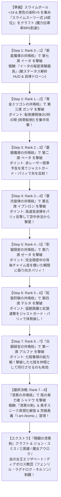

# 01. 導入・操作方法・推奨攻略チャート（Getting Started & Controls）

🌐 **言語切替 / Language**: **🇯🇵 日本語 (現在)** ｜ **[🇺🇸 Read in English](01-Getting-Started-and-Controls-EN.md)**

[🏠 日本語 Wiki ホームへ戻る](Home.md) ｜ [次章：02. 魔力・伝導率99%・スライムスーツ ➔](02-Mana-and-Slime-Bodysuit.md)

---

## 1. 動作環境・導入方法（Installation）

| 項目 | Forge 1.20.1 エディション (`v1.0.6`) |
| :--- | :--- |
| **対応 Minecraft** | `1.20.1` |
| **対応 MOD ローダー** | `Forge 47.2.0` 以上（`47.4.28` 推奨） |
| **必須 Java バージョン** | **Java 17** |
| **導入先（Environment）** | Client & Server（シングル／マルチサーバー双方に導入） |
| **前提 MOD** | **なし（単体で完全動作）** |
| **推奨併用 MOD** | `Just Enough Items (JEI)`（全51種レシピのゲーム内閲覧用） |

---

## 2. 操作方法・キーバインド完全仕様（Controls & Keybindings）

すべての専用キーは Minecraft の **「設定 → 操作設定 → キー割り当て → 陰の実力者になりたくて！（The Eminence in Shadow）」** カテゴリから自由に変更できます。

| アクション | デフォルト入力 | 発動条件・詳細仕様 |
| :--- | :---: | :--- |
| **技・射撃モード切替（順送り）** | `Z` キー | 手に持っている本MOD武器・魔道具の選択中スキルを次の技へ切り替えます。画面左下のHUDおよびアクションバーに選択された技名と消費MPが表示されます。 |
| **技・射撃モード切替（逆送り）** | `Shift + Z` | 手に持っている本MOD武器・魔道具の選択中スキルを前の技へ逆順で切り替えます。 |
| **スキル発動 / 魔導弓チャージ** | `右クリック` | 選択中のスキルをMPを消費して発動します。『スナイプボウ（ベータ専用）』は長押しで引き絞り、狙撃モードで **1.6秒（32 ticks）** 保持すると過充填《フェイタリティ》に変化します。 |
| **スライムガード** | `Shift`（スニーク）長押し | 本MODの武器を所持またはスライムスーツを1部位以上着用時に発動。被ダメージを **武器所持時 `85%` / 素手スーツ時 `75%` 軽減**（1ヒットにつき `1.5 MP` 消費）。 |
| **ジャストガード・パリィ反撃** | 攻撃着弾直前に `Shift` | ガード開始から **`7 ticks（0.35秒）` 以内** に攻撃を受けると発動。ダメージ完全無効化＋**MP `+25` 回復**＋飛び道具1.75倍速跳ね返し＋武器固有カウンター追撃＋ボスの **【体勢崩し（Posture Break）】** を誘発します。 |
| **高速移動（瞬駆 / 連閃）** | 地上・空中で `Space × 2` | 2段ジャンプ入力（`8 ticks` 以内）。『漆黒の剣』またはフルスライムスーツ素手時は **回数無制限の瞬駆**、『陰の剣（アルファ専用）』所持時は **3チャージ式の連閃** が発動。発動後 `36 ticks（1.8秒）` は落下ダメージ完全無効。 |
| **『漆黒の剣』の具現化 / 収納** | フルスーツ＋**素手で `Shift + 右クリック`**（収納は技8） | ボス「シャドウ」を1回以上撃破してマスタリーを解放後、フルスライムスーツ着用状態でメインハンドを空にして **`Shift + 右クリック`** すると、`10 MP` でスーツから『漆黒の剣』を直接具現化します。収納は漆黒の剣の技8「スライム収納」で行います。 |
| **スライム外装 / 日常服偽装切替** | `V` キー | フルスライムスーツ着用時、**`v1.0.6` 3D造形＆発光物理演算コート付きのシャドウ外装** と **プレイヤー本来のスキン（日常服偽装）** を切り替えます（フルスーツ未着用時は不可）。偽装中も **魔力伝導率99%および全防御機能は完全に維持** されます。 |
| **仲間のAI切替 / 魔力供給ヒール** | 仲間を `右クリック` | 仲間（盟約締結済みキャラ）のHPが92%未満の場合は `20 MP` を分け与えて **最大HPの25%（最低40 HP）を回復**。HP満タン時はAIモード（**護衛追従 → 積極索敵 → その場待機**）を切り替えます。 |
| **仲間との模擬戦（手合わせ）** | 仲間を `Shift + 右クリック` | 仲間のHPを全快させ、一時的にボス状態へ戻して **模擬戦（スパーリング）** を開始します。 |

---

## 3. サバイバル推奨攻略チャート（Step-by-Step Progression）

本MODはサバイバルモードで段階的に強敵を制覇し、自身の **シャドウガーデン格付けランク（Rank 0 → 8）** と装備を高めていくRPGプログレッション設計になっています。

### 序盤のワンポイントアドバイス
1. **まずはフルスライムスーツ（4部位）を最優先で作成**:
   - スライムスーツ未着用（伝導率10%）だと魔力が拡散してしまい、技の消費MPが10倍かかります。まずは湿地帯やスライムチャンクでスライムボールを19個集め、4部位すべてを装備して **魔力伝導率99%（最大MP 3,000＋被ダメージ100%魔力変換シールド＋常時スピードI＆暗視）** を手に入れましょう。
2. **中継ぎ武器として『ミスリルの剣』『地味な剣』『愛用のバール』が便利**:
   - スライムボールが集まる前でも、鉄とアメジスト・ラピスラズリで作れる **『ミスリルの剣』** を持てば伝導率50%が保証され、安価な **『地味な剣』** はジャンプ会心時に `+48.0` の隠し魔力刃が炸裂します。
3. **撃破した七陰はすぐに仲間（盟約）にしよう**:
   - 一度倒した七陰は、フルスライムスーツを着て右クリック（または共鳴核を `Shift + 右クリック`）すれば心強い味方として共闘してくれます。さらに仲間が近くにいるだけでプレイヤーのMPが毎秒 `+2.5 MP` ずつ共鳴回復します！

---

[🏠 日本語 Wiki ホームへ戻る](Home.md) ｜ [🇺🇸 Read in English](01-Getting-Started-and-Controls-EN.md) ｜ [次章：02. 魔力・伝導率99%・スライムスーツ ➔](02-Mana-and-Slime-Bodysuit.md)
