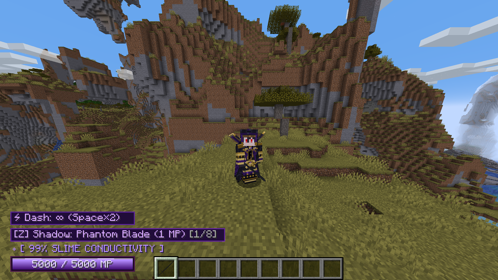

# 02. Mana (MP), 99% Conductivity & Slime Bodysuit Specification

🌐 **Language / 言語切替**: **[🇯🇵 日本語版はこちら](02-Mana-and-Slime-Bodysuit.md)** ｜ **🇺🇸 English (Current)**

[⬅ Prev: 01. Getting Started & Controls](01-Getting-Started-and-Controls-EN.md) ｜ [🏠 English Wiki Home](Home-EN.md) ｜ [Next: 03. Combat, Parry & Status Marks ➔](03-Combat-Parry-and-Status-Marks-EN.md)

---

## 1. Mana Conductivity & Actual MP Cost Formula

Faithfully modeling the canon lore of *The Eminence in Shadow*—where ordinary human bodies and steel weapons conduct only ~10% of mana, Mithril conducts ~50%, and Slime conducts 99%—every weapon skill's actual MP cost is dynamically scaled by your current **Mana Conductivity ($C$)**:

$$\text{Actual MP Cost} = \frac{\text{Base Skill MP Cost}}{\max(0.05,\ \text{Mana Conductivity } C)}$$

- **Slime Bodysuit Conductivity $C_{\text{slime}}$ by Equipped Piece Count $N \in \{0, 1, 2, 3, 4\}$**:
  $$C_{\text{slime}}(N) = 0.10 + (0.99 - 0.10) \times \frac{N}{4}$$
- **Effective Conductivity $C_{\text{eff}}$ when Holding the *Mithril Sword***:
  $$C_{\text{eff}} = \max(C_{\text{slime}}(N),\ 0.50)$$

| Equipped Slime Suit Pieces | Mana Conductivity $C$ | Cost Multiplier (vs. Base) | Actual Cost of *"I am Atomic."* (Base 500 MP) | Actual Cost of Light Skills (Base 0.99 MP) |
| :---: | :---: | :---: | :---: | :---: |
| **0 Pieces (Unarmored / Normal Armor)** | **10%** (`0.1000`) | 10.00× (90% mana loss) | `5,000 MP` | `10 MP` |
| **1 Piece** | **32%** (`0.3225`) | ~3.10× | `1,550 MP` | `3 MP` |
| **0–1 Pieces + Mithril Sword** | **50%** (`0.5000`) | 2.00× | `1,000 MP` | `2 MP` |
| **2 Pieces** | **55%** (`0.5450`) | ~1.83× | `917 MP` | `2 MP` |
| **3 Pieces** | **77%** (`0.7675`) | ~1.30× | `651 MP` | `1 MP` |
| **4 Pieces (Full Slime Bodysuit)** | **99%** (`0.9900`) | **1.01× (Only 1% loss)** | **`505 MP`** | **`1 MP`** |

---

## 2. Dynamic Max MP & Mana Regeneration Scaling

Your Maximum MP and natural regeneration rate (`MP/s`) scale dynamically in real time based on: **① Base Stats (`1,000 MP` / `20.0 MP/s`)**, **② Equipped Slime Bodysuit Pieces ($N_{\text{slime}}$)**, **③ Held Weapon Resonance**, and **④ Shadow Garden Ranking ($\text{Rank} \in [0, 8]$)**. Equipment resonance and your current MP fill percentage (`%`) persist cleanly across hotbar swaps, dimension transitions, and respawn.

$$\text{Max MP} = 1,000 + 500 \times N_{\text{slime}} + \text{WeaponBonus} + 250 \times \text{Rank}$$

$$\text{Base Regen (MP/s)} = 20.0 + 8.0 \times N_{\text{slime}} + \text{WeaponRegen} + 6.0 \times \text{Rank}$$

### Weapon Resonance Bonuses ($\text{WeaponBonus}$ / $\text{WeaponRegen}$)
- **Holding *Jet-Black Sword* (`atomic_sword`) in Main Hand or Offhand**:
  - Max MP **`+2,000`** / Base Regeneration **`+28.0 MP/s`**
- **Holding Any Other Mod Skill Weapon (Seven Shadows weapons, *Archetype Shadow Blade*, Three Heroes weapons, etc.)**:
  - Max MP **`+1,000`** / Base Regeneration **`+16.0 MP/s`**

### Conductivity Regeneration Amplification (Up to `+80%`)
Higher Slime Bodysuit conductivity accelerates internal mana circulation, multiplying your base regeneration rate by up to **1.80× (+80%)**:

$$\text{Effective Regen (MP/s)} = \text{Base Regen} \times \left(1.0 + 0.80 \times \frac{C - 0.10}{0.99 - 0.10}\right)$$

### State & Buff Regeneration Multipliers

| State / Buff / Debuff | Regen Multiplier | Trigger Condition |
| :--- | :---: | :--- |
| **Full Slime Bodysuit Equipped (Passive)** | **$\times 1.80$** | Permanent resonance bonus at 99% Mana Conductivity |
| **Meditation (Stationary Sneak) / Sleeping** | **$\times 2.50$** | Sneaking while standing completely still (velocity `< 0.001`) out of recent hit-stun, or sleeping in a bed |
| **Chrono Burst** | **$\times 1.50$** | Active for 15 seconds (`300 ticks`) after casting *I am Archetype Atomic.* with the *Archetype Shadow Blade* |
| **Steel Thread Mana Suppression** | **$\times 0.15$ (-85%)** | Inflicted for 6 seconds (`120 ticks`) by boss John Smith's Mana Disruption Wave |
| **Companion Resonance Aura** | **`+2.5 MP/s` flat per ally** | Each recruited Shadow Garden companion within a 20m radius adds a flat `+2.5 MP/s` |

### Quick Reference: MP Stats by Loadout & Rank

| Player Loadout & Rank | Conductivity | Max MP | Active Natural Regen | Stationary Sneak Meditation Regen |
| :--- | :---: | :---: | :---: | :---: |
| Base State (No Suit, Unarmed, Rank 0) | `10%` | `1,000 MP` | `20.0 MP/s` | `50.0 MP/s` |
| Full Slime Bodysuit Only (Unarmed, Rank 0) | `99%` | `3,000 MP` | `93.6 MP/s` | `234.0 MP/s` |
| Full Suit + Seven Shadows Weapon (Rank 0) | `99%` | `4,000 MP` | `122.4 MP/s` | `306.0 MP/s` |
| Full Suit + Jet-Black Sword (Rank 0) | `99%` | `5,000 MP` | `144.0 MP/s` | `360.0 MP/s` |
| **Full Suit + Jet-Black Sword (Rank 8 Master)** | **`99%`** | **`7,000 MP`** | **`230.4 MP/s`** | **`576.0 MP/s`** |

---

## 3. Slime Bodysuit Armor Stats & 5 Core Mechanics

### 3.1 Per-Piece Armor Parameters

Every piece of the Slime Bodysuit is **fireproof (cannot burn in lava or fire)**, has high gold-tier enchantability (`25`), and features custom `v1.0.6` 16×16 inventory sprites.

| Slot | Item ID | English Name / Japanese Name | Armor | Toughness | Knockback Resistance | Durability | Enchantability |
| :--- | :--- | :--- | :---: | :---: | :---: | :---: | :---: |
| **Head** | `slime_suit_helmet` | Slime Bodysuit Hood / スライムスーツのフード | `3` | `3.0` | `0.2` (20%) | `407` | `25` |
| **Chest** | `slime_suit_chestplate` | Slime Bodysuit Coat / スライムスーツのコート | `8` | `3.0` | `0.2` (20%) | `592` | `25` |
| **Legs** | `slime_suit_leggings` | Slime Bodysuit Leggings / スライムスーツのタイツ | `6` | `3.0` | `0.2` (20%) | `555` | `25` |
| **Feet** | `slime_suit_boots` | Slime Bodysuit Boots / スライムスーツのブーツ | `3` | `3.0` | `0.2` (20%) | `481` | `25` |
| **Total** | **Full 4-Piece Set** | *(Netherite-grade base armor with 80% KB resist)* | **`20`** | **`12.0`** | **`0.8` (80%)** | — | **`25`** |

---

### 3.2 The 5 Special Mechanics of the Slime Bodysuit

1. **Mana Conversion Shield Defense (`1.0 Damage = 10.0 MP`)**:
   - When you take damage, the game first applies all standard damage reductions: **Armor (`20`), Armor Toughness (`12.0`), Resistance effects, Protection enchantments (e.g., Protection IV), Shadow Garden Rank mitigation (up to 32%), and Slime Barrier mitigation (75%)** (plus Slime Guard mitigation up to 85% while guarding).
   - Wearing the full 4-piece suit converts **100%** of the remaining post-mitigation damage ($25\% \times N$ for 1–3 pieces) into MP drain at a rate of **`1.0 Damage (0.5 Hearts) = 10.0 MP`**, **completely nullifying HP loss and hit knockback** as long as you have MP!
   - *Tip*: Enchanting your suit with **Protection IV** and increasing your Shadow Garden Rank drastically reduces the MP drained per hit.
2. **Slime Gel Fall Cushioning (`10 MP` Flat Absorption)**:
   - Wearing at least 1 piece of the Slime Bodysuit absorbs **100% of fall damage from any height** for a flat cost of **`10.0 MP`**.
3. **Bio-Mana Assist & Living Gel Self-Repair**:
   - Wearing the full suit grants permanent **Speed I** and **flicker-free Night Vision** (maintained above 11 seconds duration).
   - While your current MP is `50 MP` or higher, the suit consumes `1.0 MP` per second to automatically repair the durability of all equipped Slime Bodysuit pieces and any held slime-based weapons (*Jet-Black Sword*, Seven Shadows weapons, etc.).
4. **`v1.0.6` 3D Sculpted & Emissive Shadow Longcoat Morph & Civilian Disguise (`V` Key)**:
   - Equipping all 4 pieces transforms your character into the **3D Sculpted Lord Shadow Model (`ShadowCoatModel`)** with a 256×256 texture atlas (`shadow_coat.png`) and a full-bright emissive glow layer (`shadow_coat_glow.png`).
   - **Clear Hood Face Opening & Glowing Crimson Eyes**: The sculpted hood features a transparent front arch cutout (`x=10..17, y=11..17`) and sloped golden brow trim so your character's face and Shadow's glowing crimson eyes remain clearly visible beneath the hood's shadow, crowned by a 45°-rotated 3D golden forehead diamond (`hood_crest_diamond`) and a 2-stage tapered hood tail (`hood_tail_tip` / `hood_tail_point`).
   - **3-Stage Giant Flared Wing Collar, Glowing Amethyst Brooch & 3-Joint Ribbons**: Features a 45°-rotated gold-bezel amethyst throat brooch (`throat_brooch_bezel` / `throat_brooch_gem`) that glows in the dark, 3-joint articulated hood ribbons with gold aglet tips (`hood_ribbon_top -> bot -> aglet`), and a 3-stage purple-lined wing collar swept wide to frame the face.
   - **3-Joint 9-Panel Billowing Skirt Physics & 2-Stage Slime Glider Wings**: Driven by zero-allocation travelling sine-wave physics that react to sprinting, strafing, falling, sneaking, sword swings, and Atomic chanting, all 9 lower-coat panels (including front sweeps `skirt_front_left/right`, each articulated across `_top -> _bot -> _tip` joints) and the 2-stage dorsal slime glider wings (`slime_wing -> slime_wing_outer`) billow smoothly in 3D. Also includes a 3D chevron slime chestplate, X-crossed golden waist belts, 2-stage flared bell cuffs, diamond-filigree thigh plates, and 3D V-winged knee boots.
   - Pressing **`V` (Toggle Slime Suit Exterior / Disguise)** while wearing the full suit switches your visual appearance back to your normal player skin (**Civilian Disguise**) while keeping **99% Mana Conductivity and all shield protections 100% active** (and persists across dimension travel and respawn).
5. **Empty-Hand Sneak Right-Click "Jet-Black Sword" Materialization**:
   - Once you defeat Lord Shadow (or obtain the *Jet-Black Sword*) to unlock mastery, wearing the full suit and pressing **`Shift + Right-Click` with an empty main hand** spends `10 MP` to materialize the *Jet-Black Sword* directly from your suit at any time. Use Skill 9 (*Absorb into Suit*) to absorb it back into the suit and recover `+150 MP`.

---

[⬅ Prev: 01. Getting Started & Controls](01-Getting-Started-and-Controls-EN.md) ｜ [🏠 English Wiki Home](Home-EN.md) ｜ [🇯🇵 日本語版はこちら](02-Mana-and-Slime-Bodysuit.md) ｜ [Next: 03. Combat, Parry & Status Marks ➔](03-Combat-Parry-and-Status-Marks-EN.md)
