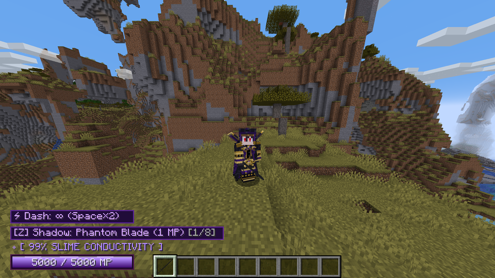

# 02. 魔力（MP）・魔力伝導率99%・スライムスーツ仕様（Mana & Slime Bodysuit）

🌐 **言語切替 / Language**: **🇯🇵 日本語 (現在)** ｜ **[🇺🇸 Read in English](02-Mana-and-Slime-Bodysuit-EN.md)**

[⬅ 前章：01. 導入・操作方法・攻略チャート](01-Getting-Started-and-Controls.md) ｜ [🏠 日本語 Wiki ホーム](Home.md) ｜ [次章：03. アクション戦闘・パリィ・7大刻印 ➔](03-Combat-Parry-and-Status-Marks.md)

---

## 1. 魔力伝導率（Mana Conductivity）と実消費MPの計算式

『陰の実力者になりたくて！』原作における「通常の肉体・鉄剣（伝導率約10%）、ミスリル（約50%）、スライム（99%）」の魔力伝導設定を忠実に数式化しています。

$$\text{実消費MP (Actual Cost)} = \frac{\text{スキルの基礎消費MP (Base Cost)}}{\max(0.05,\ \text{魔力伝導率 } C)}$$

- **スライムスーツ装着部位数 $N \in \{0, 1, 2, 3, 4\}$ による伝導率 $C_{\text{slime}}$**:
  $$C_{\text{slime}}(N) = 0.10 + (0.99 - 0.10) \times \frac{N}{4}$$
- **ミスリルの剣所持時の有効伝導率 $C_{\text{eff}}$**:
  $$C_{\text{eff}} = \max(C_{\text{slime}}(N),\ 0.50)$$

| スライムスーツ部位数 | 魔力伝導率 $C$ | 消費MP倍率（通常比） | 『I am Atomic.』（基礎500 MP）の実消費MP | 小技（基礎0.99 MP）の実消費MP |
| :---: | :---: | :---: | :---: | :---: |
| **0部位（通常肉体）** | **10%** (`0.1000`) | 10.00倍（90%魔力拡散ロス） | `5,000 MP` | `10 MP` |
| **1部位** | **32%** (`0.3225`) | 約3.10倍 | `1,550 MP` | `3 MP` |
| **0〜1部位 ＋ ミスリルの剣** | **50%** (`0.5000`) | 2.00倍 | `1,000 MP` | `2 MP` |
| **2部位** | **55%** (`0.5450`) | 約1.83倍 | `917 MP` | `2 MP` |
| **3部位** | **77%** (`0.7675`) | 約1.30倍 | `651 MP` | `1 MP` |
| **4部位（フルスライムスーツ）** | **99%** (`0.9900`) | **1.01倍（ロス1%のみ）** | **`505 MP`** | **`1 MP`** |

---

## 2. 最大MP・魔力自然回復速度の動的共鳴スケーリング

プレイヤーの最大MPおよび毎秒の自然回復量（MP/s）は、**① 基礎値（1,000 MP / 20.0 MP/s）**、**② スライムスーツ部位数**、**③ 所持武器の共鳴**、**④ シャドウガーデン格付けランク（Rank 0〜8）** の合計によってリアルタイムに変動します（装備切替・ディメンション移動・リスポーン時も最大MP共鳴と現在のMP充填率 `%` が保持されます）。

$$\text{Max MP} = 1,000 + 500 \times N_{\text{slime}} + \text{WeaponBonus} + 250 \times \text{Rank}$$

$$\text{Base Regen (MP/s)} = 20.0 + 8.0 \times N_{\text{slime}} + \text{WeaponRegen} + 6.0 \times \text{Rank}$$

### 武器共鳴ボーナス（$\text{WeaponBonus}$ / $\text{WeaponRegen}$）
- **『漆黒の剣』（`atomic_sword`）をメインまたはオフハンドに所持**:
  - 最大MP **`+2,000`** ／ 基礎自然回復 **`+28.0 MP/s`**
- **その他の本MODスキル武器（七陰武器・開闢の漆黒剣・三英雄武器など）を所持**:
  - 最大MP **`+1,000`** ／ 基礎自然回復 **`+16.0 MP/s`**

### 魔力伝導率による自然回復増幅（最大 `+80%`）
スライムスーツの伝導率が高まるほど、体内の魔力循環が効率化され、基礎自然回復速度に最大 **1.80倍（+80%）** の乗算ボーナスが掛かります：

$$\text{Effective Regen (MP/s)} = \text{Base Regen} \times \left(1.0 + 0.80 \times \frac{C - 0.10}{0.99 - 0.10}\right)$$

### 状態別の自然回復倍率テーブル

| 状態・バフ / デバフ | 自然回復倍率 | 発動条件 |
| :--- | :---: | :--- |
| **フルスライムスーツ着用時（常時）** | **$\times 1.80$** | 魔力伝導率99%による常時共鳴ボーナス |
| **瞑想（静止スニーク） / 睡眠中** | **$\times 2.50$** | 被弾直後でない状態でその場にしゃがんで静止（移動量 `< 0.001`）、またはベッドで睡眠中 |
| **クロノバースト（Chrono Burst）** | **$\times 1.50$** | 『開闢の漆黒剣』の *I am Archetype Atomic.* 発動後15秒間（`300 ticks`） |
| **鋼糸・魔力循環阻害（Mana Suppressed）** | **$\times 0.15$（-85%）** | ボス「ジョン・スミス」の魔力撹乱波を受けた後6秒間（`120 ticks`） |
| **仲間の共鳴オーラ（Companion Aura）** | **毎秒 `+2.5 MP` 固定加算** | 半径20m以内に盟約を結んだ仲間がいる場合（1体につき毎秒 `+2.5 MP`） |

### 装備＆ランク別 魔力ステータス早見表

| プレイヤーの状態 | 魔力伝導率 | 最大MP | 通常時の実効自然回復 | 静止スニーク瞑想時の回復 |
| :--- | :---: | :---: | :---: | :---: |
| 初期状態（スーツなし・素手・Rank 0） | `10%` | `1,000 MP` | `20.0 MP/s` | `50.0 MP/s` |
| フルスライムスーツのみ（素手・Rank 0） | `99%` | `3,000 MP` | `93.6 MP/s` | `234.0 MP/s` |
| フルスーツ ＋ 七陰武器（Rank 0） | `99%` | `4,000 MP` | `122.4 MP/s` | `306.0 MP/s` |
| フルスーツ ＋ 漆黒の剣（Rank 0） | `99%` | `5,000 MP` | `144.0 MP/s` | `360.0 MP/s` |
| **フルスーツ ＋ 漆黒の剣（Rank 8 制覇時）** | **`99%`** | **`7,000 MP`** | **`230.4 MP/s`** | **`576.0 MP/s`** |

---

## 3. スライムスーツ（Slime Bodysuit）の防具ステータスと特殊機能

### 3.1 部位別防具パラメータ

すべての部位は **耐火属性（溶岩・火炎で焼失しない）** を持ち、金防具並みの高いエンチャント適性（`25`）を備えています。`v1.0.6` にてインベントリ用の専用16×16ドットアイコン（フード・コート・タイツ・ブーツ）も刷新されました。

| 部位 | アイテムID | 日本語名 / 英語名 | 防御力 | 防具強度 | ノックバック耐性 | 耐久値 | エンチャント適性 |
| :--- | :--- | :--- | :---: | :---: | :---: | :---: | :---: |
| **頭** | `slime_suit_helmet` | スライムスーツのフード / Slime Bodysuit Hood | `3` | `3.0` | `0.2` (20%) | `407` | `25` |
| **胴** | `slime_suit_chestplate` | スライムスーツのコート / Slime Bodysuit Coat | `8` | `3.0` | `0.2` (20%) | `592` | `25` |
| **脚** | `slime_suit_leggings` | スライムスーツのタイツ / Slime Bodysuit Leggings | `6` | `3.0` | `0.2` (20%) | `555` | `25` |
| **足** | `slime_suit_boots` | スライムスーツのブーツ / Slime Bodysuit Boots | `3` | `3.0` | `0.2` (20%) | `481` | `25` |
| **合計** | **4部位フル装備** | *(ネザライト同等の基礎防御・高ノックバック耐性)* | **`20`** | **`12.0`** | **`0.8` (80%)** | — | **`25`** |

---

### 3.2 スライムスーツの5大特殊メカニズム

1. **被ダメージ魔力変換シールド（Mana Shield Defense）**:
   - 攻撃を受けた際、まずバニラの **防具防御力（20）・防具強度（12.0）・耐性バフ・ダメージ軽減エンチャント（Protection IV等）・シャドウガーデン格付けRank軽減（最大32%）・スライムバリア軽減（75%）** をすべて計算した後の最終ダメージを算出します（ガード時はさらにスライムガード軽減 最大85%）。
   - フルスーツ（4部位）着用時はその最終ダメージの **100%**（1〜3部位時は $25\% \times \text{部位数}$）を **`1.0 ダメージ（ハート0.5個） = 10.0 MP`** のレートでMP消費へ変換し、**HPへのダメージおよび被弾ノックバックを完全に無効化** します！
   - ※防具に『ダメージ軽減IV（Protection IV）』をエンチャントしたり格付けRankを上げるほど、被弾時のMP消費量が劇的に減少し、継戦能力が飛躍的に向上します。
2. **落下ダメージのゲル緩衝（10 MP 固定完全吸収）**:
   - スライムスーツを1部位以上着用している場合、どれほど高い場所から落下しても **一律 `10.0 MP`** を消費するだけで **落下ダメージを100%完全吸収** します。
3. **生体魔力アシスト＆リビングゲル自動修復**:
   - フルスーツ着用中は常時 **移動速度上昇I（Speed I）** と **残り時間11秒以上をキープするチラつきゼロの暗視（Night Vision）** が自動付与されます。
   - 残MPが `50 MP` 以上ある場合、1秒ごとに `1.0 MP` を消費してスーツおよびメインハンド／オフハンドに所持しているスライム系武器（漆黒の剣・七陰武器等）の耐久値を自動的に自己修復します。
4. **`v1.0.6` 3D造形＆発光シャドウロングコート変身 ＆ 日常服偽装（`V` キー）**:
   - フルスーツを装備すると、256×256高精細テクスチャ（`shadow_coat.png`）とフルブライト発光レイヤー（`shadow_coat_glow.png`）を備えた **立体造形3D「シャドウ」モデル（`ShadowCoatModel`）** へ変身します。
   - **顔がしっかり見え、奥で真紅の双眸が光る立体フード**: フード前面アーチ開口部（`x=10..17, y=11..17` 透過抜き）と角度付き金縁バイザーにより、フードの影の奥からプレイヤー（およびシャドウ）の顔と発光する真紅の瞳が鮮明に視認できます。額には45°回転の立体金菱形クレスト（`hood_crest_diamond`）、後頭部には2段テーパーのフード尾（`hood_tail_tip` / `hood_tail_point`）を備えます。
   - **3段巨大ウイング襟・紫宝ブローチ・3関節リボン**: 喉元で45°回転の金枠アメジストブローチ（`throat_brooch_bezel` / `throat_brooch_gem`）が妖しく発光し、金アグレット付きの3関節リボン（`hood_ribbon_top -> bot -> aglet`）と紫裏地付きの3段ウイングハイカラーが顔を遮らずに立体展開します。
   - **3関節×9パネルの裾物理演算＆2段階スライムグライダー翼**: 移動速度・横滑り・落下・スニーク・抜刀・アトミック詠唱に連動し、上段・中段・先端（`_top -> _bot -> _tip`）の3関節構造を持つ全9パネル（前面左右スイープ `skirt_front_left/right` 含む）のロングコート裾と、背面の2段階スライム翼（`slime_wing -> slime_wing_outer`）が滑らかな進行波としてなびきます。さらに立体V字スライム胸甲、金バックル付きX字クロスベルト、2段ベルカフス、金菱形装飾付き太もも装甲＆V字ウイング膝当てブーツを完全造形しています。
   - フルスーツ着用中に **`V` キー（スライム外装 / 偽装切替）** を押すと、魔力伝導率99%と全防御機能を維持したまま、見た目を通常のプレイヤースキン（日常服）へ瞬時に擬態させることができます（偽装状態はディメンション移動やリスポーン後もそのまま維持されます）。
5. **素手スニーク右クリックによる『漆黒の剣』具現化・収納**:
   - 一度ボスの「シャドウ」を撃破（または『漆黒の剣』を入手）してマスタリーを解放すると、フルスーツ着用時に **メインハンドを空（素手）にして `Shift + 右クリック`** するだけで、`10 MP` を消費してスーツから『漆黒の剣』をいつでも直接具現化できるようになります。収納は『漆黒の剣』の技9「スライム収納」で行います。

---

[⬅ 前章：01. 導入・操作方法・攻略チャート](01-Getting-Started-and-Controls.md) ｜ [🏠 日本語 Wiki ホーム](Home.md) ｜ [🇺🇸 Read in English](02-Mana-and-Slime-Bodysuit-EN.md) ｜ [次章：03. アクション戦闘・パリィ・7大刻印 ➔](03-Combat-Parry-and-Status-Marks.md)
