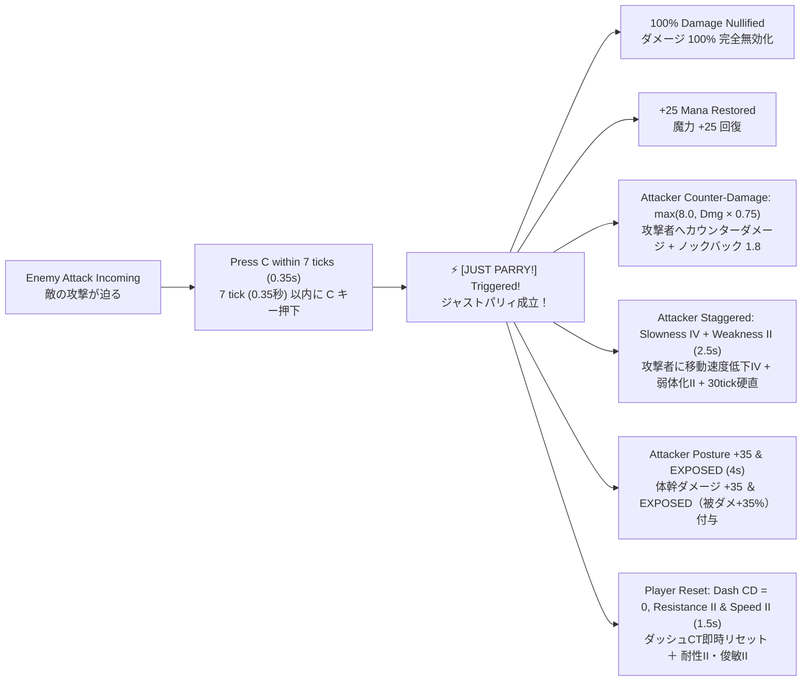

# 03. Combat, Parry & Status Marks / 戦闘システム・ジャストパリィ・状態異常

[🏠 Home](Home.md) | [⬅️ Previous: 02. Mana & Slime Bodysuit](02-Mana-and-Slime-Bodysuit.md) | [➡️ Next: 04. "I Am Atomic" Magic System](04-I-Am-Atomic.md)

---

## 🛡️ 5.1 Slime Guard (`C` Key Hold) / スライムガード（`C`キー長押し）

Holding the **Slime Guard (`C`)** key weaves a defensive barrier of魔力 (Mana) and liquid slime around your body.
**スライムガード（`C`キー）**を長押しすると、魔力と液体スライムの防御障壁を展開します。

| Mechanic / 仕様 | Value / 数値 | Description / 詳細 |
| :--- | :---: | :--- |
| **Damage Reduction (Full Set)** フルセット時のダメージ軽減 | **`80%` Reduced** （被ダメージ `0.2x`） | Reduces incoming damage by 80% while `C` is held with the 4-piece Slime Bodysuit. |
| **Damage Reduction (Partial)** 一部装備・未装備時の軽減 | **`50%` Reduced** （被ダメージ `0.5x`） | Reduces incoming damage by 50% without the full 4-piece set. |
| **Knockback Mitigation** ノックバック軽減 | **`70%` Reduced** | Multiplies incoming knockback velocity by `0.3`. |
| **Guard Mana Drain** ガード被弾時の魔力消費 | **`min(30, Damage × 3)`** | Deducted from Current Mana on block. If Mana hits `0`, **Guard Break** occurs (`40 ticks` cooldown). |

---

## ⚡ 5.2 Just-Guard Parry (`7 ticks` Window) / ジャストパリィ（受付 0.35秒）

If you press **`C` (Slime Guard)** within **`7 ticks` (`0.35 seconds`)** before an attack hits you, a **Just-Guard Parry (ジャストパリィ)** triggers!
攻撃が命中する直前 **`7 tick`（`0.35秒`）以内** に **`C`キー** を押すと、**ジャストパリィ (`[JUST PARRY!]`)** が発動します！

### Six Simultaneous Benefits of a Just-Guard Parry / ジャストパリィ成立時の6大恩恵

1. **100% Damage Nullification (完全無傷)**: Incoming attack is completely canceled (`0` HP lost, `0` Mana consumed).
2. **Mana Recovery (魔力回復)**: Immediately restores **`+25 Mana`**.
3. **Counter-Slash & Knockback (カウンター斬撃＆弾き飛ばし)**: Deals **`max(8.0, IncomingDamage × 0.75)`** magic damage back to the attacker and launches them away with **`1.8` knockback strength**.
4. **Enemy Stagger (敵の体勢崩し)**: Inflicts **Slowness IV (`50 ticks` / `2.5s`)** and **Weakness II (`50 ticks` / `2.5s`)**. If the attacker is a Mob, its target AI and navigation are forcibly halted for **`30 ticks` (`1.5s`)**.
5. **Posture Damage & `[EXPOSED]` Mark (体幹削り＆無防備刻印)**: Adds **`+35 Posture Damage`** to the attacker (which can trigger a **Posture Break** at `100` posture) and applies the **`[EXPOSED]`** mark for **`80 ticks` (`4.0s`)**, increasing all damage they take by **`+35%`**.
6. **Instant Dash Reset & Counter Buffs (ダッシュCTリセット＆反撃バフ)**: Immediately resets your **Slime Dash (`V`) cooldown to `0`** and grants you **Resistance II (`30 ticks`)** and **Speed II (`30 ticks`)**.

---

## 💥 5.3 Enemy Posture System & Posture Break / 敵の体幹（Posture）＆ブレイクシステム

All hostile enemies and bosses have an internal **Posture Gauge (`0` to `100`)** tracked via `CombatMarkHandler`:
全ての敵およびボスには内部的な **体幹ゲージ（`0`〜`100`）** が存在します。

- **How to Deal Posture Damage / 体幹の削り方**:
  - **Just-Guard Parry (`C`)**: **`+35 Posture`**
  - **Heavy Weapon Skills & Boss Counter-Hits**: **`+15` to `+45 Posture`**
  - **High-Damage Melee / Magic Attacks**: Scales with damage dealt.
- **Posture Decay / 自然回復**: Decays after `100 ticks` (`5.0s`) out of combat.
- **Posture Break (`Posture >= 100`) / 体幹ブレイク発動**:
  - Resets Posture to `0` and triggers **`[POSTURE BREAK!]`** (`Totem Use` + `Anvil Land` sound + `45` Enchanted Hit & `20` Flash/Soul Fire particles).
  - Deals **`max(12.0, MaxHP × 0.06)`** bonus magic damage immediately.
  - Inflicts **Slowness VI (`70 ticks` / `3.5s`)**, **Weakness III (`70 ticks`)**, **Glowing (`70 ticks`)**, and **halts Mob AI for `50 ticks` (`2.5s`)**.
  - Applies **`[EXPOSED]` (`100 ticks` / `5.0s`, `+35%` damage taken)** and **`[SILENCED]` (`100 ticks` / `5.0s`, Boss Skills Sealed)**.

---

## 💨 5.4 Slime High-Speed Dash (`V` Key) / スライム高速ステップ（`V`キー）

Pressing **`V`** channels Mana into your legs to perform a shadow step with invulnerability frames (i-frames).
**`V`キー** を押すと足元に魔力を集中し、無敵フレーム（i-frame）付きの高速移動を行います。

| Parameter / 項目 | Full 4-Piece Slime Suit / フルセット装備時 | Partial or No Suit / 未揃い時 |
| :--- | :---: | :---: |
| **Mana Cost / 消費魔力** | **`15 Mana`** | **`15 Mana`** |
| **Cooldown / クールダウン** | **`25 ticks` (`1.25s`)** *(Reset to `0` on Just Parry!)* | **`25 ticks` (`1.25s`)** |
| **Dash Speed / 初速ベクトル** | **`1.85 blocks/tick`** (Directional or Look vector) | **`1.30 blocks/tick`** |
| **Vertical Boost / 垂直補正** | `max(currentY, 0.25)` (`+0.35` if pitching up) | `max(currentY, 0.25)` |
| **Invulnerability (i-frames) / 無敵時間** | **`10 ticks` (`0.50s`)** + Fall Distance Reset (`0`) | **`10 ticks` (`0.50s`)** |
| **Through-Slash Damage / すれ違い斬撃** | **`8.0 + (MasteryRank × 1.5)` Magic Damage** to all enemies within `1.8m` along dash path + **Slowness II (`2.0s`)** | *None (Full Suit Exclusive)* |

---

## 🩸 5.5 Combat Marks & Status Effects / 7種の戦闘刻印（状態異常）一覧

Weapons, artifacts, and parries apply specialized **Combat Marks** tracked per entity by `CombatMarkHandler`:
各武器の固有スキルやジャストパリィにより、対象に7種類の固有戦闘刻印（デバフ）が付与されます。

| Combat Mark / 刻印名 | Trigger Sources / 主な付与手段 | Mechanical Effect / 効果詳細 |
| :--- | :--- | :--- |
| **`[BLEED]`** 出血（最大5スタック） | Blood Queen's Scythe, Crimson Claws, Delta's Greatsword, Victoria's Rose Blade, etc. | Deals **`1.5 × Stacks` Magic Damage every `20 ticks` (`1.0s`)** with redstone blood particles. Max **5 Stacks** (`7.5 dmg/sec`). At **5 Stacks**, triggers **`[HEMORRHAGE!]` (大量出血爆発)** dealing **`18.0 + (MaxHP × 0.05)`** burst magic damage (capped at `45.0`) and resetting stacks! |
| **`[EXPOSED]`** 無防備・防御崩壊 | Just-Guard Parry (`C`), Posture Break, Eta's Wrench, Omega's Twin Blades, Nina's Dagger | Target takes **`+35%` (`1.35x`) increased damage** from ALL sources while active. |
| **`[VOIDMARK]`** 虚空の刻印 | Mist Dragon Blade, Kai's Sonic Blade | The next heavy hit (`>= 6.0` damage) detonate **`[VOID DETONATION!]`**, dealing **`+40% Bonus Damage` (`+8.0` to `+35.0` cap)** and restoring **`+15 Mana`** to the attacker! |
| **`[FROSTBITE]`** 凍傷・氷結 | Alexia's Rapier, Beatrix's Elven Blade, Borgnine's Greatsword, Yukime's Fan, Olivier's Sword | Inflicts continuous freezing (`TicksFrozen + 40`), **Slowness III**, and causes the target to take **`+20%` (`1.20x`) shatter damage** from all attacks. |
| **`[SILENCED]`** 魔力封鎖・沈黙 | Eye of Avarice, Eta's Wrench, Claire's Rapier, Posture Break, Rose's Royal Rapier | **Completely seals Boss special skills & magic patterns** while active, and reduces the target's outgoing attack damage by **`-25%` (`0.75x`)**. |
| **`[CONDUCTIVE]`** 感電・雷鳴連鎖 | Sherry's Rune Staff, Gamma's Comedy Sword, Lambda's Whip | Every hit triggers **`[CHAIN LIGHTNING!]`**: deals **`+4.0` bonus magic damage** to the target and arcs **`6.0` magic damage** to up to **4 nearby enemies within `6.0 blocks`**. |
| **`[GOLDEN_DOOM]`** 黄金の破滅 | Golden Crowbar (`Right-Click` Overdrive Strike) | After the countdown expires (`60 ticks` / `3.0s`), detonates for **`28.0` Golden Explosion Magic Damage** and launches the target upward (`+0.55 Y`). |

---

[🏠 Home](Home.md) | [⬅️ Previous: 02. Mana & Slime Bodysuit](02-Mana-and-Slime-Bodysuit.md) | [➡️ Next: 04. "I Am Atomic" Magic System](04-I-Am-Atomic.md)
