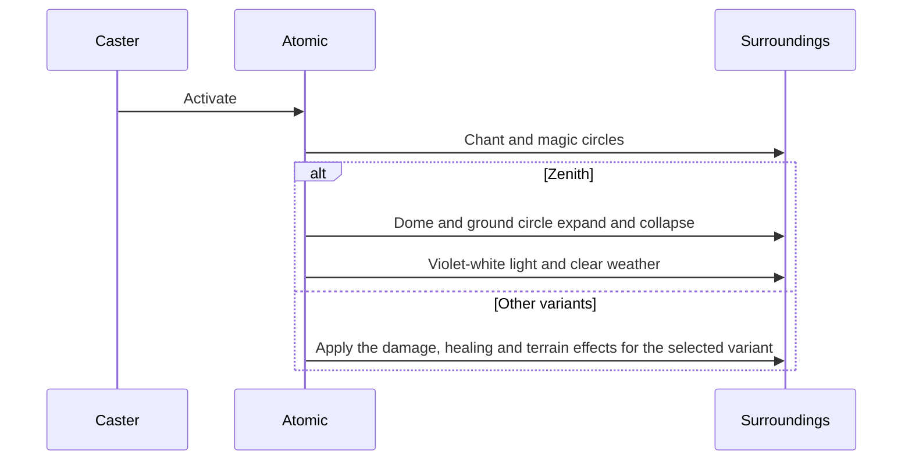

# 04. Ultimate Art: "I am Atomic." — All Modes & Spatial Annihilation Engine

🌐 **Language / 言語切替**: **[🇯🇵 日本語版はこちら](04-I-Am-Atomic.md)** ｜ **🇺🇸 English (Current)**

[⬅ Prev: 03. Combat, Parry & Status Marks](03-Combat-Parry-and-Status-Marks-EN.md) ｜ [🏠 English Wiki Home](Home-EN.md) ｜ [Next: 05. All 30 3D Weapons & Artifacts ➔](05-Weapons-and-Artifacts-EN.md)

---

## 1. Chant & Presentation Timeline Specification

When casting any *"I am Atomic."* variant, the caster levitates into the air and becomes **completely invulnerable until detonation** (Resistance V + full damage cancellation controlled via `mana.isActiveAtomicRunning()`). MP and cooldowns are finalized upon release (if the caster's MP was drained below the cost during chanting, `PlayerMana.drainUpTo()` safely drains remaining MP).

---

## 2. Three Posture-Controlled Canon Modes (Standard `I am Atomic.`)

When casting standard **`I am Atomic.`** with the *Jet-Black Sword*, your **posture at the moment of activation (Sneaking / Camera Pitch)** automatically branches the blast into one of three anime-accurate spatial control modes:

| Cast Mode | Input Condition | Anime Reference | Spatial Destruction & Damage Mechanics |
| :--- | :--- | :--- | :--- |
| **① Standard Sphere Mode** *(通常球体形態)* | `Right-Click` while **standing upright** (not sneaking, not looking straight up) | Royal Capital Showdown (Standard Form) | Expands a violet-blue singularity sphere up to a `100-block` radius (`Config.blastRadius`), vaporizing all terrain and enemies in 360° around the caster. |
| **② Directional Beam Mode** *(指向性貫通ビーム形態)* | `Right-Click` while **holding `Shift` (Sneak)** | **Anime Episode 5** (vs. Zenon in front of Iris & Alexia) | Carves a directional cone beam `100 blocks` long strictly along the caster's line of sight. **All terrain, structures, and entities within 36m behind the caster—and all allied entities—are 100% unharmed.** |
| **③ Zenith Sublimation Pillar** *(天蓋昇華ピラー形態)* | `Right-Click` while **looking skyward (`Pitch <= -45°`)** | **Anime Episode 20** (Colossal pre-blast dome over the Capital & skyward cloud-parting pillar) | The dome and ground circle collapse together, followed by violet-white light. Zenith clears rain and thunderstorms, deals zero damage, and leaves terrain intact. Shadow uses it in rain and thunderstorms. |

### Zenith Atomic in 1.0.7

1. **Chant and expansion.** The purple hemisphere reaches the configured radius (100 blocks by default) at the “I” vocal beat. A ground magic circle follows the dome radius. The dome uses atomic nuclei, electron orbits and circuit traces, and its boundary contains hostile targets during the chant. A light purple tint applies inside.
2. **Collapse and release.** The dome and its ground circle contract during the final eight ticks before release. Violet-white light follows, and the ground circle reappears at the full dome radius. The caster retains the normal Atomic circle and spherical effects. Four canopy rings spread above the dome as the weather clears.

---

## 3. All 5 Atomic Variants Comparison Table

All offensive Atomic damage values scale dynamically with `Config.blastDamage` (default `5000.0` = `1.0×` multiplier).

| Ultimate Art | Weapon | Base MP Cost *(at 99% Suit)* | Chant Duration *(Silence Window)* | Cooldown | Max Radius | True Damage / Effects | Block Destruction |
| :--- | :--- | :---: | :---: | :---: | :---: | :--- | :---: |
| **`I am Atomic.`** | *Jet-Black Sword* | `500 MP` *(`505 MP`)* | `100 ticks` (5.0s) *(Silence 8t)* | `600 ticks` (30.0s) | `100m` *(Config)* | **Sphere and beam** deal `5,000` base damage. **Zenith** deals zero damage and clears the weather. | **Yes** *(None in Zenith Mode)* |
| **`I am the All-Range Atomic.`** | *Jet-Black Sword* | `750 MP` *(`758 MP`)* | `130 ticks` (6.5s) *(Silence 14t)* | `600 ticks` (30.0s) | **`125m`** *(125% of base, max 127m)* | **Fixed `7,500` True Damage** (Maximum-scale omnidirectional annihilation that erases even the Sanctuary) | **Yes** |
| **`I am Recovery Atomic.`** | *Jet-Black Sword* | `350 MP` *(`354 MP`)* | `70 ticks` (3.5s) *(Freeze 4t)* | `160 ticks` (8.0s) | `40m` | **[Allies]** 100% Full HP heal + purges all debuffs + full hunger/saturation + **`+500 MP` supply** + Regeneration II (8s), Resistance II (6s) & Speed I (6s). **[Zombie Villagers]** Instantly cures into normal Villagers (Season 2 Ep. 3 accuracy). **[Enemies]** Deals **`1,800`** to regular mobs (**`180`** to bosses when player-cast) × distance falloff (`0.55–1.0×`) + knockback. | **No** *(100% Non-Destructive)* |
| **`I am Archetype Atomic.`** | *Archetype Shadow Blade* | `260 MP` *(`263 MP`)* | `70 ticks` (3.5s) *(Freeze 4t)* | `100 ticks` (5.0s) | `24–48m` | **Fixed `3,600` True Damage** + strips enemy Absorption & inflicts Weakness II (8s). **Zero friendly-fire damage**. **[Caster Rewards]** Heals 25% HP + **Chrono Burst (15s: 1.5× MP regen, +50% cooldown recovery, Haste II)** + **3 Auto-Parry Charges (15s)** + **Slime Barrier (7s)** + triggers **[Atomic Unison]** with nearby allied Alpha! | **No** *(100% Non-Destructive)* |
| **`I am Catastrophe Atomic.`** | *Archetype Shadow Blade* | `420 MP` *(`424 MP`)* | `70 ticks` (3.5s) *(Freeze 4t)* | `120 ticks` (6.0s) | `24–48m` | **Fixed `6,400` True Damage** + strips Absorption + simultaneously inflicts **[Depravity] (8s)**, **[Hellfire] (5s)**, and **Boss [Posture Break] (5s)**. High-speed 3.5s crimson-violet demonic Atomic that obliterates terrain. | **Yes** |

---

## 4. Asynchronous Crater Engine, Audio & `v1.0.6` LUT Rendering

1. **Asynchronous Slice Precomputation & Lock-Free Fast-Path (`SphereDestroyer` / `DirectionalDestroyer`)**:
   - Precomputes sorted coordinate offset slices on a background thread as soon as chanting starts, skipping empty `LevelChunkSection` (16×16×16) regions and vaporizing up to `blocksPerTick` (default `40,000`) blocks per tick (`v1.0.6` adds a `volatile` lock-free completion flag to eliminate server-thread lock contention during aftermath ticks).
2. **`v1.0.6` Precomputed Trigonometric & Geodesic Look-Up Tables (`AtomicBlastRenderer`)**:
   - Uses static precomputed `32×48` unit sphere vertex tables, `16×40` geodesic dome meridian rib tables, and `48`-segment ring cosine/sine tables, eliminating ~10,000+ `Math.sin` / `Math.cos` calls per frame while preserving 100% identical visual geometry.
3. **Procedural Audio Synthesis & Nakanishi Pre-Blast Silence**:
   - Uses zero copyrighted audio assets—synthesizing the singularity hum, the **8–14 tick client-side acoustic silence window** right before release, and the atmospheric thunder shockwave procedurally from pitch/phase-modulated vanilla sounds.

---

[⬅ Prev: 03. Combat, Parry & Status Marks](03-Combat-Parry-and-Status-Marks-EN.md) ｜ [🏠 English Wiki Home](Home-EN.md) ｜ [🇯🇵 日本語版はこちら](04-I-Am-Atomic.md) ｜ [Next: 05. All 30 3D Weapons & Artifacts ➔](05-Weapons-and-Artifacts-EN.md)
