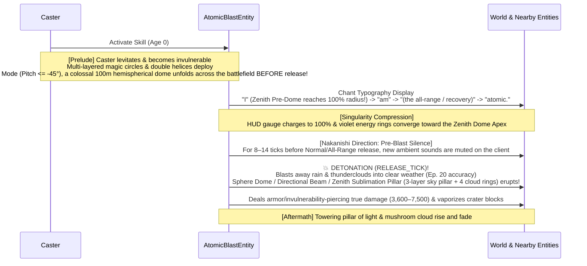

# 04. Ultimate Art: "I am Atomic." — All Modes & Spatial Annihilation Engine

🌐 **Language / 言語切替**: **[🇯🇵 日本語版はこちら](04-I-Am-Atomic.md)** ｜ **🇺🇸 English (Current)**

[⬅ Prev: 03. Combat, Parry & Status Marks](03-Combat-Parry-and-Status-Marks-EN.md) ｜ [🏠 English Wiki Home](Home-EN.md) ｜ [Next: 05. All 29 3D Weapons & Artifacts ➔](05-Weapons-and-Artifacts-EN.md)

---

## 1. Chant & Presentation Timeline Specification

When casting any *"I am Atomic."* variant, the caster levitates into the air and becomes **completely invulnerable until detonation** (Resistance V + full damage cancellation controlled via `mana.isActiveAtomicRunning()`). MP and cooldowns are finalized upon release (if the caster's MP was drained below the cost during chanting, `PlayerMana.drainUpTo()` safely drains remaining MP).

---

## 2. Three Posture-Controlled Canon Modes (Standard `I am Atomic.`)

When casting standard **`I am Atomic.`** with the *Jet-Black Sword*, your **posture at the moment of activation (Sneaking / Camera Pitch)** automatically branches the blast into one of three anime-accurate spatial control modes:

| Cast Mode | Input Condition | Anime Reference | Spatial Destruction & Damage Mechanics |
| :--- | :--- | :--- | :--- |
| **① Standard Sphere Mode** *(通常球体形態)* | `Right-Click` while **standing upright** (not sneaking, not looking straight up) | Royal Capital Showdown (Standard Form) | Expands a violet-blue singularity sphere up to a `100-block` radius (`Config.blastRadius`), vaporizing all terrain and enemies in 360° around the caster. |
| **② Directional Beam Mode** *(指向性貫通ビーム形態)* | `Right-Click` while **holding `Shift` (Sneak)** | **Anime Episode 5** (vs. Zenon in front of Iris & Alexia) | Carves a directional cone beam `100 blocks` long strictly along the caster's line of sight. **All terrain, structures, and entities within 36m behind the caster—and all allied entities—are 100% unharmed.** |
| **③ Zenith Sublimation Pillar** *(天蓋昇華ピラー形態)* | `Right-Click` while **looking skyward (`Pitch <= -45°`)** | **Anime Episode 20** (Colossal pre-blast dome over the Capital & skyward cloud-parting pillar) | **`v1.0.6` Complete Overhaul**: **During the chant (before detonation), a colossal hemispherical dome (`100m` radius) unfolds over the entire battlefield** (reaching 100% radius by `"I"` with active boundary containment). Upon *"Atomic."* release, **zero ground blocks are destroyed**—the entire dome redirects skyward into a **3-layer Zenith Sublimation Pillar (220+ blocks high) and 4-tier cloud-parting rings**, clearing rain/thunderstorms and dealing `5,000` damage to enemies! |

### 🌟 `v1.0.6` Episode 20 "Zenith Sublimation Pillar" Two-Stage Spatial Architecture

1. **Stage 1 — Pre-Blast Chant (`age < releaseTick`): Colossal Hemispherical Battlefield Dome (`computeZenithPreDomeRadius`)**:
   - Initiating the chant while looking skyward (`Pitch <= -45°`) immediately unfolds a colossal violet-blue hemispherical dome over the entire battlefield *before* the explosion occurs.
   - The dome expands rapidly from the caster, **reaching 100% of `maxRadius` (`100m`) by the `"I"` vocal beat (`age / releaseTick = 0.25`)**.
   - Rendered with **3 concentric dome shells (`100%`, `99%`, `96%`)**, **16 geodesic meridian ribs**, **5 latitude rings**, and **16 perimeter monolith pylons**, while ascending zenith convergence rings (`computeZenithApexConvergence`) surge from ground level to the **Top Apex Crown Seal** during `"am"` → `"atomic."`.
   - Active **dome boundary containment (`enforceZenithPreDomeContainment`)** keeps hostile targets inside the 100m dome perimeter during the chant.
2. **Stage 2 — Post-Release Sublimation (`age >= releaseTick`): Skyward Redirection & 3-Layer Zenith Pillar (`computeZenithPillarRadius`)**:
   - At the moment of *"Atomic."* release, instead of exploding outward into the ground (**0 blocks destroyed**), the 100m dome redirects and sublimates skyward into a **3-layer Zenith Sublimation Pillar (`32%` core radius, `220+` blocks tall)**.
   - Accompanied by 8 spiraling double-helix ribbons, an 8-spoked ground seal, and **4-tier cloud-parting sky canopy shockwave rings (`+72Y`, `+110Y`, `+148Y`, `+185Y`)**, it parts the storm clouds into clear weather while dealing the full `5,000` fixed true damage to all enemies inside.

---

## 3. All 5 Atomic Variants Comparison Table

All offensive Atomic damage values scale dynamically with `Config.blastDamage` (default `5000.0` = `1.0×` multiplier).

| Ultimate Art | Weapon | Base MP Cost *(at 99% Suit)* | Chant Duration *(Silence Window)* | Cooldown | Max Radius | True Damage / Effects | Block Destruction |
| :--- | :--- | :---: | :---: | :---: | :---: | :--- | :---: |
| **`I am Atomic.`** | *Jet-Black Sword* | `500 MP` *(`505 MP`)* | `100 ticks` (5.0s) *(Silence 8t)* | `600 ticks` (30.0s) | `100m` *(Config)* | **Fixed `5,000` True Damage** (pierces armor, enchantments, shields, boss hardening, mist form, single-hit damage caps, and `invulnerableTime`; respects Creative & Just-Guard Parry invulnerability) | **Yes** *(None in Zenith Mode)* |
| **`I am the All-Range Atomic.`** | *Jet-Black Sword* | `750 MP` *(`758 MP`)* | `130 ticks` (6.5s) *(Silence 14t)* | `600 ticks` (30.0s) | **`125m`** *(125% of base, max 127m)* | **Fixed `7,500` True Damage** (Maximum-scale omnidirectional annihilation that erases even the Sanctuary) | **Yes** |
| **`I am Recovery Atomic.`** | *Jet-Black Sword* | `350 MP` *(`354 MP`)* | `70 ticks` (3.5s) *(Freeze 4t)* | `160 ticks` (8.0s) | `40m` | **[Allies]** 100% Full HP heal + purges all debuffs + full hunger/saturation + **`+500 MP` supply** + Regeneration II (8s), Resistance II (6s) & Speed I (6s). **[Zombie Villagers]** Instantly cures into normal Villagers (Season 2 Ep. 3 accuracy). **[Enemies]** Deals **`1,800`** to regular mobs (**`180`** to bosses when player-cast) × distance falloff (`0.55–1.0×`) + knockback. | **No** *(100% Non-Destructive)* |
| **`I am Archetype Atomic.`** | *Archetype Shadow Blade* | `260 MP` *(`263 MP`)* | `70 ticks` (3.5s) *(Freeze 4t)* | `100 ticks` (5.0s) | `24–48m` | **Fixed `3,600` True Damage** + strips enemy Absorption & inflicts Weakness II (8s). **Zero friendly-fire damage**. **[Caster Rewards]** Heals 25% HP + **Chrono Burst (15s: 1.5× MP regen, +50% cooldown recovery, Haste II)** + **3 Auto-Parry Charges (15s)** + **Slime Barrier (7s)** + triggers **[Atomic Unison]** with nearby allied Alpha! | **No** *(100% Non-Destructive)* |
| **`I am Catastrophe Atomic.`** | *Archetype Shadow Blade* | `420 MP` *(`424 MP`)* | `70 ticks` (3.5s) *(Freeze 4t)* | `120 ticks` (6.0s) | `24–48m` | **Fixed `6,400` True Damage** + strips Absorption + simultaneously inflicts **[Depravity] (8s)**, **[Hellfire] (5s)**, and **Boss [Posture Break] (5s)**. High-speed 3.5s crimson-violet demonic Atomic that obliterates terrain. | **Yes** |

---

## 4. Asynchronous Crater Engine, Audio & `v1.0.6` LUT Rendering

1. **Asynchronous Slice Precomputation & Lock-Free Fast-Path (`SphereDestroyer` / `DirectionalDestroyer`)**:
   - Precomputes sorted coordinate offset slices on a background thread as soon as chanting starts, skipping empty `LevelChunkSection` (16×16×16) regions and vaporizing up to `blocksPerTick` (default `40,000`) blocks per tick (`v1.0.6` adds a `volatile` lock-free completion flag to eliminate server-thread lock contention during aftermath ticks).
2. **`v1.0.6` Precomputed Trigonometric & Geodesic Look-Up Tables (`AtomicBlastRenderer`)**:
   - Uses static precomputed `32×48` unit sphere vertex tables, `16×40` geodesic dome meridian rib tables, and `48`-segment ring cosine/sine tables, eliminating ~10,000+ `Math.sin` / `Math.cos` calls per frame while preserving 100% identical visual geometry.
3. **Procedural Audio Synthesis & Nakanishi Pre-Blast Silence**:
   - Uses zero copyrighted audio assets—synthesizing the singularity hum, the **8–14 tick client-side acoustic silence window** right before release, and the atmospheric thunder shockwave procedurally from pitch/phase-modulated vanilla sounds.

---

[⬅ Prev: 03. Combat, Parry & Status Marks](03-Combat-Parry-and-Status-Marks-EN.md) ｜ [🏠 English Wiki Home](Home-EN.md) ｜ [🇯🇵 日本語版はこちら](04-I-Am-Atomic.md) ｜ [Next: 05. All 29 3D Weapons & Artifacts ➔](05-Weapons-and-Artifacts-EN.md)
