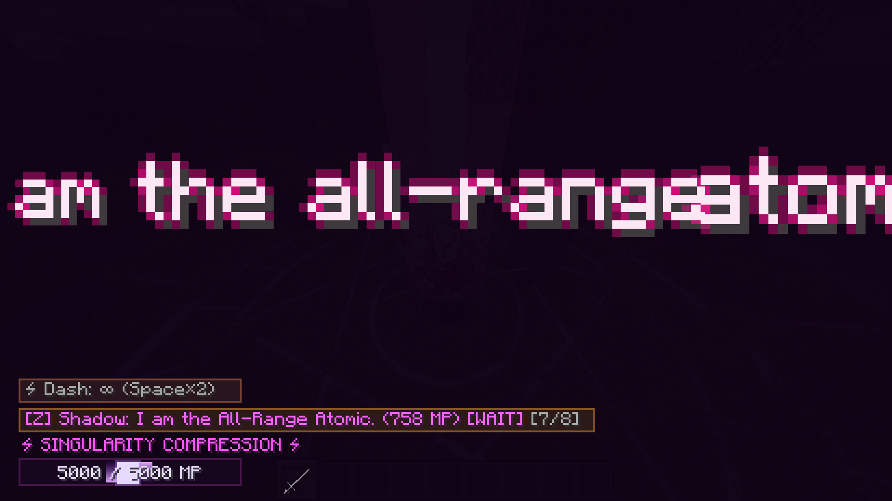
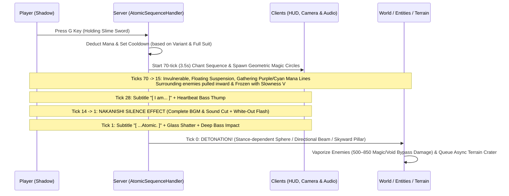
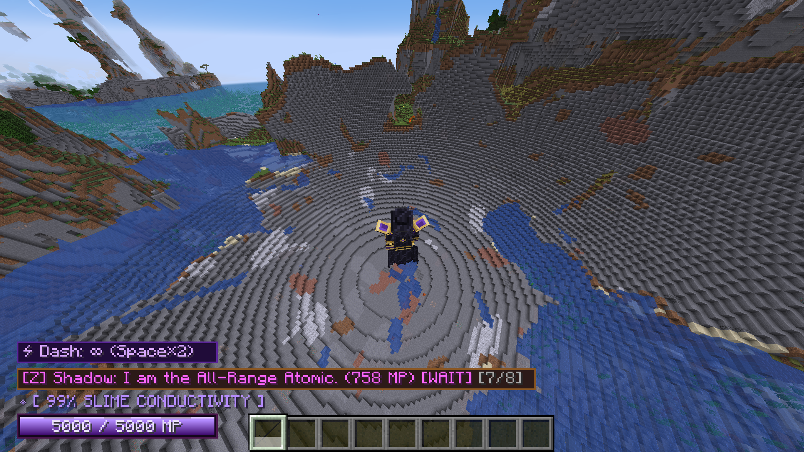

# 04. "I Am Atomic" Magic System / 『I am Atomic』奥義システム完全解説

[🏠 Home](Home.md) | [⬅️ Previous: 03. Combat, Parry & Status Marks](03-Combat-Parry-and-Status-Marks.md) | [➡️ Next: 05. Weapons & Artifacts Arsenal](05-Weapons-and-Artifacts.md)

---

## ⚛️ 6.1 How to Cast "I Am Atomic" / 発動条件と手順

To unleash Lord Shadow's signature annihilation magic:
シャドウの代名詞である究極奥義『I am Atomic』を発動するための条件は以下の通りです。

1. **Weapon Requirement / 武器条件**: Hold the **Slime Sword (`eminence_shadow:slime_sword`)** in your Main Hand.
2. **Armor Bonus (Optional) / 装備ボーナス**: Wearing the **Full 4-Piece Slime Bodysuit** unlocks your selected Atomic Variant (`X` key) and applies the **`-20%` Mana Cost reduction**. Without the full set, casting defaults to **Standard Atomic** at base cost (`200 Mana`).
3. **Activation / 発動キー**: Press **`G`** (`key.eminence_shadow.atomic`) while having sufficient Mana and `0` Atomic Cooldown.

---

## 🎬 6.2 Cast Sequence & Anime-Accurate Presentation / 詠唱から爆発までのタイムライン

### Key Presentation Highlights / 演出のこだわり
- **Invulnerability During Chant / 詠唱中完全無敵**: Throughout the `70 ticks` (`3.5s`) chant, the caster has `invulnerableTime = 20`, levitates steadily in place, and generates rotating multi-layered purple/cyan geometric magic circles and barrier domes.
- **Gravitational Convergence / 重力収束**: Enemies within `35 blocks` are pulled toward the epicenter and afflicted with **Slowness V** so they cannot escape judgment.
- **The "Nakanishi Silence" (`Ticks 14 -> 1`) / 静寂演出（無音空間）**: Just before detonation, all explosion and ambient sounds cut to absolute silence while the screen flashes blinding white/violet—faithfully recreating the anime's sound design before the glass-shattering *"Atomic"* drop.

---

## 🎯 6.3 Three Casting Stances (Standard Atomic) / 視線・姿勢による3つの撃ち分け（通常アトミック）

When **Standard Atomic** (`Variant 0`) is selected, your **posture and camera pitch at the moment you press `G`** dynamically changes the execution style to match three iconic anime episodes!
**通常アトミック（Standard Atomic）** 選択時、**`G`キーを押した瞬間の姿勢（スニーク・視線角度）** によって、アニメの名シーンを再現した3種類の形態に自動変化します！

| Casting Stance / 発動時の姿勢 | Condition when pressing `G` / 条件 | Anime Reference / 元ネタ | Mechanical & Visual Behavior / 挙動と威力・範囲 |
| :--- | :--- | :--- | :--- |
| **1. Omnidirectional Sphere** 全方位球状ドーム爆発 | **Default** (Standing, looking normally: Pitch `>= -65°`, Not Crouching) | **Season 1 Ep. 20 / General** 標準全方位アトミック | Expands an omnidirectional purple-cyan dome up to **`48 blocks` radius** (`500.0` Damage) and carves a spherical crater (`32 blocks` default radius) around the caster. |
| **2. Directional Railgun Beam** 指向性貫通レーザー（第5話再現） | **Crouching (`Shift`) + Looking Forward** | **Season 1 Ep. 5 (vs. Zenon)** 第5話 ゼノン戦・指向性貫通ビーム | Fires a concentrated **`96-block` horizontal beam** (`6.5m` core radius) straight along your crosshair! Deals **`575.0` Damage (`1.15x`)** along the beam and carves a cylindrical tunnel through terrain without destroying the ground behind you! |
| **3. Skyward Zenith Pillar** 天頂貫通・光柱（第20話再現） | **Looking Straight Up (`Pitch < -65°`)** | **Season 1 Ep. 20 (Season Finale)** 第20話 雨雲を吹き飛ばす天頂光柱 | Unleashes a colossal vertical pillar of violet light piercing from bedrock level to the sky, dealing **`550.0` Damage (`1.10x`)** within a **`55-block` radius**, carving a `22-block` wide vertical shaft, and **instantly clearing Rain & Thunderstorms into a clear night/day sky!** |

---

## 🌌 6.4 All 5 Atomic Variants (`X` Key Cycle) / 全5種のアトミック派生比較表

Press **`X`** (`key.eminence_shadow.atomic_variant`) to cycle through the 5 Atomic Variants. Your active variant is shown on the bottom-left Mana HUD (`[ATOMIC: ...]`).
**`X`キー** を押すことで、5種類のアトミック派生をいつでも切り替えられます（画面左下のHUDに現在選択中のモードが表示されます）。

| # | Variant Name / 派生名 | Mana Cost (Base / **Full Suit**) | Cooldown (Ticks / Sec) | Damage / 威力 | Effect Radius / 効果範囲 | Crater / 地形破壊 | Unique Mechanics & Secondary Effects / 固有効果・特徴 |
| :-: | :--- | :---: | :---: | :---: | :---: | :---: | :--- |
| **0** | **Standard Atomic** 通常『I am Atomic』 | `200` / **`160`** | `400t` (`20.0s`) | **`500.0`** *(Beam: `575` / Sky: `550`)* | **`48 blocks`** *(Beam: `96m` / Sky: `55m`)* | **Yes** (`32m` sphere / `96m` tunnel / `22m` shaft) | Supports the **3 Casting Stances** (Sphere, Ep.5 Directional Beam, Ep.20 Skyward Pillar + Weather Clear). Deals 50% Bypass/Void + 50% Magic damage. |
| **1** | **All-Range Atomic** 『I am All-Range Atomic』 | `300` / **`240`** | `600t` (`30.0s`) | **`850.0`** | **`80 blocks`** | **Yes** (`48m` massive crater, `1.5x` radius) | Maximum annihilation radius and damage. Vaporizes entire armies and fortresses across 5 chunks (`160m` diameter). |
| **2** | **Recovery Atomic** 『I am Recovery Atomic』 | `150` / **`120`** | `300t` (`15.0s`) | **`350.0`** *(to Undead & Cult Mobs ONLY)* | **`48 blocks`** | **No** (`0` blocks broken — Safe inside bases!) | **100% heals the caster & all non-hostile Players, Villagers, Iron Golems, Tamed Pets, and Sworn Shadow Garden Companions** within `48m`! Clears all negative debuffs, cures Zombie Villagers, grants **Regeneration IV (`20s`) + Absorption IV (`60s`) + Resistance II (`15s`)**, and smites Undead/Cultists for `350` damage! |
| **3** | **Sword Atomic (Non-Destructive)** 『Sword Atomic』（地形保護・一点集中） | `120` / **`96`** | `200t` (`10.0s`) | **`650.0`** | **`18 blocks`** | **No** (`0` blocks broken — Safe for builds!) | High-density combat variant with a short `10s` cooldown and low `96 Mana` cost. Concentrates `650.0` damage into an `18m` strike zone without damaging a single block. Ideal for boss fights inside structures! |
| **4** | ** Cosmic Atomic** 『I am Cosmic Atomic』（宇宙規模・究極奥義） | `300` / **`240`** | `800t` (`40.0s`) | **`1250.0`** | **`110 blocks`** | **Yes** (`60m` abyssal crater) | **Requires Mastery Rank 4+ (`Shadow Sovereign` or higher)** to select! Summons an orbital cosmic railgun array that plunges the region into midnight, rains starlight spears across `110 blocks`, deals **`1,250.0` bypass damage**, and grants the caster **Resistance IV + Regeneration IV (`15s`)**. |

> [!TIP]
> **Server & Base Protection (`atomicBlockDestruction`)**
> Server administrators or builders who want to use Standard, All-Range, or Cosmic Atomic without carving craters into the world can set `atomicBlockDestruction = false` in `config/eminence_shadow-common.toml` (or use **Sword Atomic** / **Recovery Atomic**, which never destroy blocks).

---

[🏠 Home](Home.md) | [⬅️ Previous: 03. Combat, Parry & Status Marks](03-Combat-Parry-and-Status-Marks.md) | [➡️ Next: 05. Weapons & Artifacts Arsenal](05-Weapons-and-Artifacts.md)
