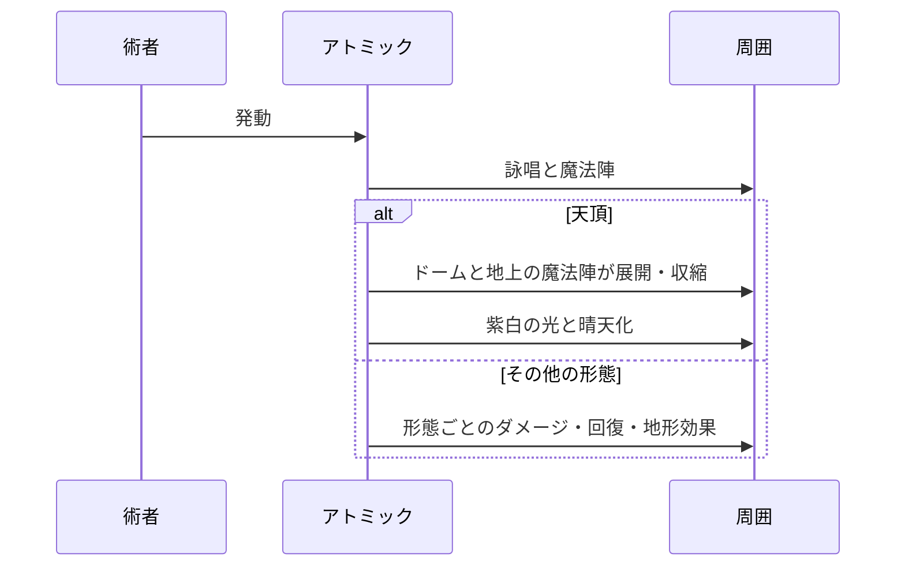

# 04. 究極奥義『I am Atomic.』全形態＆空間消滅エンジン（I am Atomic Engine）

🌐 **言語切替 / Language**: **🇯🇵 日本語 (現在)** ｜ **[🇺🇸 Read in English](04-I-Am-Atomic-EN.md)**

[⬅ 前章：03. 戦闘・パリィ・7大刻印](03-Combat-Parry-and-Status-Marks.md) ｜ [🏠 日本語 Wiki ホーム](Home.md) ｜ [次章：05. 全30種 3D武器・アイテム図鑑 ➔](05-Weapons-and-Artifacts.md)

---

## 1. 詠唱・演出タイムライン仕様

『I am Atomic.』を発動すると、術者は空中に浮遊し、**詠唱完了（解放）まで完全無敵状態**（耐性V＋被ダメージ完全キャンセル）になります。なお、詠唱中・解放中の無敵および耐性保護は `mana.isActiveAtomicRunning()` により正確に解放瞬間まで制御され、解放時にMPとクールダウンが確定します（万が一リリース時点でMPが不足していた場合は `PlayerMana.drainUpTo()` により所持MP分のみ消費します）。

---

## 2. 発動姿勢による3つの正典空間制御（Normal `I am Atomic.`）

『漆黒の剣』で通常の **`I am Atomic.`** を発動する際、プレイヤーの **姿勢（スニーク / 視点ピッチ角）** によって自動的に3つの原作再現モードに分岐します。

| 発動モード | 発動時の操作条件 | 原作再現元 | 空間破壊・ダメージ判定の仕様 |
| :--- | :--- | :--- | :--- |
| **① 通常球体形態** *(Standard Sphere)* | **直立状態**（スニークせず、真上を向かない）で右クリック | 王都決戦・標準形態 | 術者を中心に半径 `100ブロック`（`Config.blastRadius` 準拠）の真球状に青紫の特異点が膨張し、周囲360°の地形と敵対者をすべて消滅させます。 |
| **② 指向性貫通ビーム形態** *(Directional Beam)* | **`Shift`（スニーク）しながら** 右クリック | **アニメ第5話**（アイリス＆アレクシアの前での対ゼノン戦） | 術者の視線方向（前方コーン領域）のみを長さ `100ブロック` にわたって円錐状に抉り抜きます。**術者の背後36m以内の地形・建物・存在およびすべての味方エンティティは一切傷つきません。**（地形破壊は完全に前方コーン内のみ） |
| **③ 天蓋昇華ピラー形態** *(Zenith Skyward Dome & Pillar)* | **上空（視点ピッチ角 `Pitch <= -45°`）を見上げて** 右クリック | **アニメ第20話**（終焉の雨・王都全域を覆う超巨大事前ドーム＆上空指向性昇華ピラー） | 紫のドームと地上の魔法陣が収縮し、直後に紫白の光を放ちます。天頂形態のダメージは0で地形は保たれ、雨・雷雨が晴れます。雨・雷雨時はシャドウも発動します。 |

### 1.0.7の天頂演出

1. **詠唱と展開**。紫の半球ドームが広がり、詠唱の「I」で設定半径（既定100ブロック）に到達します。地面の魔法陣はドームの半径に連動します。ドームには原子核、電子軌道、電子回路の描画が加わり、詠唱中は境界内に敵対対象を留めます。内側の視界には薄紫の効果がかかります。
2. **収縮と解放**。解放前の最後の8 ticksでドームと地面の魔法陣が急速に収縮します。直後に紫白の光が立ち上がり、ドームと同じ半径の魔法陣が再び現れます。術者周辺の魔法陣や球状エフェクトは通常アトミックと共通です。4段の雲割りリングが広がり、雨・雷雨が晴れます。

---

## 3. 全5種のAtomicバリエーション性能比較表

すべての破壊系・攻撃系ダメージは `Config.blastDamage`（デフォルト `5000.0` = `1.0倍`）による倍率スケーリングに対応しています。

| 奥義名 | 使用武器 | 基礎消費MP *(99%スーツ時)* | チャージ時間 *(静寂時間)* | クールダウン | 最大半径 | 固定ダメージ / 効果 | ブロック破壊 |
| :--- | :--- | :---: | :---: | :---: | :---: | :--- | :---: |
| **`I am Atomic.`** | 『漆黒の剣』 | `500 MP` *(`505 MP`)* | `100 ticks` (5.0s) *(静寂 8t)* | `600 ticks` (30.0秒) | `100m` *(Config準拠)* | **球体・ビーム**は基礎威力`5,000`。**天蓋**はダメージ0で雨・雷雨を晴らします。 | **あり** *(天蓋形態のみなし)* |
| **`I am the All-Range Atomic.`** | 『漆黒の剣』 | `750 MP` *(`758 MP`)* | `130 ticks` (6.5s) *(静寂 14t)* | `600 ticks` (30.0秒) | **`125m`** *(通常の125%、上限127m)* | **固定 `7,500` ダメージ**（聖域すら消し飛ばす最大規模の全方位抹消） | **あり** |
| **`I am Recovery Atomic.`** | 『漆黒の剣』 | `350 MP` *(`354 MP`)* | `70 ticks` (3.5s) *(粒子停止 4t)* | `160 ticks` (8.0秒) | `40m` | **【味方】** HP 100%完全回復＋全デバフ浄化＋満腹度全快＋**MP `+500` 供給**＋再生II（8秒）＆耐性II（6秒）＆移動速度上昇I（6秒）付与。 **【村人ゾンビ】** 即座に通常の村人へ浄化・蘇生（2期3話再現）。 **【敵】** 通常Mobに **`1,800`**（プレイヤー発動時のボス敵には **`180`**）×距離減衰（`0.55〜1.0x`）ダメージ＋弾き飛ばし。 | **なし** *(完全非破壊)* |
| **`I am Archetype Atomic.`** | 『開闢の漆黒剣』 | `260 MP` *(`263 MP`)* | `70 ticks` (3.5s) *(粒子停止 4t)* | `100 ticks` (5.0秒) | `24〜48m` | **固定 `3,600` ダメージ**＋敵の吸収障壁剥奪＆弱体化II（8秒）。**味方への誤射ダメージなし**。 **【術者特典】** HP 25%回復＋**クロノバースト（15秒：MP回復1.5倍・CT回復+50%・採掘速度II）**＋**自動パリィ3チャージ（15秒）**＋**スライム防壁（7秒）**＋味方アルファ連動 **【アトミック・ユニゾン】** 発動！ | **なし** *(完全非破壊)* |
| **`I am Catastrophe Atomic.`** | 『開闢の漆黒剣』 | `420 MP` *(`424 MP`)* | `70 ticks` (3.5s) *(粒子停止 4t)* | `120 ticks` (6.0秒) | `24〜48m` | **固定 `6,400` ダメージ**＋敵の吸収障壁剥奪・**『堕落』（8秒）・『業火』（5秒）・ボス【体勢崩し】（5秒）** を同時付与。高速詠唱（3.5秒）で地形ごと粉砕する魔人化シャドウの深紅黒紫アトミック。 | **あり** |

---

## 4. 非同期空間破壊エンジン＆音響・描画最適化メモ

1. **非同期スライス事前計算＆ロックフリー完了判定（`SphereDestroyer` / `DirectionalDestroyer`）**:
   - 詠唱開始時にバックグラウンドスレッドで座標オフセット配列を生成し、`LevelChunkSection`（16×16×16）単位で空気チャンクを即座にスキップしつつ 1 tick あたり最大 `blocksPerTick`（デフォルト `40,000`）ブロックを滑らかに消去します（`v1.0.6` にて完了後の `volatile` ロックフリー高速パスを導入し、サーバーTPS負荷を極小化）。
2. **`v1.0.6` 測地線ドーム＆球体メッシュの三角関数LUT（Look-Up Table）高速描画**:
   - `AtomicBlastRenderer` にて `32×48` 単位球頂点テーブル、`16×40` ドーム子午線リブテーブル、`48` 分割リングテーブルを静的プリコンピュート（LUT化）。100%同一の描画品質を保ちながら、フレームあたり約10,000回以上の `Math.sin` / `Math.cos` 呼び出しを削減しています。
3. **プロシージャル音響＆中西演出（静寂ウィンドウ）**:
   - 著作権保護音源を一切使わず、バニラ音響の位相制御によって「収束の唸り → 爆発直前 `8〜14 ticks` の新規環境音遮断（静寂） → 大気破砕雷鳴」をリアルタイム合成しています。詠唱が中断された場合は `ClientboundStopSoundPacket` で即座に詠唱音が停止します。

---

[⬅ 前章：03. 戦闘・パリィ・7大刻印](03-Combat-Parry-and-Status-Marks.md) ｜ [🏠 日本語 Wiki ホーム](Home.md) ｜ [🇺🇸 Read in English](04-I-Am-Atomic-EN.md) ｜ [次章：05. 全30種 3D武器・アイテム図鑑 ➔](05-Weapons-and-Artifacts.md)
