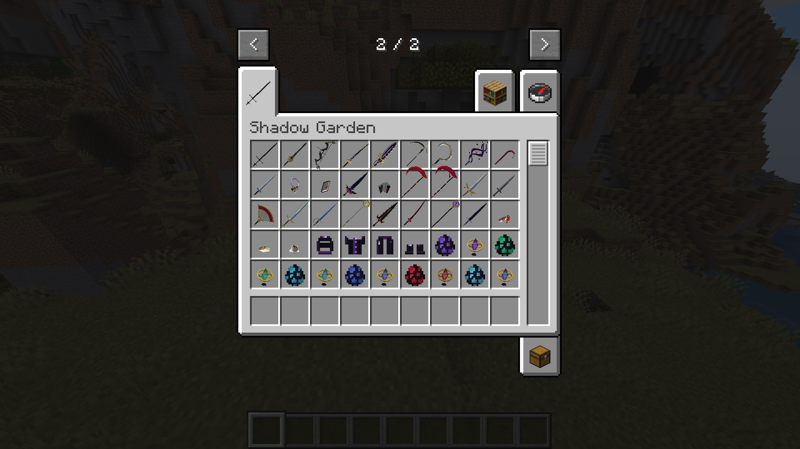

# 05. Weapons & Artifacts Arsenal (All 27 Items) / 武器・アーティファクト・三越商会アイテム完全図鑑

[🏠 Home](Home.md) | [⬅️ Previous: 04. "I Am Atomic" Magic System](04-I-Am-Atomic.md) | [➡️ Next: 06. Bosses, Mastery Ranks & Companions](06-Bosses-and-Companions.md)

---

Every weapon in this mod features a **custom 3D model**, **unbreakable Slime/Mana infusion** (or infinite scaling), **passive on-hit effects**, and up to **two active skills** (**Right-Click** and **Sneak + Right-Click**).
本MODに収録されている全27種の武器・アーティファクト・消費アイテムの完全データシートです。すべての武器は固有の3Dモデル、パッシブ効果、右クリックスキル（さらに主要武器はスニーク＋右クリックの第2スキル）を備えています。

---

## 🗡️ 8.1 Core Shadow & Seven Shadows Weapons / シャドウ＆七陰のメイン武器（10種）

| # | Weapon / 武器名 (`Registry ID`) | Total ATK / 攻撃力 (Attack Speed) | Passive On-Hit Effect / 通常攻撃パッシブ | Right-Click Skill / 右クリックスキル (Mana Cost / Cooldown) | Sneak + Right-Click Skill / スニーク＋右クリックスキル (Mana Cost / Cooldown) |
| :-: | :--- | :---: | :--- | :--- | :--- |
| **1** | **Slime Sword** スライムソード `slime_sword` | **`12.0` + Rank Bonus** (`1.6` SPD) *Unbreakable* | **Mana Overdrive**: When Current Mana `>= 50%`, deals **`+30%` Bonus Magic Damage** (`1.3x`). Scales up to `+12.0` additional base damage at Rank 8 (`24.0` base!). | **Slime Edge Wave / 魔力斬撃波** (`20 Mana` / `20t = 1.0s`) Fires a piercing slime crescent wave up to `24m`, dealing **`16.0 + (Rank × 2.5)` Magic Damage** in a `2.5m` radius along its path. | **Overdrive Thrust / 空間圧縮突進斬り** (`35 Mana` / `45t = 2.25s`) Teleports/lunges `9m` forward, striking all enemies along the path for **`26.0 + (Rank × 3.5)` Magic Damage** + **`[EXPOSED]` (`3s`)**. *(Also enables `G` Key "I Am Atomic"!)* |
| **2** | **Golden Crowbar** 黄金のバール `golden_crowbar` | **`11.0`** (`1.8` SPD) *Unbreakable* | **Aesthetic Multi-Hit**: Every melee swing strikes **twice** (main hit + `4.5` follow-up blunt magic damage) with high knockback (`+0.4`). | **Stylish execution / 黄金の破滅刻印** (`30 Mana` / `50t = 2.5s`) Slams targets within `5m` for **`18.0` Damage** and brands them with **`[GOLDEN_DOOM]`** (`60t`), which detonates for **`28.0` Golden Explosion Damage** + upward launch! | **Mob-Fu Parry Stance / モブ式カウンター構え** (`20 Mana` / `40t = 2.0s`) Grants **Resistance III (`1.5s`) + Speed II (`3s`)** and immediately triggers an AoE shockwave (`14.0` dmg + `+30 Posture`) around you. |
| **3** | **Alpha's Slime Blade** アルファの黒刃 `alpha_blade` | **`14.0`** (`1.7` SPD) *Unbreakable* | **First Seat Precision**: Deals **`+25%` Bonus Damage** to targets above `70%` HP and restores **`+4 Mana`** per melee hit. | **Mist Flash Step / 霧閃・瞬歩一閃** (`30 Mana` / `35t = 1.75s`) Shadow-steps up to `12m` through enemies, dealing **`28.0` Magic Damage** and applying **`[EXPOSED]` (`80t / 4s`)** + **`+25 Posture`**. | **Commander's Judgment / 七陰筆頭の号令** (`45 Mana` / `80t = 4.0s`) Unleashes a `7m` golden-black radial slash for **`36.0` Magic Damage** and grants you & nearby allies **Strength II + Speed II (`8s`)**. |
| **4** | **Beta's Magic Bow & Quill** ベータの魔導弓 `beta_bow` | **`10.0` Melee** **`18.0` Arrow** *No Arrows Needed* | **Chronicle Shot**: Fires high-velocity mana arrows without consuming vanilla arrows. Melee hits apply **Slowness II (`2s`)**. | **Starlight Volley / 星光の連射** (`25 Mana` / `25t = 1.25s`) Fires a 5-arrow fan barrage of piercing mana arrows (`22.0` Magic Damage each, `0` gravity drop) that apply **Glowing (`6s`)**. | **Natsume's Finale / 漆黒の叙事詩・終章** (`45 Mana` / `70t = 3.5s`) Calls down a rain of魔力 arrows in an `8m` target zone (`25m` range), dealing **`34.0` AoE Magic Damage** + **Slowness IV (`3s`)**. |
| **5** | **Gamma's Slime Sword** ガンマのスライム剣 `gamma_sword` | **`13.0`** (`1.4` SPD) *Unbreakable* | **Unpredictable Trip**: Each melee swing has a **`35%` chance to trigger a Comic Trip Shockwave**, dealing **`2.5x` (`32.5`) AoE Damage** + **`[CONDUCTIVE]`**! | **Tripping Calamity / 最強の転倒スラッシュ** (`35 Mana` / `45t = 2.25s`) Lunges wildly forward (`1.6` speed) and faceplants into a massive **`6m` explosion**, dealing **`42.0` Magic Damage** + **`[CONDUCTIVE]` (`5s`)** to all enemies (0 self-damage!). | **Mitsugoshi Gold Bribe / 三越商会の札束攻勢** (`30 Mana` / `60t = 3.0s`) Scatters explosive gold coins in a `6m` radius for **`26.0` Magic Damage**, stunning mobs (`30t`) and granting **Absorption II (`10s`)**. |
| **6** | **Delta's Feral Greatsword** デルタの剛剣 `delta_greatsword` | **`17.0`** (`1.1` SPD) *Unbreakable* | **Beast Hunt**: Inflicts **`[BLEED]` (+1 Stack)** on every hit and restores **`2.0 HP`** when striking a bleeding enemy. | **Feral Leap Slam / 獣王の跳躍粉砕** (`35 Mana` / `45t = 2.25s`) Leaps forward and slams the ground (`6.5m` radius) for **`38.0` Physical/Magic Damage**, inflicting **+2 `[BLEED]` Stacks** and **`+35 Posture`**. | **Predator Rampage / 狩りの時間です！** (`50 Mana` / `90t = 4.5s`) Enters a feral frenzy: **Strength III + Speed III + Resistance II (`8s`)** and releases a **`7m` roar (`28.0` Damage + Slowness III)**. |
| **7** | **Epsilon's Slime Conductor** イプシロンの魔力細剣 `epsilon_blade` | **`12.5`** (`1.8` SPD) *Unbreakable* | **99% Slime Precision**: Reduces the **Mana Cost of all Weapon Skills by `-20%`** while held and fires a `6m` micro-wave (`+5.0` magic dmg) on every swing. | **Sonata Slash Array / 魔力収束・協奏斬** (`24 Mana` / `30t = 1.5s`) Fires 3 converging long-range mana crescents (`28m` range), each dealing **`15.0` Magic Damage** (`45.0` total on single target). | **Slime Armor Reinforcement / 精密スライム装甲展開** (`35 Mana` / `65t = 3.25s`) Condenses high-density slime barriers, granting **Absorption IV (`15s`) + Regeneration II (`8s`)** and pushing enemies back (`18.0` dmg). |
| **8** | **Zeta's Beast Claw** ゼータの隠密鉤爪 `zeta_claw` | **`12.0`** (`2.2` SPD) *Unbreakable* | **Shadow Assassination**: Attacks from behind or while invisible deal **`2.0x` Critical Damage** and apply **`[BLEED]` (+1 Stack)**. | **Phantom Ambush / 影猫の瞬獄殺** (`25 Mana` / `30t = 1.5s`) Teleports directly behind the targeted enemy within `16m`, striking for **`30.0` Backstab Magic Damage** + **+2 `[BLEED]` Stacks** + **Invisibility (`4s`)**. | **Smoke Screen Vanish / 隠密煙幕・神隠し** (`30 Mana` / `55t = 2.75s`) Blinds & slows enemies within `6m` (`16.0` Damage + **Blindness `4s`**) while granting **Invisibility + Speed III (`6s`)**. |
| **9** | **Eta's Mad Wrench** イータの魔導レンチ `eta_wrench` | **`11.5`** (`1.5` SPD) *Unbreakable* | **Artifact Analysis**: Every hit has a **`40%` chance** to inflict **`[EXPOSED]` (`4s`)** or **`[SILENCED]` (`3s`)** while draining **`+6 Mana`** for the wielder. | **EMP Suppression Field / 魔力阻害パルス展開** (`35 Mana` / `50t = 2.5s`) Emits an `8m` technological pulse dealing **`24.0` Magic Damage** and applying **`[SILENCED]` (`100t / 5s` — Seals Boss Skills!)** + **`[EXPOSED]` (`5s`)**. | **Gravity Anomaly Trap / 重力異常フィールド** (`45 Mana` / `75t = 3.75s`) Pulls all enemies within `9m` into a singularity (`32.0` Magic Damage + **Slowness V `4s`** + **`+40 Posture`**). |
| **10** | **John Smith's Monofilament Gloves** ジョン・スミスの鋼糸手袋 `john_smith_gloves` | **`12.5`** (`2.0` SPD) *Unbreakable* | **Steel Thread Snare**: Melee range extended by floating threads; hits apply **Slowness II (`3s`)** and **`[BLEED]` (+1 Stack)**. | **Monofilament Web Bind / 鋼糸結界・拘束切断** (`30 Mana` / `35t = 1.75s`) Slices all enemies within a `9m` radius with razor threads for **`28.0` Magic Damage**, inflicting **Slowness V (`3.5s`)** + **+2 `[BLEED]` Stacks** and pulling them inward. | **Puppeteer's Execution / 糸の処刑場** (`45 Mana` / `65t = 3.25s`) Detonates all thread-bound / bleeding targets within `12m` for **`38.0` Armor-Bypassing Damage** + **`[EXPOSED]` (`5s`)**. |

---

## ⚔️ 8.2 Heroic, Royal & Numbers Weapons / 英雄・王族・ナンバーズ・幹部武器（14種）

| # | Weapon / 武器名 (`Registry ID`) | Total ATK / 攻撃力 (Attack Speed) | Passive On-Hit Effect / 通常攻撃パッシブ | Right-Click Skill / 右クリックスキル (Mana Cost / Cooldown) |
| :-: | :--- | :---: | :--- | :--- |
| **11** | **Blood Queen's Scythe** 血の女王エリザベートの鎌 `blood_queen_scythe` | **`15.0`** (`1.3` SPD) | **Vampiric Harvest**: Inflicts **`[BLEED]` (+1 Stack)** and heals the wielder for **`25%` of damage dealt** (`+50%` vs bleeding targets). | **Crimson Moon Harvest / 紅月の血鎌乱舞** (`40 Mana` / `45t = 2.25s`) Sweeps a `7.5m` crimson crescent around the caster for **`34.0` Magic Damage**, applying **+3 `[BLEED]` Stacks** and healing **`4.0 HP` per enemy hit** (up to `24.0 HP`). |
| **12** | **Mist Dragon Blade** 霧の竜刃（ミストドラゴン） `mist_dragon_blade` | **`15.5`** (`1.6` SPD) | **Immortal Dragon Breath**: Applies **`[VOIDMARK]` (`5s`)** on hit; next heavy hit detonates for **`+40%` Bonus Damage** + **`+15 Mana`**. | **Mist Dragon Breath / 霧竜の咆哮ブレス** (`40 Mana` / `45t = 2.25s`) Unleashes a `16m` cone of poisonous draconic mist dealing **`36.0` Magic Damage**, applying **`[VOIDMARK]`** + **Wither II (`5s`)** + **Weakness II (`5s`)**. |
| **13** | **Olivier's Hero Sword** 英雄オリヴィエの聖剣 `olivier_sword` | **`16.0`** (`1.7` SPD) | **Hero's Sanctuary**: Deals **`+30%` Bonus Damage** to Bosses & Cult entities and inflicts **`[FROSTBITE]` (`4s`)**. | **Sanctuary Judgment Slash / 聖域の断罪剣** (`45 Mana` / `50t = 2.5s`) Dashes forward `10m` with a blinding holy-azure wave, dealing **`40.0` Magic Damage** in a `5m` width, applying **`[FROSTBITE]` (`5s`)** + **`[EXPOSED]` (`4s`)**. |
| **14** | **Aurora's Violet Spear** 厄災の魔女アウロラの血槍 `aurora_spear` | **`15.5`** (`1.5` SPD) | **Calamity Blood Pierce**: Pierces armor (`+4.0` bypass damage) and applies **`[BLEED]` (+2 Stacks)** on every thrust. | **Diabolos Blood Rain / 魔人ディアボロスの血槍雨** (`45 Mana` / `50t = 2.5s`) Summons erupting blood spears in an `8.5m` radius around the target (`20m` range), dealing **`38.0` Magic Damage** + **+3 `[BLEED]` Stacks** (instant Hemorrhage trigger!). |
| **15** | **Beatrix's Elven Blade** 剣聖ベアトリクスのエルフ剣 `beatrix_blade` | **`14.5`** (`1.9` SPD) | **Goddess of War**: Grants **Speed I** while held; melee hits apply **`[FROSTBITE]` (`3s`)** and **`+15 Posture`**. | **Goddess Gale Flurry / 武神の疾風連斬** (`30 Mana` / `35t = 1.75s`) Executes a 4-hit high-speed sword combo across `6m` (`4 × 9.0 = 36.0` total Magic Damage), applying **`[FROSTBITE]`** + **`+35 Posture`** and granting **Speed III (`5s`)**. |
| **16** | **Iris's Crimson Broadsword** アイリス王女の紅蓮大剣 `iris_broadsword` | **`15.0`** (`1.4` SPD) | **Crimson Flame**: Ignites targets for **`6 seconds`** and deals **`+4.0` Fire/Magic Damage** to burning enemies. | **Artifact Inferno Eruption / 紅蓮の覇王斬** (`40 Mana` / `45t = 2.25s`) Slams the flaming broadsword to create an `8m` firestorm pillar, dealing **`36.0` Fire/Magic Damage**, igniting enemies for `8s`, and inflicting **`+30 Posture`**. |
| **17** | **Alexia's Royal Rapier** アレクシア王女の王家細剣 `alexia_rapier` | **`13.0`** (`1.8` SPD) | **Fencer's Form**: Perfect fundamentals—grants **`+20%` Counter Damage** after parrying or dashing and applies **`[FROSTBITE]` (`3s`)**. | **Ordinary Fencer's Perfection / 凡人の極致・王家正統剣** (`25 Mana` / `30t = 1.5s`) Lunges `8m` with textbook precision, dealing **`28.0` Armor-Piercing Magic Damage**, applying **`[FROSTBITE]` (`4s`)** + **`[EXPOSED]` (`4s`)**, and resetting Dash CD! |
| **18** | **Rose's Royal Rapier (666)** ローズ（666番）の王剣 `rose_rapier` | **`13.5`** (`1.8` SPD) | **Queen's Resolve**: Applies **`[SILENCED]` (`3s`)** on critical hits and restores **`+5 Mana`** per strike. | **Golden Petal Storm / 黄金薔薇の連突** (`30 Mana` / `35t = 1.75s`) Unleashes a `7m` flurry of golden rose thrusts for **`30.0` Magic Damage**, inflicting **`[SILENCED]` (`4s`)** and granting **Resistance II (`5s`)**. |
| **19** | **Victoria's Rose Blade (559)** ヴィクトリア（559番）の聖剣 `victoria_blade` | **`14.5`** (`1.7` SPD) | **Zealot's Devotion**: Inflicts **`[BLEED]` (+1 Stack)** and deals **`+25%` Damage** while the wielder is above `80%` HP. | **Saint's Crimson Judgment / 第559番・狂信の聖光斬** (`35 Mana` / `40t = 2.0s`) Fires a cross-shaped crimson-gold wave (`18m` range), dealing **`34.0` Magic Damage** + **+2 `[BLEED]` Stacks** + **`[EXPOSED]` (`4s`)**. |
| **20** | **Claire's Crimson Rapier** クレアの紅細剣 `claire_rapier` | **`13.5`** (`1.8` SPD) | **Possessed Bloodline**: Applies **`[BLEED]` (+1 Stack)** and **`[SILENCED]` (`2s`)** on hit. | **Aurora's Borrowed Seal / 暴走魔力・紅の縛鎖** (`30 Mana` / `40t = 2.0s`) Binds all enemies within `7m` in crimson magic chains for **`30.0` Magic Damage**, applying **`[SILENCED]` (`5s`)** + **Slowness IV (`4s`)** + **+2 `[BLEED]` Stacks**. |
| **21** | **Yukime's Nine-Tailed Fan** ユキメの九尾鉄扇 `yukime_fan` | **`12.5`** (`1.9` SPD) | **White Fox Illusion**: Applies **`[FROSTBITE]` (`4s`)** and **Weakness I (`3s`)** on hit. | **Blizzard Fox Mirage / 白狐の吹雪幻影** (`30 Mana` / `40t = 2.0s`) Whips up a `9m` freezing cyclone for **`28.0` Magic Damage**, applying **`[FROSTBITE]` (`6s`)** + **Slowness IV (`4s`)**, and grants **Invisibility + Speed II (`5s`)**. |
| **22** | **Crimson's Lion Claws** 紅蓮の獅子クリムゾンの鉤爪 `crimson_claws` | **`13.5`** (`2.0` SPD) | **Savage Rending**: Inflicts **`[BLEED]` (+1 Stack)** and ignites targets for `4s`. | **Flame Claw Ripper / 紅蓮獅子の裂傷乱舞** (`30 Mana` / `35t = 1.75s`) Slashes forward `7m` in a fiery X-pattern for **`30.0` Fire/Magic Damage** + **+2 `[BLEED]` Stacks**. |
| **23** | **Juggernaut's Tyrant Cleaver** 暴君ジャガーノートの大鉈 `juggernaut_cleaver` | **`16.5`** (`1.1` SPD) | **Lawless Crusher**: Deals **`+25 Posture Damage`** per heavy swing and applies **`[BLEED]` (+1 Stack)**. | **Tyrant Earthshatter / 無法都市の覇王断** (`40 Mana` / `50t = 2.5s`) Crushes the ground in a `6.5m` radius for **`38.0` Damage**, dealing **`+45 Posture Damage`** (instant or near-instant Posture Break!) and launching enemies. |
| **24** | **Lambda's Tactical Whip-Blade** ラムダ教官の魔導鞭剣 `lambda_whip` | **`13.0`** (`1.7` SPD) | **Instructor's Discipline**: Extended sweep reach; applies **`[CONDUCTIVE]` (`4s`)** and **`[EXPOSED]` (`3s`)**. | **Shadow Garden Drill Lash / 鬼教官の雷鳴鞭打** (`30 Mana` / `35t = 1.75s`) Lashes an `8.5m` arc in front of the player for **`28.0` Magic Damage**, applying **`[CONDUCTIVE]` (`6s`)** (triggering Chain Lightning across all hit targets!) + **`[EXPOSED]` (`4s`)**. |

---

## 🔮 8.3 Artifacts & Mitsugoshi Co. Luxury Consumables / 古代アーティファクト＆三越商会アイテム（3種）

| # | Item / アイテム名 (`Registry ID`) | Category / 分類 | Effect & Mechanics / 効果・仕様詳細 |
| :-: | :--- | :---: | :--- |
| **25** | **Eye of Avarice** 強欲の瞳（アーティファクト） `eye_of_avarice` | **Ancient Artifact** (Reusable / `120t = 6.0s` CD) | **Right-Click (`0 Mana Cost`)**: Absorbs ambient and enemy魔力 from all hostile entities within **`14.0 blocks`**! Deals **`18.0` Magic Damage** to each enemy, applies **`[SILENCED]` (`100 ticks / 5.0s` — Seals Boss Skills)**, and **restores `+80 Mana` Base + `+25 Mana` per enemy drained** (up to Full Mana!). **Sneak + Right-Click (Overload Release)**: Consumes **`100 Mana`** to unleash stored energy in a **`14m` Crimson Artifact Blast**, dealing **`55.0` Magic Damage** + **`[EXPOSED]` (`6s`)** to all surrounding enemies! |
| **26** | **Mitsugoshi Supreme Tuna Burger** 三越商会の特製マグロバーガー `mitsugoshi_tuna_burger` | **Consumable Food** (Favorite of **Delta** & **Shadow**) | Restores **`10 Hunger` (`5 Shanks`)** and **`1.2 Saturation`**, immediately restores **`+60 Mana`**, and grants: • **Strength II (`1200 ticks / 60s`)** • **Speed II (`1200 ticks / 60s`)** • **Regeneration II (`400 ticks / 20s`)** *(Also grants **3x Sparring Progress** when gifted to a sworn Shadow Garden companion!)* |
| **27** | **Mitsugoshi Artisanal Chocolate** 三越商会の高級チョコレート `mitsugoshi_chocolate` | **Consumable Treat** (Fast Eat: `16 ticks`) | Restores **`6 Hunger` (`3 Shanks`)** and **`0.8 Saturation`**, immediately restores **`+120 Mana`**, clears **Weakness / Slowness / Mining Fatigue**, and grants: • **Regeneration III (`300 ticks / 15s`)** • **Absorption III (`1200 ticks / 60s` — `+6 Golden Hearts`)** • **Speed II (`600 ticks / 30s`)** |

---

[🏠 Home](Home.md) | [⬅️ Previous: 04. "I Am Atomic" Magic System](04-I-Am-Atomic.md) | [➡️ Next: 06. Bosses, Mastery Ranks & Companions](06-Bosses-and-Companions.md)
