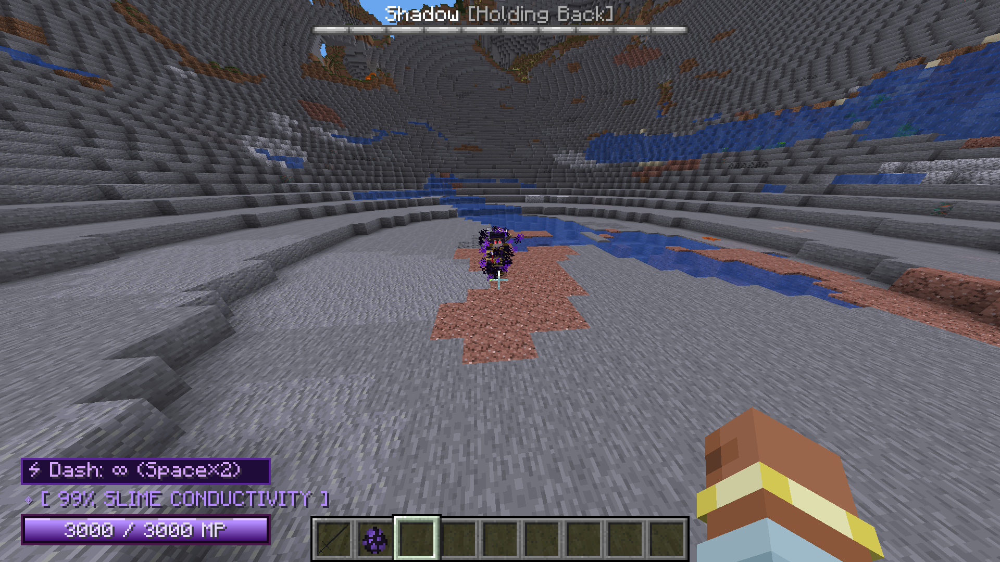
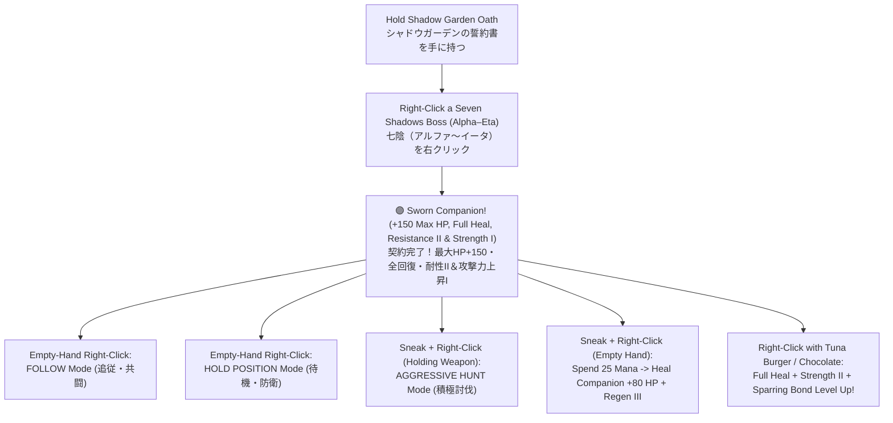

# 06. Bosses, Mastery Ranks & Companions (All 26 Bosses) / 全26体ボス攻略・熟練度ランク・七陰仲間システム

[🏠 Home](Home.md) | [⬅️ Previous: 05. Weapons & Artifacts Arsenal](05-Weapons-and-Artifacts.md) | [➡️ Next: 07. Complete Crafting Recipes](07-Crafting-Recipes.md)

---

## 👑 7.1 Shadow Mastery Rank Progression (Ranks 0–8) / 陰の実力者ランク（熟練度）システム

Defeating the **8 Canon Bosses** (Lord Shadow, Alpha, Beta, Gamma, Delta, Epsilon, Zeta, Eta) permanently records a unique victory flag in your `ManaCapability`. Each unique boss defeated increases your **Shadow Mastery Rank (陰の実力者ランク)** from **Rank 0** up to **Rank 8**, unlocking permanent stat bonuses and **Cosmic Atomic**!
**8体のメインボス（シャドウ＋七陰7名）** をそれぞれ討伐するごとに、プレイヤー固有の討伐フラグが記録され、**熟練度ランク（Rank 0 〜 Rank 8）** が永続的に上昇します。

| Mastery Rank ランク | Unique Bosses Defeated 討伐ボス種類数 | Title / 称号 | Permanent Max Mana Bonus 最大魔力ボーナス | Permanent Regen Bonus 自然回復ボーナス | Slime Sword Base ATK Bonus スライムソード攻撃力上昇 | Special Unlocks / 特別解放要素 |
| :-: | :-: | :--- | :---: | :---: | :---: | :--- |
| **Rank 0** | `0 / 8` | **Novice in the Shadows** (見習い工作員) | `+0` (`100` Base) | `+0.0/s` | `+0.0` (`12.0` ATK) | Standard, All-Range, Recovery & Sword Atomic |
| **Rank 1** | `1 / 8` | **Shadow Initiate** (シャドウガーデン新入隊員) | **`+25`** | **`+0.5/s`** | **`+1.5`** (`13.5` ATK) | Enhanced Slime Dash Through-Slash (`9.5` dmg) |
| **Rank 2** | `2 / 8` | **Numbers Operative** (ナンバーズ級戦闘員) | **`+50`** | **`+1.0/s`** | **`+3.0`** (`15.0` ATK) | Enhanced Slime Wave (`21.0` dmg) |
| **Rank 3** | `3 / 8` | **Named Numbers** (上級ナンバーズ) | **`+75`** | **`+1.5/s`** | **`+4.5`** (`16.5` ATK) | — |
| **Rank 4** | `4 / 8` | **Shadow Sovereign** (七陰級幹部) | **`+100`** | **`+2.0/s`** | **`+6.0`** (`18.0` ATK) | 🌌 **Unlocks Variant 4: `I Am Cosmic Atomic` (`1,250` Damage, `110m` Radius)!** |
| **Rank 5** | `5 / 8` | **Master of Shadows** (闇の支配者) | **`+125`** | **`+2.5/s`** | **`+7.5`** (`19.5` ATK) | — |
| **Rank 6** | `6 / 8` | **Apostle of the Eclipse** (蝕の使徒) | **`+150`** | **`+3.0/s`** | **`+9.0`** (`21.0` ATK) | — |
| **Rank 7** | `7 / 8` | **Eminence Candidate** (陰の実力者候補) | **`+175`** | **`+3.5/s`** | **`+10.5`** (`22.5` ATK) | All Seven Shadows Defeated! |
| **Rank 8** | **`8 / 8`** | **The Eminence in Shadow** (陰の実力者) | **`+200`** *(Total `450` w/ Full Suit!)* | **`+4.0/s`** | **`+12.0`** *(`24.0` Base ATK!)* | Maximum Mastery! Slime Wave deals `36.0` dmg; Overdrive Thrust deals `54.0` dmg! |

---

## 🌑 9.1 The Ultimate Boss: Lord Shadow (`eminence_shadow:shadow_boss`) / 最高難度ボス：シャドウ

Summoned with the **Shadow Resonance Crystal (`shadow_spawner`)**, **Lord Shadow** is a 4-phase raid boss featuring custom animations, dynamic dialogue, teleportation combos, and his own **"I Am Atomic"** chant that you must interrupt or escape!
**シャドウ共鳴結晶 (`shadow_spawner`)** で召喚される本作最強の4フェーズ制レイドボスです。

### Base Stats / 基本ステータス
- **Max HP**: **`600.0 HP`** (`300 Hearts`) | **Armor**: **`16.0`** (`+8.0 Toughness`)
- **Base Attack Damage**: **`18.0`** | **Movement Speed**: **`0.38`** | **Knockback Resistance**: **`0.85`**
- **Guaranteed Drops / 確定ドロップ**:
  - **Shadow's Slime Core (`shadow_core`) × 2–3**
  - **Shadow Garden Oath (`shadow_garden_oath`) × 1**
  - **Eye of Avarice (`eye_of_avarice`) × 1** (35% chance)
  - **Mitsugoshi Supreme Tuna Burger × 2**

### 4-Phase Progression & Combat Guide / 全4フェーズの行動パターンと攻略法

| Phase / フェーズ | HP Threshold / 移行HP | Aura & Buffs / 状態変化 | Signature Attacks & Counterplay / 使用スキルと対策（カウンター法） |
| :---: | :---: | :--- | :--- |
| **Phase 1** *The Unseen Blade* 静かなる闇の刃 | **`100%` – `75%`** (`600` – `450 HP`) | Standard Purple Mana Aura | • **Shadow Step Slash**: Teleports behind you (`45t` CD) and slashes for `18.0` damage. **Counter**: Watch for purple flash particles and press **`C` (Just Parry)** for `+35 Posture`! • **Slime Crescent Wave**: Fires a ranged mana wave (`16.0` dmg). Dodge sideways with **`V` (Slime Dash)**. |
| **Phase 2** *Overdrive Awakening* 魔力解放・加速 | **`75%` – `45%`** (`450` – `270 HP`) | **Speed II + Strength I** Restores `30 HP` on transition | • **Triple Phantom Blitz**: Chains 3 consecutive teleport slashes around you (`14.0` dmg each). Hold **`C` (Slime Guard)** or dash outside his `8m` lock-on ring. • **Crowbar Overdrive Slam**: Leaps high and slams the ground (`6m` AoE, `22.0` dmg + `[EXPOSED]`). Jump or dash away as he ascends! |
| **Phase 3** *The Atomic Chant* 『I am Atomic』詠唱開始 | **`45%` – `20%`** (`270` – `120 HP`) | **Resistance II + Speed II** Summons Geometric Magic Dome | • ⚠️ **BOSS ATOMIC CHANT (`100 ticks / 5.0 seconds`)**: Shadow floats into the air, surrounds the arena with purple magic circles, and chants *"I am... Atomic."* If completed, it deals **`120.0` AoE Damage** within `28 blocks`! • **HOW TO INTERRUPT (詠唱阻止ギミック)**: Deal **`>= 45.0` total damage** to Shadow during the `5.0s` chant OR trigger a **Posture Break / `[SILENCED]` (Eta's Wrench / Eye of Avarice)**! Interrupting the chant shatters his dome, deals **`35.0` backlash damage** to Shadow, and stuns him with **`[EXPOSED]` for `100 ticks` (`5.0s`)**! |
| **Phase 4** *True Eminence in Shadow* 真・陰の実力者（最終形態） | **`< 20%`** (`120` – `0 HP`) | **Strength II + Speed III + Resistance II** Continuous Lightning & Soul Fire Aura | • **All-Range Sword Rain**: Periodically rains mana blades around the arena while chaining rapid teleport slashes. Save your own **`G` ("I Am Atomic" — Sword Atomic or Standard Atomic)** or **Eye of Avarice Overload** to finish him during a Parry/Posture Break window! |

---

## 🌙 9.2 The Seven Shadows & John Smith (8 Canon Bosses) / 七陰＆ジョン・スミス（8体）ステータス・報酬一覧

All 7 members of the Seven Shadows and Super Elite Agent **John Smith** have their own **Resonance Crystals**, custom AI combat cycles, signature phase transitions at `50% HP`, and unique weapon drops.
さらに、**七陰の7名（アルファ〜イータ）は討伐時に必ず『シャドウガーデンの誓約書 (`shadow_garden_oath`)』をドロップし、討伐後または召喚時に右クリックで味方コンパニオンとして勧誘することも可能です！**

| Boss Name / ボス名 (`Entity ID`) | Summon Item / 召喚アイテム | Max HP / 体力 (Armor) | Base ATK (Speed) | Signature Skills & Mechanics / 固有スキルと特徴 | Guaranteed Drops / 確定ドロップ報酬 |
| :--- | :--- | :---: | :---: | :--- | :--- |
| **Alpha (First Seat)** 七陰第一席 アルファ `alpha_boss` | `alpha_spawner` | **`450 HP`** (`14 Armor`) | **`16.0`** (`0.37`) | **Mist Flash Teleport**, **Golden Crescent Wave (`22.0` dmg)**, and **Commander's Aura** (`50% HP`: Speed II + Strength II + `[EXPOSED]` counter-slashes). | • **Alpha's Slime Blade (`alpha_blade`)** • **Shadow Garden Oath × 1** • **Shadow's Slime Core × 1–2** |
| **Beta (Second Seat)** 七陰第二席 ベータ `beta_boss` | `beta_spawner` | **`380 HP`** (`10 Armor`) | **`14.0`** (`0.35`) | **Evasive Backstep Shot**, **5-Arrow Starlight Fan Barrage**, and **Chronicle Arrow Rain** (`8m` AoE zone + Slowness III). Keeps optimal distance (`10–18m`). | • **Beta's Magic Bow (`beta_bow`)** • **Shadow Garden Oath × 1** • **Shadow's Slime Core × 1** |
| **Gamma (Third Seat)** 七陰第三席 ガンマ `gamma_boss` | `gamma_spawner` | **`420 HP`** (`12 Armor`) | **`15.0`** (`0.33`) | **Catastrophic Trip Slam**: Sprints toward you and trips into a massive **`32.0` Damage AoE explosion** + **`[CONDUCTIVE]`**! Also throws explosive Mitsugoshi gold coins. | • **Gamma's Slime Sword (`gamma_sword`)** • **Shadow Garden Oath × 1** • **Mitsugoshi Chocolate × 2** |
| **Delta (Fourth Seat)** 七陰第四席 デルタ `delta_boss` | `delta_spawner` | **`480 HP`** (`12 Armor`) | **`19.0`** (`0.39`) | **Relentless Beast Leap** (`6m` ground slam + **`[BLEED]`**), **Feral Roar (Strength II + Speed III at `50% HP`)**, and life-steal on bleeding targets. *Tip: Use Just Parry (`C`) against her telegraph leap!* | • **Delta's Feral Greatsword (`delta_greatsword`)** • **Shadow Garden Oath × 1** • **Mitsugoshi Tuna Burger × 2** |
| **Epsilon (Fifth Seat)** 七陰第五席 イプシロン `epsilon_boss` | `epsilon_spawner` | **`390 HP`** (`13 Armor`) | **`14.5`** (`0.36`) | **Triple Converging Mana Waves**, **99% Slime Barrier** (gains `Absorption IV` at `60%` & `30%` HP), and precision ranged/melee stance switching. | • **Epsilon's Slime Conductor (`epsilon_blade`)** • **Shadow Garden Oath × 1** • **Shadow's Slime Core × 1** |
| **Zeta (Sixth Seat)** 七陰第六席 ゼータ `zeta_boss` | `zeta_spawner` | **`370 HP`** (`10 Armor`) | **`15.5`** (`0.41`) | **Stealth Invisibility Ambush**, **Backstab Critical (`1.8x` dmg + `[BLEED]`)**, and **Blindness Smoke Bomb**. *Tip: Inflict `[FROSTBITE]` or Glowing (Beta's Bow) to track her through stealth!* | • **Zeta's Beast Claw (`zeta_claw`)** • **Shadow Garden Oath × 1** • **Shadow's Slime Core × 1** |
| **Eta (Seventh Seat)** 七陰第七席 イータ `eta_boss` | `eta_spawner` | **`360 HP`** (`12 Armor`) | **`13.5`** (`0.32`) | **EMP Silence Pulse** (temporarily increases player skill cooldowns & applies **`[SILENCED]`**), **Gravity Pull Singularity**, and self-repair regeneration drone phase. | • **Eta's Mad Wrench (`eta_wrench`)** • **Shadow Garden Oath × 1** • **Eye of Avarice (25% chance)** |
| **John Smith** 超エリート工作員 ジョン・スミス `john_smith_boss` | `john_smith_spawner` | **`500 HP`** (`15 Armor`) | **`17.0`** (`0.38`) | **Monofilament Steel Thread Web** (`10m` AoE pull + Slowness IV + **`[BLEED]`**), **Wire Counter-Trap**, and **Banknote Hurricane Slash**. | • **John Smith's Monofilament Gloves (`john_smith_gloves`)** • **Shadow's Slime Core × 2** |

---

## ⚔️ 9.3 Kagemasu, Heroes, Blood Queen & Cult of Diabolos Bosses (17 Bosses) / カゲマス・英雄・魔人・教団ボス一覧（全17体）

All 17 additional bosses are implemented via `KagemasuBossEntity` with unique **Fighting Archetypes**, **Elemental/Mark Weaknesses (`+35%` Weakness Damage & `+25` Bonus Posture Damage when hit with their weakness!)**, and dedicated weapon or core drops.

| # | Boss Name / ボス名 | Entity / Spawner ID | Max HP (Armor) | Base ATK | Combat Archetype / 戦闘AI型 | Weakness (Deals `+35%` Dmg & `+25` Posture) | Signature Drop / 固有ドロップ |
| :-: | :--- | :--- | :---: | :---: | :---: | :---: | :--- |
| **1** | **Hero Olivier** 英雄オリヴィエ | `olivier_boss` `olivier_spawner` | **`520 HP`** (`16 Armor`) | **`18.0`** | **Vanguard Sword Saint** (High-speed dash slashes & holy azure waves) | **`[VOIDMARK]` / `[BLEED]`** | **Olivier's Hero Sword (`olivier_sword`)** + Core × 2 |
| **2** | **Calamity Witch Aurora** 厄災の魔女アウロラ | `aurora_boss` `aurora_spawner` | **`540 HP`** (`14 Armor`) | **`18.5`** | **Blood Calamity Caster** (Erupting blood spears, `[BLEED]` stacks & life drain) | **`[FROSTBITE]` / `[SILENCED]`** | **Aurora's Violet Spear (`aurora_spear`)** + Core × 2 |
| **3** | **Blood Queen Elisabeth** 血の女王エリザベート | `elisabeth_boss` `elisabeth_spawner` | **`500 HP`** (`13 Armor`) | **`17.5`** | **Crimson Reaper** (Wide scythe sweeps, bat swarm teleport & vampiric heal) | **`[CONDUCTIVE]` / `[SILENCED]`** | **Blood Queen's Scythe (`blood_queen_scythe`)** + Core × 2 |
| **4** | **Mist Dragon** 霧の竜（ミストドラゴン） | `mist_dragon_boss` `mist_dragon_spawner` | **`580 HP`** (`18 Armor`) | **`19.5`** | **Immortal Elder Dragon** (`16m` poison mist breath, `[VOIDMARK]` & high toughness) | **`[EXPOSED]` / Atomic Magic** | **Mist Dragon Blade (`mist_dragon_blade`)** + Core × 2 |
| **5** | **War Goddess Beatrix** 武神ベアトリクス | `beatrix_boss` `beatrix_spawner` | **`460 HP`** (`14 Armor`) | **`17.0`** | **Speed Blade Master** (4-hit gale combos, parry counter-stance & `[FROSTBITE]`) | **`[BLEED]` / `[CONDUCTIVE]`** | **Beatrix's Elven Blade (`beatrix_blade`)** + Burger × 2 |
| **6** | **Princess Iris Midgar** アイリス・ミドガル王女 | `iris_boss` `iris_spawner` | **`440 HP`** (`15 Armor`) | **`16.5`** | **Flame Berserker** (8m inferno eruption slams, fire aura & high posture pressure) | **`[FROSTBITE]` / Just Parry** | **Iris's Crimson Broadsword (`iris_broadsword`)** + Core × 1 |
| **7** | **Princess Alexia Midgar** アレクシア・ミドガル王女 | `alexia_boss` `alexia_spawner` | **`380 HP`** (`12 Armor`) | **`14.5`** | **Royal Duelist** (Precision thrusts, counter-parry window & `[FROSTBITE]`) | **`[EXPOSED]` / `[VOIDMARK]`** | **Alexia's Royal Rapier (`alexia_rapier`)** + Chocolate × 2 |
| **8** | **Rose Oriana (No. 666)** ローズ・オリアナ（666番） | `rose_boss` `rose_spawner` | **`400 HP`** (`13 Armor`) | **`15.0`** | **Golden Fencer** (Petal flurry thrusts, `[SILENCED]` & Royal Resolve shield) | **`[BLEED]` / `[EXPOSED]`** | **Rose's Royal Rapier (`rose_rapier`)** + Oath × 1 |
| **9** | **Victoria (No. 559)** ヴィクトリア（559番） | `victoria_boss` `victoria_spawner` | **`440 HP`** (`14 Armor`) | **`16.5`** | **Fanatic Saint** (Cross-wave projectiles, `[BLEED]` & self-healing devotion) | **`[SILENCED]` / `[VOIDMARK]`** | **Victoria's Rose Blade (`victoria_blade`)** + Oath × 1 |
| **10** | **Claire Kagenou** クレア・カゲノー | `claire_boss` `claire_spawner` | **`390 HP`** (`12 Armor`) | **`15.0`** | **Crimson Binder** (Magic chain bind AoE, `[SILENCED]` & Aurora resonance) | **`[FROSTBITE]` / `[EXPOSED]`** | **Claire's Crimson Rapier (`claire_rapier`)** + Core × 1 |
| **11** | **Spirit Fox Yukime** 白狐ユキメ | `yukime_boss` `yukime_spawner` | **`410 HP`** (`11 Armor`) | **`15.0`** | **Illusion Frost Caster** (Blizzard cyclone, `[FROSTBITE]` & mirage blink) | **`[CONDUCTIVE]` / Fire** | **Yukime's Nine-Tailed Fan (`yukime_fan`)** + Core × 1 |
| **12** | **Crimson (Red Tower)** 紅蓮の獅子クリムゾン | `crimson_boss` `crimson_spawner` | **`420 HP`** (`13 Armor`) | **`16.0`** | **Savage Claw Brawler** (Rapid flame claw combos & `[BLEED]`) | **`[FROSTBITE]` / `[EXPOSED]`** | **Crimson's Lion Claws (`crimson_claws`)** + Core × 1 |
| **13** | **Tyrant Juggernaut** 暴君ジャガーノート | `juggernaut_boss` `juggernaut_spawner` | **`450 HP`** (`15 Armor`) | **`17.5`** | **Heavy Cleaver Brute** (Earthshatter AoE slam & massive posture damage) | **`[CONDUCTIVE]` / `[VOIDMARK]`** | **Juggernaut's Tyrant Cleaver (`juggernaut_cleaver`)** + Core × 1 |
| **14** | **Instructor Lambda** 鬼教官ラムダ | `lambda_boss` `lambda_spawner` | **`410 HP`** (`13 Armor`) | **`15.5`** | **Tactical Whip Master** (Wide 8.5m lightning whip sweeps, `[CONDUCTIVE]` & `[EXPOSED]`) | **`[SILENCED]` / `[FROSTBITE]`** | **Lambda's Tactical Whip-Blade (`lambda_whip`)** + Oath × 1 |
| **15** | **Nu (No. 13)** ニュー（13番） | `nu_boss` `nu_spawner` | **`380 HP`** (`12 Armor`) | **`14.5`** | **Disguise Assassin** (Shadow step ambushes, throwing daggers & `[BLEED]`) | **`[CONDUCTIVE]` / `[EXPOSED]`** | **Shadow's Slime Core × 2** + **Shadow Garden Oath × 1** |
| **16** | **Chi (No. 22) & Omega (No. 24)** カイ＆オメガ（またはシェリー／アンネローゼ等） | `chi_boss` / `omega_boss` `chi_spawner` / `omega_spawner` | **`390 HP`** (`12 Armor`) | **`15.0`** | **Numbers Striker** (Sonic blade dashes / Twin-blade `[EXPOSED]` flurries) | **`[SILENCED]` / `[FROSTBITE]`** | **Shadow's Slime Core × 2** + **Mitsugoshi Treats** |
| **17** | **Cult Knights & Rounds (Mordred / Nelson / Fenrir / Zenon / Rex / Lutheran)** ディアボロス教団幹部・ラウンズ | `mordred_boss`, `fenrir_boss`, `zenon_boss`, etc. | **`400`–`520 HP`** (`13`–`16 Armor`) | **`15.0`–`18.5`** | **Cult of Diabolos Executives** (Artifact barriers, magic waves & berserk phases) | **`[VOIDMARK]` / `[EXPOSED]` / Recovery Atomic** | **Eye of Avarice (`eye_of_avarice`)** + **Shadow's Slime Core × 2–3** |

---

## 🤝 10. Shadow Garden Companion System (`ShadowGardenOathItem`) / 七陰コンパニオン（仲間・共闘）システム

You can recruit **any of the Seven Shadows (Alpha, Beta, Gamma, Delta, Epsilon, Zeta, Eta)** as a permanent, immortal-capable AI companion!
**『シャドウガーデンの誓約書 (`shadow_garden_oath`)』** を使用することで、**七陰の7名（アルファ〜イータ）** をあなたの忠実な味方コンパニオンとして勧誘し、共に戦わせることができます！

### Companion Controls & Features / 仲間操作と絆システム一覧

| Interaction / 操作方法 | Effect / 機能詳細 |
| :--- | :--- |
| **1. Recruiting a Companion** 勧誘（契約）する | Hold **Shadow Garden Oath (`shadow_garden_oath`)** and **Right-Click** any Seven Shadows entity (**Alpha, Beta, Gamma, Delta, Epsilon, Zeta, or Eta**). Consumes 1 Oath (unless in Creative), permanently binds them to you, increases their **Max HP by `+150.0`**, heals them to 100%, and switches their AI from Boss to **Sworn Companion**! |
| **2. Cycle AI Orders (`FOLLOW` ⇄ `HOLD`)** 追従／待機モード切替 | **Right-Click** your companion with an **Empty Hand** (Not Crouching) to toggle between: • **`[FOLLOWING LORD SHADOW]` (追従・護衛モード)**: Teleports to you if `> 20 blocks` away and attacks anything you attack or anything that attacks you. • **`[HOLDING POSITION]` (拠点待機モード)**: Guards their current spot without following. |
| **3. Toggle `AGGRESSIVE HUNT` Mode** 積極討伐モード | **Sneak + Right-Click** your companion while holding any **Weapon** to order **`[AGGRESSIVE HUNT]`**: they actively scan and eliminate all hostile mobs and non-allied bosses within **`24 blocks`**. |
| **4. Mana Infusion Heal (`25 Mana`)** 魔力譲渡による回復 | **Sneak + Right-Click** your companion with an **Empty Hand**: consumes **`25 Mana`** to immediately restore **`+80.0 HP`** to your companion and grant them **Regeneration III (`5s`) + Resistance II (`10s`)**. |
| **5. Friendly Fire Protection & Recovery Atomic** 同士討ち完全無効＆リカバリー対応 | Your attacks, weapon skills, and **Standard / All-Range / Sword / Cosmic Atomic NEVER harm your sworn companions**! Casting **Recovery Atomic** heals all sworn companions within `48m` to **100% HP** and buffs them with **Absorption IV + Regeneration IV**! |
| **6. Gifting Mitsugoshi Food & Sparring Bond** 三越グルメのプレゼント＆手合わせ絆強化 | **Right-Click** your companion with a **Mitsugoshi Supreme Tuna Burger** or **Mitsugoshi Artisanal Chocolate**: restores **`+120 HP`**, triggers unique voiced/chat gratitude lines (especially **Delta** with burgers and **Gamma/Epsilon** with chocolate!), grants **Strength II + Speed II (`60s`)**, and permanently increases their **Companion Bond Level** (`+2.0 Base ATK` and `+40 Max HP` per Bond rank!). |
| **7. Multi-Member Party Banter** 七陰同士の掛け合い会話 | When 2 or more sworn Seven Shadows are near you (e.g., **Alpha & Delta**, **Beta & Epsilon**, **Gamma & Eta**, **Delta & Zeta**), they periodically exchange lore-accurate dialogue lines in chat! |

---

[🏠 Home](Home.md) | [⬅️ Previous: 05. Weapons & Artifacts Arsenal](05-Weapons-and-Artifacts.md) | [➡️ Next: 07. Complete Crafting Recipes](07-Crafting-Recipes.md)
