# 08. Advancements, `/mana` Commands, Config & Technical Architecture

🌐 **Language / 言語切替**: **[🇯🇵 日本語版はこちら](08-Commands-Config-and-Advancements.md)** ｜ **🇺🇸 English (Current)**

[⬅ Prev: 07. All 51 Crafting Recipes](07-Crafting-Recipes-EN.md) ｜ [🏠 English Wiki Home](Home-EN.md)

---

## 1. Advancements Reference (13 Gameplay + 5 Recipe Unlock Advancements)

### 1.1 Main Gameplay Advancement Tree (13 Advancements)

```mermaid
flowchart LR
    Root["The Eminence in Shadow<br/>(root)"] --> Suit["99% Mana Conductivity<br/>(slime_suit)"]
    Suit --> Parry["Read Like an Open Book<br/>(posture_break)"]
    Suit --> Eta["Deconstruction Denied<br/>(eta_defeat)"]
    Eta --> Gamma["Mitsugoshi Implosion<br/>(gamma_defeat)"]
    Gamma --> Beta["Counter-Snipe Mastery<br/>(beta_defeat)"]
    Beta --> Epsilon["Silencing the Moonlight<br/>(epsilon_defeat)"]
    Epsilon --> Zeta["Catching the Phantom<br/>(zeta_defeat)"]
    Zeta --> Delta["Taming the Red Wolf<br/>(delta_defeat)"]
    Delta --> Alpha["Surpassing the First Seat<br/>(alpha_defeat)"]
    Alpha --> Complete["Conqueror of the Seven Shadows<br/>(seven_shadows_complete)"]
    Complete --> Shadow["The Pinnacle of Shadow<br/>(shadow_defeat)"]
    Shadow --> Atomic["I am Atomic.<br/>(i_am_atomic)"]
```

| Advancement ID | Title (EN / JA) | Unlock Condition | Frame Type |
| :--- | :--- | :--- | :---: |
| `root` | **The Eminence in Shadow** / *陰の実力者になりたくて！* | Equip at least 1 piece of the Slime Bodysuit | Task |
| `slime_suit` | **99% Mana Conductivity** / *魔力伝導率 99%* | Equip all 4 pieces of the Slime Bodysuit simultaneously | Goal |
| `posture_break` | **Read Like an Open Book** / *見切った……そこが隙だ* | Shatter a boss's posture using a Just-Guard Parry | Goal |
| `eta_defeat` | **Deconstruction Denied** / *第七席の解析突破* | Defeat 7th Seat Eta | Task |
| `gamma_defeat` | **Mitsugoshi Implosion** / *ミツゴシの暴走を鎮めて* | Defeat 3rd Seat Gamma | Task |
| `beta_defeat` | **Counter-Snipe Mastery** / *精密魔導狙撃の打破* | Defeat 2nd Seat Beta | Task |
| `epsilon_defeat` | **Silencing the Moonlight** / *蒼月の旋律を断ち切る* | Defeat 5th Seat Epsilon | Task |
| `zeta_defeat` | **Catching the Phantom** / *影猫の闇を見破る者* | Defeat 6th Seat Zeta | Task |
| `delta_defeat` | **Taming the Red Wolf** / *狂乱の紅狼を制す力* | Defeat 4th Seat Delta | Task |
| `alpha_defeat` | **Surpassing the First Seat** / *七陰第一席を超えし者* | Defeat 1st Seat Alpha | Challenge |
| `seven_shadows_complete` | **Conqueror of the Seven Shadows** / *七陰全席制覇* | Defeat all 7 members of the Seven Shadows | Challenge |
| `shadow_defeat` | **The Pinnacle of Shadow** / *陰の頂き――さらなる深淵へ* | Defeat Lord Shadow | Challenge |
| `i_am_atomic` | **I am Atomic.** / *I am Atomic.* | Cast and detonate any *"I am Atomic."* ultimate art yourself | Challenge |

### 1.2 Automatic Recipe Book Unlock Advancements (5 Advancements Covering All 51 Recipes)
Stored under `data/eminence_shadow/advancements/recipes/`, automatically unlocking recipes in the vanilla Recipe Book when you obtain their key materials:
- `slime_core_recipes`: Obtaining a `Slimeball` unlocks the 4 Slime Bodysuit pieces + 8 canon boss resonators (12 recipes)
- `starter_weapons`: Obtaining an `Iron Ingot` unlocks early-game weapons and tools (*Mithril Sword*, *Trusted Crowbar*, *Plain Sword*, etc. — 7 recipes)
- `amethyst_and_kagemasu_resonators`: Obtaining an `Amethyst Shard` unlocks *Shadow's Encrypted Memo*, *Archetype Shadow Blade*, and all 18 Kagemasu/Cult resonators (19 recipes)
- `netherite_relic_weapons`: Obtaining a `Netherite Ingot` unlocks the 11 Three Heroes, Witch, Blood Queen & Cult Executive weapons (11 recipes)
- `mitsugoshi_treats`: Obtaining `Cocoa Beans` unlocks *Mitsugoshi Special Chocolate* & *Mitsugoshi Roasted Blend Coffee* (2 recipes)

---

## 2. `/mana` Command Reference

| Command Syntax | Required OP Level | Function & Output |
| :--- | :---: | :--- |
| `/mana get` | Level `0` (All Players) | Displays your current MP / Max MP, current Mana Conductivity (`%`), and effective natural regeneration rate (`MP/s`). |
| `/mana fill` | Level `2` (OP) | Instantly refills the executing player's current MP to 100% of Max MP. |
| `/mana set <amount>` | Level `2` (OP) | Sets the executing player's current MP to the specified value (`0.0 – MaxMP`). |
| `/mana max <amount>` | Level `2` (OP) | Sets the executing player's base Max MP (`>= 10.0`, before Slime Suit, weapon resonance, and Rank bonuses). |
| `/mana regen <rate>` | Level `2` (OP) | Sets the executing player's base natural MP regeneration rate (`MP/s`, `>= 0.0`). |

---

## 3. Configuration File (`config/eminence_shadow-common.toml`)

| Config Key | Type | Default | Valid Range | Detailed Description |
| :--- | :---: | :---: | :---: | :--- |
| `blastRadius` | Int | `100` | `8 – 100` | Explosion and crater radius (in blocks) of standard `I am Atomic.`. *All-Range Atomic* scales to 125% of this value (up to `125`, hard-capped at `127`). |
| `expandSpeed` | Double | `1.0` | `0.1 – 4.0` | Number of blocks the `I am Atomic.` singularity dome expands per tick (`1.0` = 1 radial shell per tick). |
| `blastDamage` | Double | `5000.0` | `0.0 – 1000000.0` | Baseline Atomic damage scaling anchor (`config / 5000.0` scales Normal=`5,000`, All-Range=`7,500`, Catastrophe=`6,400`, and Archetype=`3,600`; default `5000.0` = `1.0×`). |
| `destroyBlocks` | Boolean | `true` | `true / false` | Whether destructive `I am Atomic.` modes vaporize terrain blocks (`false` makes all modes non-destructive; also respects gamerule `mobGriefing = false`). |
| `blocksPerTick` | Int | `40000` | `100 – 500000` | **Maximum blocks removed per tick** during crater generation. Lower to `10000–20000` on low-spec servers to cap per-tick MSPT. |
| `cooldownTicks` | Int | `600` | `0 – 72000` | Cooldown after casting `I am Atomic.` (`600 ticks = 30.0s`; enforces a `40-tick` safety floor to protect servers). |
| `casterImmune` | Boolean | `true` | `true / false` | Whether the caster is immune to their own `I am Atomic.` blast (Recovery is always caster-safe, and active Resistance V chant protection takes priority). |
| `fastCraterMode` | Boolean | `true` | `true / false` | Suppresses block item drops (`UPDATE_SUPPRESS_DROPS`) during crater vaporization and omitscascading neighbor updates (`UPDATE_NEIGHBORS`) to prevent lag spikes while preserving lighting integrity. |
| `crossModNonPlayerScale` | Double | `3.0` | `1.0 – 20.0` | Outgoing damage multiplier when Lord Shadow, the Seven Shadows, or Slime Drones attack **non-player entities (Warden, Wither, bosses from other mods)**. |
| `bossPowerMultiplier` | Double | `1.0` | `0.5 – 10.0` | Global multiplier applied to the Max HP and Attack Damage of hostile bosses. |
| `bossSingleHitDamageCapRatio` | Double | `0.20` | `0.0 – 1.0` | Maximum fraction of a boss's Max HP that a single non-*Atomic* hit can deal (default `0.20 = 20%`, relaxed by `1.4×` to `28%` during Posture Break; set `0.0` to remove cap). |
| `challengeModdedBosses` | Boolean | `true` | `true / false` | Whether hostile Shadow Garden bosses proactively seek out and fight high-HP modded bosses and monsters nearby. |
| `clientAuraDensity` | Double | `1.0` | `0.0 – 2.0` | Client-side ambient mana aura particle density multiplier (`0.0` disables ambient aura particles). |

---

## 4. `v1.0.6` Multiplayer Optimization & Technical Architecture

1. **Asynchronous Slice Precomputation & Lock-Free Fast-Paths (`SphereDestroyer` & `DirectionalDestroyer`)**:
   - Precomputes and caches radial block offset slices on a background `CompletableFuture` thread as soon as chanting starts, skipping empty 16×16×16 `LevelChunkSection` regions to prevent TPS drops.
   - `v1.0.6` introduces a `volatile` lock-free fast-path (`allDone` / `finished`) once crater excavation finishes, eliminating `synchronized` monitor lock contention on the server thread during the aftermath phase.
2. **100%-Fidelity Trigonometric LUTs & Zero-Allocation 3D Physics (`v1.0.6`)**:
   - `AtomicBlastRenderer`: Static precomputed Look-Up Tables for the `32×48` unit sphere mesh, `16×40` geodesic dome meridian ribs, `48`-segment rings, and `16` perimeter pylons eliminate ~10,000+ `Math.sin` / `Math.cos` calls per frame while preserving 100% identical visual output.
   - `ShadowCoatModel` (`PanelRippleScratch`) & `YukimeAttireModel` (`KitsuneTailScratch`): Reuses zero-allocation scratch structs for the 3-joint 9-panel coat skirt and 36-part (9 tails × 4 segments) Kitsune tail animations, eliminating per-frame heap allocations and GC pressure.
3. **Multiplayer S2C Batch Packet Networking (`ParticleFxPayload` & `SyncEntityMarksPayload`)**:
   - Batches geometric particle rings, shockwaves, and laser lines into compact S2C payloads expanded on the client, and packs all 7 Combat Marks into a single `int` bitmask synchronized only on state change.
4. **Procedural Audio Synthesis & Copyright-Clean Engineering**:
   - Contains zero ripped audio assets—all sound effects are procedurally synthesized in real time by layering pitch- and phase-controlled vanilla sound events.

---

[⬅ Prev: 07. All 51 Crafting Recipes](07-Crafting-Recipes-EN.md) ｜ [🏠 English Wiki Home](Home-EN.md) ｜ [🇯🇵 日本語版はこちら](08-Commands-Config-and-Advancements.md)
