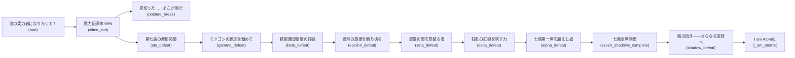

# 08. 進捗・コマンド・コンフィグ＆技術仕様（Advancements, Commands & Config）

🌐 **言語切替 / Language**: **🇯🇵 日本語 (現在)** ｜ **[🇺🇸 Read in English](08-Commands-Config-and-Advancements-EN.md)**

[⬅ 前章：07. 全51種 クラフトレシピ一覧](07-Crafting-Recipes.md) ｜ [🏠 日本語 Wiki ホーム](Home.md)

---

## 1. 進捗（Advancements）一覧（ゲームプレイ13種 ＋ レシピ解放5種）

### 1.1 メイン進捗ツリー（13種）

| 進捗ID | タイトル（日 / 英） | 達成条件 | フレーム種別 |
| :--- | :--- | :--- | :---: |
| `root` | **陰の実力者になりたくて！** / *The Eminence in Shadow* | スライムスーツを1部位以上着用する | Task |
| `slime_suit` | **魔力伝導率 99%** / *99% Mana Conductivity* | スライムスーツ4部位をフル装備する | Goal |
| `posture_break` | **見切った……そこが隙だ** / *Read Like an Open Book* | ジャストガード・パリィでボスの体勢を崩す | Goal |
| `eta_defeat` | **第七席の解析突破** / *Deconstruction Denied* | 第七席「イータ」を撃破する | Task |
| `gamma_defeat` | **ミツゴシの暴走を鎮めて** / *Mitsugoshi Implosion* | 第三席「ガンマ」を撃破する | Task |
| `beta_defeat` | **精密魔導狙撃の打破** / *Counter-Snipe Mastery* | 第二席「ベータ」を撃破する | Task |
| `epsilon_defeat` | **蒼月の旋律を断ち切る** / *Silencing the Moonlight* | 第五席「イプシロン」を撃破する | Task |
| `zeta_defeat` | **影猫の闇を見破る者** / *Catching the Phantom* | 第六席「ゼータ」を撃破する | Task |
| `delta_defeat` | **狂乱の紅狼を制す力** / *Taming the Red Wolf* | 第四席「デルタ」を撃破する | Task |
| `alpha_defeat` | **七陰第一席を超えし者** / *Surpassing the First Seat* | 第一席「アルファ」を撃破する | Challenge |
| `seven_shadows_complete` | **七陰全席制覇** / *Conqueror of the Seven Shadows* | 七陰7名全員をすべて撃破する | Challenge |
| `shadow_defeat` | **陰の頂き――さらなる深淵へ** / *The Pinnacle of Shadow* | 陰の実力者「シャドウ」を撃破する | Challenge |
| `i_am_atomic` | **I am Atomic.** / *I am Atomic.* | 自らの手で究極奥義『I am Atomic.』系を発動・解放する | Challenge |

### 1.2 レシピブック自動解放進捗（5種 / 全51レシピ網羅）
`data/eminence_shadow/advancements/recipes/` に格納され、対応素材の入手時にバニラのレシピブックへ自動解放されます：
- `slime_core_recipes`: スライムボール入手でスライムスーツ4部位＋正典8ボス共鳴核（計12種）を解放
- `starter_weapons`: 鉄インゴット入手で序盤武器・道具（ミスリルの剣、バール、地味な剣等 7種）を解放
- `amethyst_and_kagemasu_resonators`: アメジストの欠片入手で暗号メモ・開闢剣・カゲマス＆教団共鳴核18種等（計19種）を解放
- `netherite_relic_weapons`: ネザライトインゴット入手で三英雄・教団幹部等の上位武器（11種）を解放
- `mitsugoshi_treats`: カカオ豆入手でミツゴシ特製チョコレート＆ブレンド珈琲（2種）を解放

---

## 2. `/mana` コマンド一覧

| コマンド構文 | 必要OP権限 | 機能・出力内容 |
| :--- | :---: | :--- |
| `/mana get` | レベル `0`（全員可） | 現在のMP / 最大MP、現在の魔力伝導率（`%`）、実効自然回復速度（`MP/s`）を表示します。 |
| `/mana fill` | レベル `2`（OP） | 実行プレイヤーの現在MPを最大値まで即座に100%全回復します。 |
| `/mana set <amount>` | レベル `2`（OP） | 実行プレイヤーの現在MPを指定値（`0.0 〜 MaxMP`）に設定します。 |
| `/mana max <amount>` | レベル `2`（OP） | 実行プレイヤーの基礎最大MPを指定値（`>= 10.0`）に変更します（その上にスーツ・武器・Rankボーナスが加算されます）。 |
| `/mana regen <rate>` | レベル `2`（OP） | 実行プレイヤーの基礎MP自然回復速度（`MP/秒`、`>= 0.0`）を変更します。 |

---

## 3. コンフィグ設定（`config/eminence_shadow-common.toml`）

| 設定キー | 型 | デフォルト値 | 許容範囲 | 詳細説明 |
| :--- | :---: | :---: | :---: | :--- |
| `blastRadius` | Int | `100` | `8 〜 100` | 通常『I am Atomic.』の爆発・消滅半径（ブロック数）。*All-Range Atomic* はこの値の125%（最大 `125`、ハードキャップ `127`）になります。 |
| `expandSpeed` | Double | `1.0` | `0.1 〜 4.0` | 『I am Atomic.』の球体ドームが1 tickあたりに膨張するブロック数（`1.0` = 1 tickに1層ずつ消去）。 |
| `blastDamage` | Double | `5000.0` | `0.0 〜 1000000.0` | 基準アトミックダメージ倍率の基準値（`config / 5000.0` 倍が Normal=`5,000` / All-Range=`7,500` / Catastrophe=`6,400` / Archetype=`3,600` に掛かる。デフォルト `5000.0` で 1.0倍）。 |
| `destroyBlocks` | Boolean | `true` | `true / false` | 『I am Atomic.』でブロックを消去するかどうか（`false` で全形態非破壊。ゲームルール `mobGriefing` が `false` の場合も破壊されません）。 |
| `blocksPerTick` | Int | `40000` | `100 〜 500000` | クレーター生成時に **1 tickあたりに消去する最大ブロック数**。低スペックサーバーでMSPT負荷を抑えたい場合は `10000〜20000` へ調整可能。 |
| `cooldownTicks` | Int | `600` | `0 〜 72000` | 『I am Atomic.』発動後のクールダウン時間（`600 ticks = 30.0秒`。サーバー保護のため実効下限 `40 ticks` が適用されます）。 |
| `casterImmune` | Boolean | `true` | `true / false` | 術者自身が自分の放った『I am Atomic.』のダメージを受けないかどうか（Recoveryは常に術者無敵・詠唱中の耐性V保護中は無敵優先）。 |
| `fastCraterMode` | Boolean | `true` | `true / false` | `true` 時はブロック消去時にドロップ生成を抑制（`UPDATE_SUPPRESS_DROPS`）。隣接更新（`UPDATE_NEIGHBORS`）は負荷暴走防止のため常時省略され、ライティング整合性は維持されます。 |
| `crossModNonPlayerScale` | Double | `3.0` | `1.0 〜 20.0` | シャドウ、七陰、スライムドローンが **非プレイヤー（ウォーデン、ウィザー、他MODボス等）** を攻撃する際のダメージ倍率。 |
| `bossPowerMultiplier` | Double | `1.0` | `0.5 〜 10.0` | 敵対時のシャドウ・七陰・各ボスの最大HPおよび攻撃力に掛かるグローバル倍率。 |
| `bossSingleHitDamageCapRatio` | Double | `0.20` | `0.0 〜 1.0` | 『I am Atomic.』以外の単発攻撃が1ヒットでボスに与えられる最大HP割合キャップ（デフォルト `0.20 = 最大HPの20%`、体勢崩し時は1.4倍まで緩和、`0.0` で上限解除）。 |
| `challengeModdedBosses` | Boolean | `true` | `true / false` | 敵対状態のシャドウや七陰が、周囲にいる高HPの他MODボスや敵対モンスターへ自ら戦いを挑むかどうか。 |
| `clientAuraDensity` | Double | `1.0` | `0.0 〜 2.0` | クライアント側で描画されるシャドウ・七陰の常時オーラパーティクルの密度倍率（`0.0` で無効化）。 |

---

## 4. `v1.0.6` マルチプレイ最適化＆技術アーキテクチャ

1. **非同期スライス事前計算＆ロックフリー高速パス（`SphereDestroyer` & `DirectionalDestroyer`）**:
   - 詠唱開始時に `CompletableFuture` バックグラウンドスレッドで座標オフセット配列を事前計算・キャッシュし、消去実行時は空気セクション（`LevelChunkSection`）を即スキップしてTPS低下を防止します。
   - `v1.0.6` ではクレーター完了後の `volatile` ロックフリー高速パス（`allDone` / `finished`）を導入し、余波フェーズ中のサーバースレッドにおける `synchronized` ロック競合をゼロにしました。
2. **100%描画精度維持の三角関数LUT＆ゼロアロケーション3D物理演算（`v1.0.6`）**:
   - `AtomicBlastRenderer`: `32×48` 単位球頂点テーブル、`16×40` 測地線ドーム子午線リブテーブル、`48` 分割リングテーブル、`16` パイロン座標を静的LUT化し、フレームあたり約10,000回以上の `Math.sin` / `Math.cos` 呼び出しを削減。
   - `ShadowCoatModel` (`PanelRippleScratch`) & `YukimeAttireModel` (`KitsuneTailScratch`): 3段×9パネルのコート裾および36パーツ（9尾×4関節）の九尾アニメーション計算を再利用スクラッチ構造体で処理し、フレームごとのヒープ割り当てとGCスパイクを完全排除。
3. **マルチプレイS2Cバッチパケット通信（`ParticleFxPayload` & `SyncEntityMarksPayload`）**:
   - 円環・爆風・レーザーラインを数十バイトの軽量ペイロードへ集約してクライアント展開し、7大戦闘刻印も `int` ビットマスクへパッキングして変化時のみ同期します。
4. **プロシージャル合成音響＆著作権クリーン設計**:
   - 抽出音声を一切含まず、バニラ効果音のピッチ・位相制御による波形合成のみで構成されています。

---

[⬅ 前章：07. 全51種 クラフトレシピ一覧](07-Crafting-Recipes.md) ｜ [🏠 日本語 Wiki ホーム](Home.md) ｜ [🇺🇸 Read in English](08-Commands-Config-and-Advancements-EN.md)
