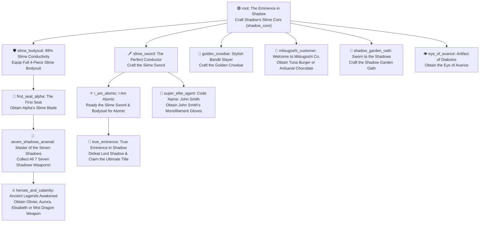

# 08. Advancements, Commands, Configuration & Architecture / 実績ツリー・コマンド・Config・技術仕様

[🏠 Home](Home.md) | [⬅️ Previous: 07. Complete Crafting Recipes](07-Crafting-Recipes.md)

---

## 🏆 12. Advancements Progression Tree (All 13 Advancements) / 全13種の進捗（実績）ツリー

The mod includes a dedicated **"The Eminence in Shadow" (`陰の実力者になりたくて！`)** advancement tab tracking your rise from crafting your first Slime Core to mastering all 8 Canon Bosses.
本MOD専用の進捗（実績）タブが実装されており、最初のスライムコア作成から全ボス制覇までの道のりをガイドします。

| # | Advancement ID | Title (EN / JA) | Trigger Requirement / 達成条件 | Frame Type |
| :-: | :--- | :--- | :--- | :---: |
| **1** | `eminence_shadow:root` | **The Eminence in Shadow** 陰の実力者になりたくて！ | Obtain **Shadow's Slime Core (`shadow_core`)** | `task` |
| **2** | `eminence_shadow:slime_bodysuit` | **99% Slime Conductivity** 魔力伝導率99%・漆黒の装束 | Obtain all 4 pieces of the **Slime Bodysuit** (`slime_hood`, `slime_chestplate`, `slime_leggings`, `slime_boots`) | `goal` |
| **3** | `eminence_shadow:slime_sword` | **The Perfect Conductor** 最強の魔力伝導剣 | Craft or obtain the **Slime Sword (`slime_sword`)** | `task` |
| **4** | `eminence_shadow:golden_crowbar` | **Stylish Bandit Slayer** バールのようなもの（黄金） | Craft or obtain the **Golden Crowbar (`golden_crowbar`)** | `task` |
| **5** | `eminence_shadow:i_am_atomic` | **I Am Atomic** 『I am Atomic』 | Hold the **Slime Sword** with the **Slime Chestplate** equipped | `challenge` |
| **6** | `eminence_shadow:first_seat_alpha` | **The First Seat of Seven Shadows** 七陰第一席の黒刃 | Obtain **Alpha's Slime Blade (`alpha_blade`)** | `goal` |
| **7** | `eminence_shadow:seven_shadows_arsenal` | **Master of the Seven Shadows** 七陰集結・全ての神器 | Obtain all 7 weapons of the Seven Shadows (`alpha_blade`, `beta_bow`, `gamma_sword`, `delta_greatsword`, `epsilon_blade`, `zeta_claw`, `eta_wrench`) | `challenge` |
| **8** | `eminence_shadow:super_elite_agent` | **Code Name: John Smith** 超エリート工作員ジョン・スミス | Obtain **John Smith's Monofilament Gloves (`john_smith_gloves`)** | `goal` |
| **9** | `eminence_shadow:eye_of_avarice` | **Artifact of Diabolos** 暴走する古代アーティファクト | Obtain the **Eye of Avarice (`eye_of_avarice`)** | `goal` |
| **10** | `eminence_shadow:shadow_garden_oath` | **Sworn to the Shadows** シャドウガーデンの盟約 | Craft or obtain the **Shadow Garden Oath (`shadow_garden_oath`)** | `task` |
| **11** | `eminence_shadow:mitsugoshi_customer` | **Welcome to Mitsugoshi Co.** 三越商会へようこそ | Obtain a **Mitsugoshi Supreme Tuna Burger** or **Mitsugoshi Artisanal Chocolate** | `task` |
| **12** | `eminence_shadow:heroes_and_calamity` | **Ancient Legends Awakened** 英雄と厄災の記憶 | Obtain **Olivier's Hero Sword**, **Aurora's Violet Spear**, **Blood Queen's Scythe**, or **Mist Dragon Blade** | `challenge` |
| **13** | `eminence_shadow:true_eminence` | **True Eminence in Shadow** 真・陰の実力者 | Defeat **Lord Shadow (`shadow_boss`)** | `challenge` |

---

## 💻 13. Commands Reference (`/mana`) / コマンドリファレンス

Implemented in `ManaCommand.java`, the `/mana` command suite allows players to inspect their Mana & Mastery Rank and lets operators (`Permission Level 2`) test or adjust player states.
`/mana` コマンドを使用することで、魔力や熟練度ランクの確認・変更（OP権限）が可能です。

| Command Syntax / コマンド構文 | Permission / 権限 | Description / 実行効果 |
| :--- | :---: | :--- |
| **`/mana info`** | **All Players (`Level 0`)** | Displays your current **Mana (`Current / EffectiveMax`)**, **Effective Regen Rate (`/s`)**, **Selected Atomic Variant**, **Atomic Cooldown**, and **Shadow Mastery Rank (`0–8`)**. |
| **`/mana full`** | Operator (`Level 2`) | Immediately refills your **Current Mana to `100%` of Effective Max** and resets your **Atomic Cooldown to `0`**. |
| **`/mana set <amount>`** | Operator (`Level 2`) | Sets your **Current Mana** to `<amount>` (`0` to `10000`, clamped to Effective Max). |
| **`/mana max <amount>`** | Operator (`Level 2`) | Sets your **Base Max Mana** to `<amount>` (`10` to `10000`, default `100`). |
| **`/mana rank <0..8>`** | Operator (`Level 2`) | Sets your **Shadow Mastery Rank** directly to `<0..8>` (unlocking the corresponding `+25/rank` Max Mana, `+0.5/s` Regen, Slime Sword ATK bonus, and **Cosmic Atomic** at Rank 4+). |

---

## ⚙️ 14. Configuration File (`eminence_shadow-common.toml`) / コンフィグ設定項目一覧

Located at `config/eminence_shadow-common.toml`, all 13 server/common gameplay parameters can be customized without restarting the game world:
ワールドやサーバーのルールに合わせて、`config/eminence_shadow-common.toml` の全13項目を自由に調整できます。

| Section | Config Key / 設定キー | Default / 初期値 | Valid Range / 範囲 | Description / 設定内容の詳細 |
| :---: | :--- | :---: | :---: | :--- |
| **`[mana]`** | `defaultMaxMana` | **`100`** | `10` – `10000` | Base Maximum Mana for a fresh player before armor and Mastery Rank bonuses. |
| **`[mana]`** | `defaultManaRegen` | **`2`** | `0` – `1000` | Base passive Mana regeneration per second (`20 ticks`) before armor and Rank bonuses. |
| **`[mana]`** | `slimeSuitMaxManaBonus` | **`150`** | `0` – `10000` | Bonus Maximum Mana granted while wearing the full 4-piece Slime Bodysuit (`+150` default). |
| **`[mana]`** | `slimeSuitRegenMultiplier` | **`2.0`** | `1.0` – `20.0` | Multiplier applied to passive Mana regeneration while wearing the full 4-piece Slime Bodysuit (`2.0x` default). |
| **`[atomic]`** | `atomicManaCost` | **`200`** | `0` – `10000` | Base Mana cost for **Standard Atomic** (`160` with full suit `-20%` discount). |
| **`[atomic]`** | `atomicCooldownTicks` | **`400`** | `0` – `72000` | Cooldown in ticks for **Standard Atomic** (`400 ticks = 20.0 seconds`). |
| **`[atomic]`** | `atomicDamage` | **`500.0`** | `1.0` – `100000.0` | Base damage dealt by **Standard Atomic** (`500.0` default). |
| **`[atomic]`** | `atomicEntityRadius` | **`48.0`** | `4.0` – `256.0` | Entity damage radius in blocks for **Standard Atomic** (`48.0m` default). |
| **`[atomic]`** | `atomicCraterRadius` | **`32`** | `0` – `128` | Terrain crater radius in blocks for **Standard Atomic** (`32m` default; All-Range uses `1.5x = 48m`). |
| **`[atomic]`** | `atomicBlockDestruction` | **`true`** | `true` / `false` | Whether Standard, All-Range, and Cosmic Atomic carve terrain craters. Set to **`false`** to disable all terrain block destruction server-wide! |
| **`[atomic]`** | `allRangeManaCost` | **`300`** | `0` – `10000` | Base Mana cost for **All-Range Atomic** & **Cosmic Atomic** (`240` with full suit `-20%` discount). |
| **`[atomic]`** | `allRangeEntityRadius` | **`80.0`** | `8.0` – `256.0` | Entity damage radius in blocks for **All-Range Atomic** (`80.0m` default). |
| **`[atomic]`** | `allRangeDamage` | **`850.0`** | `1.0` – `100000.0` | Base damage dealt by **All-Range Atomic** (`850.0` default). |

---

## 🛠️ 15. Technical Architecture & Server Optimization / 技術仕様・マルチプレイ負荷対策

To ensure **zero server TPS lag** even when unleashing `48m` to `60m` Atomic craters in multiplayer, **The Eminence in Shadow: Shadow Garden & Atomic** uses a custom asynchronous block-carving and network-batching pipeline (`AtomicSequenceHandler.java`):
巨大なクレーターを生成する『I am Atomic』をマルチプレイサーバーで使用しても **TPS低下（ラグ）が発生しない** よう、以下の独自最適化エンジンを実装しています。

1. **Asynchronous Multi-Tick Crater Carving (`PendingCrater` Queue)**:
   - Instead of removing 100,000+ blocks in a single server tick (which freezes vanilla Minecraft), craters are queued into a per-dimension `PendingCrater` iterator and carved outward shell-by-shell at a budgeted **`5,500 blocks per tick`**.
   - Low-level `LevelChunkSection.setBlockState(..., false)` writes directly to the palette without triggering cascading neighbor updates, physics checks, or lighting recalculations per block.
2. **Batched S2C Chunk Delta Packets (`ClientboundSectionBlocksUpdatePacket`)**:
   - Instead of sending thousands of individual `ClientboundBlockUpdatePacket` messages, modified blocks are grouped by `SectionPos` and broadcast as a single compressed `ClientboundSectionBlocksUpdatePacket` per 16×16×16 chunk section to nearby players.
3. **Full Dual-Loader Parity (NeoForge 1.21.1 & Forge 1.20.1)**:
   - **NeoForge 1.21.1 (`21.1.219`)**: Uses the modern `RegisterPayloadHandlersEvent` (`CustomPacketPayload` / `StreamCodec`), `AttachmentType<ManaCapability>`, and Data Component item attributes.
   - **Forge 1.20.1 (`47.3.0`)**: Uses `SimpleChannel` packet registration, `ICapabilitySerializable<CompoundTag>` (`CapabilityManager`), and `Multimap<Attribute, AttributeModifier>` item attributes with 100% identical gameplay behavior.

---

[🏠 Home](Home.md) | [⬅️ Previous: 07. Complete Crafting Recipes](07-Crafting-Recipes.md)
