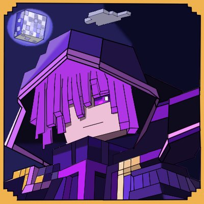
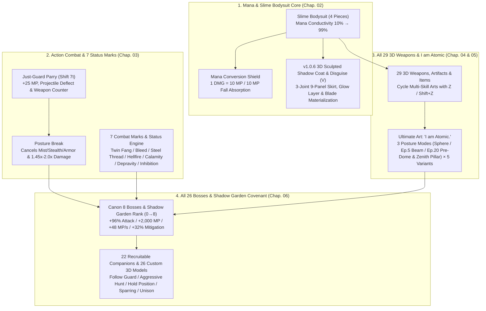

# 🌑 The Eminence in Shadow: Shadow Garden & Atomic — Official English Wiki

**Welcome to the Official English Strategy & Technical Specification Wiki for _The Eminence in Shadow: Shadow Garden & Atomic_ (`v1.0.6` — Minecraft Forge 1.20.1)!**

🌐 **Language / 言語切替**: **[🇯🇵 日本語 Wiki (Switch to Japanese)](Home.md)** ｜ **🇺🇸 English Wiki (Current)**

---

## 🆕 What's New in `v1.0.6`

- **Episode 20 Zenith Sublimation Pillar (`I am Atomic.` Skyward Mode)**: Chanting `I am Atomic.` while looking skyward (`Pitch <= -45°`) now **unfolds a colossal hemispherical dome across the entire 100m battlefield *before* detonation (reaching 100% max radius by the `"I"` vocal beat)** with 3 concentric shells, 16 geodesic meridian ribs, 5 latitude rings, 16 perimeter pylons, ascending zenith convergence waves, and dome boundary containment. At *"Atomic."* release, the entire dome redirects skyward into a **3-layer Zenith Sublimation Pillar (220+ blocks high) and 4-tier cloud-parting sky canopy rings**, blasting away rain/thunderclouds into clear skies with **zero ground block destruction**!
- **3D Sculpted Shadow Coat Overhaul & Full-Bright Emissive Glow**: Rebuilt `ShadowCoatModel` and `SlimeArmorModel` with a 3-joint 9-panel tattered skirt (`_top -> _bot -> _tip` + front sweeps), clear arched hood face opening revealing crimson glowing eyes under the shadow visor, 45°-rotated forehead gold diamond & glowing amethyst throat brooch, 3-joint gold-aglet ribbons, 3-stage giant flared wing collar, 3D chevron slime chestplate, 2-stage slime glider wings, full-bright `shadow_coat_glow.png` emissive pass, and custom 16×16 armor slot icons.
- **Dedicated 3D Attire Models & Glow Maps for All 17 Kagemasu / Anime Characters**: Every single boss and companion—including **Aurora**, **Yukime (36-part dynamic 9-tail system: 9 golden tails × 4 articulated segments)**, and **256×256 Ultra-HD Elisabeth & Olivier**—now features a dedicated 3D attire model and full-bright emissive glow layer.
- **100%-Fidelity Performance Optimizations**: Precomputed Trigonometric & Geodesic LUTs in `AtomicBlastRenderer`, zero-allocation physics scratch buffers (`PanelRippleScratch` & `KitsuneTailScratch`), and lock-free `volatile` completion fast-paths on `SphereDestroyer` and `DirectionalDestroyer`.

---

## 🧭 English Wiki Chapters Navigation

> 🇯🇵 日本語のWikiページ一覧は **[日本語 Wiki ホーム (`Home.md`)](Home.md)** をご覧ください。

| Chap. | English Page Link | Japanese Page Link | Contents Overview |
| :-: | :--- | :--- | :--- |
| **01** | **[Getting Started, Controls & Progression Guide](01-Getting-Started-and-Controls-EN.md)** | **[JA Chap. 01](01-Getting-Started-and-Controls.md)** | Installation requirements, complete keybindings reference, and the **8-Step Survival Progression Route from 7th Seat Eta to Lord Shadow** |
| **02** | **[Mana (MP), 99% Conductivity & Slime Bodysuit](02-Mana-and-Slime-Bodysuit-EN.md)** | **[JA Chap. 02](02-Mana-and-Slime-Bodysuit.md)** | Mana Conductivity formulas (`10% → 50% → 99%`), `7,000` Max MP resonance scaling, Mana Shield Defense (`1 DMG = 10 MP`), **`v1.0.6` 3D Sculpted Shadow Coat (3-joint 9-panel skirt & emissive glow)** & Civilian Disguise (`V`) |
| **03** | **[Action Combat, Just-Guard Parry & 7 Status Marks](03-Combat-Parry-and-Status-Marks-EN.md)** | **[JA Chap. 03](03-Combat-Parry-and-Status-Marks.md)** | Slime Guard, Just-Guard Parry (`7 ticks` window & 6 parry rewards), **Posture Break** damage multipliers, High-Speed Dash, and the **7 Combat Marks (Twin Fang, Bleed, Steel Thread, Hellfire, Calamity Break, Depravity, Magic Inhibition)** |
| **04** | **[Ultimate Art: "I am Atomic." Engine & All Modes](04-I-Am-Atomic-EN.md)** | **[JA Chap. 04](04-I-Am-Atomic.md)** | Chant timeline & Nakanishi Pre-Blast Silence, **3 Posture-Controlled Modes (Standard Sphere / Ep.5 Directional Beam / `v1.0.6` Ep.20 Pre-Blast Colossal Dome & Zenith Sublimation Pillar)**, and all 5 Atomic variants |
| **05** | **[All 29 3D Weapons, Artifacts & Consumables Catalog](05-Weapons-and-Artifacts-EN.md)** | **[JA Chap. 05](05-Weapons-and-Artifacts.md)** | Complete stats, MP costs, cooldowns, and damage formulas for all 9 Shadow/Cid weapons, **7 Seven Shadows weapons (5 skills each)**, 11 Hero/Witch/Cult weapons, and 2 Mitsugoshi rations |
| **06** | **[All 26 Boss Entities & Shadow Garden Covenant](06-Bosses-and-Companions-EN.md)** | **[JA Chap. 06](06-Bosses-and-Companions.md)** | **4-Phase Lord Shadow** (44m barrier dome), **Seven Shadows (7)**, **Super Elite Agent John Smith**, **17 Kagemasu Heroes & Cult Bosses with dedicated 3D attire models**, and the **22-Character Companion System, AI Tactics & Sparring** |
| **07** | **[Complete 51 Crafting Recipes Reference](07-Crafting-Recipes-EN.md)** | **[JA Chap. 07](07-Crafting-Recipes.md)** | Full 3×3 crafting grids for all 4 Slime Bodysuit pieces, 21 weapons/artifacts/foods, 8 canon boss resonators, and 18 Kagemasu/Cult boss resonators |
| **08** | **[Advancements, `/mana` Commands, Config & Architecture](08-Commands-Config-and-Advancements-EN.md)** | **[JA Chap. 08](08-Commands-Config-and-Advancements.md)** | All 13 gameplay advancements, `/mana` commands, all 13 `eminence_shadow-common.toml` options, and **`v1.0.6` LUT & Zero-Allocation optimizations** |
| **📄** | **[Single-File Master Specification (`WIKI_SPECIFICATION.md`)](../WIKI_SPECIFICATION.md)** | — | Combined bilingual master technical specification in a single document |

---

## 🗺️ System Architecture Overview

---

## 📊 Content Summary at a Glance

| Category | Count | Breakdown & Highlights |
| :--- | :---: | :--- |
| **Custom 3D Weapons, Artifacts & Consumables** | **29** | 9 Shadow/Cid weapons & artifacts + 7 Seven Shadows weapons (5 skills each) + 11 Three Heroes/Kagemasu/Cult weapons + 2 Mitsugoshi rations |
| **Slime Bodysuit Armor Pieces** | **4** | Hood, Coat, Leggings, Boots (Full set grants 99% Mana Conductivity, 100% Mana Shield & `v1.0.6` 3D sculpted/glowing Shadow Coat transformation) |
| **Multi-Phase Boss Entities** | **26** | 4-Phase Lord Shadow + 7 Seven Shadows + John Smith + **14 Kagemasu Heroes/Numbers & 3 Cult of Diablos Executives with dedicated 3D attire models** |
| **Recruitable Companions (Covenant)** | **22** | Every boss except the 3 Cult Executives (Fenrir, Ragnarok, Nelson) and Lord Shadow himself can be recruited as an AI companion |
| **Boss Summoning Resonators & Spawn Eggs** | **26 each** | 26 craftable 3D Resonators (also summon defeated bosses directly as allied companions via `Shift + Right-Click`) + 26 creative Spawn Eggs |
| **Survival Crafting Recipes** | **51** | Automatically unlocked in the vanilla Recipe Book and fully viewable in JEI |
| **Custom Advancements** | **13** | Full progression tree from equipping the Slime Bodysuit to conquering the Seven Shadows, defeating Lord Shadow, and unleashing `I am Atomic.` |
