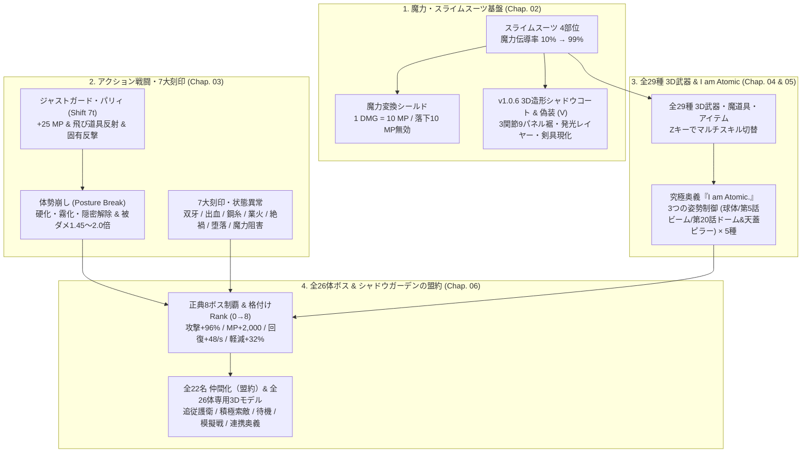

# 🌑 The Eminence in Shadow: Shadow Garden & Atomic — 公式Wiki (Japanese Wiki)

**『陰の実力者になりたくて！』Minecraft アクション＆RPG MOD (`v1.0.6` — Forge 1.20.1) 公式攻略＆仕様Wikiへようこそ！**

🌐 **Language / 言語切替**: **🇯🇵 日本語 Wiki (現在)** ｜ **[🇺🇸 English Wiki (Switch to English)](Home-EN.md)**

---

## 🆕 `v1.0.6` 最新アップデートハイライト

- **アニメ第20話完全再現『天蓋昇華ピラー形態（Zenith Sublimation Pillar）』**: 上空（`Pitch <= -45°`）を見上げて `I am Atomic.` を詠唱すると、**解放前に戦場全域（半径100m）を覆う超巨大半球ドームが展開（`"I"` の時点で最大半径到達）** し、解放の瞬間に地上ブロックを一切破壊せず上空へ指向性を転換して **3層天蓋昇華ピラー＆4層雲割りリング** へと昇華！
- **シャドウ専用 3D造形ロングコート完全刷新＆3D発光レイヤー**: 3段関節×9パネルの裾物理演算、フード顔開口部から覗く真紅の眼光、45°額ダイヤ紋章＆紫宝ブローチ、3関節金具リボン、3段巨大ウイング襟、2段階スライム翼、専用アイテムアイコン4種を実装。
- **カゲマス＆アニメ全17キャラクターの専用3D衣装モデル＆発光テクスチャ実装**: **災厄の魔女アウロラ**、**36パーツ（9尾×4関節）が独立可動する金毛九尾ユキメ**、256×256超高精細テクスチャの**エリザベート**＆**オリヴィエ**を含む全17体に専用3Dモデルと発光レイヤーを実装。
- **100%描画精度維持のパフォーマンス最適化**: 測地線ドーム三角関数LUTキャッシュ、ゼロアロケーション物理演算、非同期クレーター完了後のロックフリー高速パスを導入。

---

## 🧭 日本語 Wiki 全章インデックス（Japanese Chapters）

> 🇺🇸 For the English Wiki chapters, please visit **[English Wiki Home (`Home-EN.md`)](Home-EN.md)**.

| 章 | 日本語ページリンク (Japanese) | English Page Link | 収録内容 |
| :-: | :--- | :--- | :--- |
| **01** | **[導入・操作方法・推奨攻略チャート](01-Getting-Started-and-Controls.md)** | **[EN Chap. 01](01-Getting-Started-and-Controls-EN.md)** | インストール手順、全キーバインド詳細、**第七席イータから陰の実力者シャドウへ至る8ステップ攻略ガイド** |
| **02** | **[魔力（MP）・魔力伝導率99%・スライムスーツ](02-Mana-and-Slime-Bodysuit.md)** | **[EN Chap. 02](02-Mana-and-Slime-Bodysuit-EN.md)** | 魔力伝導率（`10% → 50% → 99%`）と実消費MPの数式、最大MP `7,000` 共鳴スケーリング、魔力変換シールド（`1 DMG = 10 MP`）、**`v1.0.6` 3D造形シャドウコート（3関節9パネル裾＆発光レイヤー）**＆日常服偽装（`V`） |
| **03** | **[アクション戦闘・パリィ・体勢崩し・7大刻印](03-Combat-Parry-and-Status-Marks.md)** | **[EN Chap. 03](03-Combat-Parry-and-Status-Marks-EN.md)** | スライムガード、ジャストガード・パリィ（`7 ticks`受付＆6大恩恵）、【体勢崩し（Posture Break）】倍率計算、高速移動（瞬駆/連閃）、7大刻印（**双牙・出血・鋼糸・業火・絶禍・堕落・魔力阻害**） |
| **04** | **[究極奥義『I am Atomic.』全形態＆空間消滅エンジン](04-I-Am-Atomic.md)** | **[EN Chap. 04](04-I-Am-Atomic-EN.md)** | 詠唱タイムライン＆中西演出（爆発前無音）、**発動姿勢による3形態（通常球体 / 第5話・指向性貫通ビーム / `v1.0.6` 第20話・事前極大ドーム＆天蓋昇華ピラー）**、全5種Atomic比較表 |
| **05** | **[全29種 3D武器・魔道具・消費アイテム完全図鑑](05-Weapons-and-Artifacts.md)** | **[EN Chap. 05](05-Weapons-and-Artifacts-EN.md)** | シャドウ/シド系9種、**七陰専用武器7種（各5スキル収録）**、三英雄・魔女・血の女王・妖狐・剣聖・教団幹部武器11種、ミツゴシ商会アイテム2種の全ステータス＆全スキル数値 |
| **06** | **[全26体 ボス攻略データ＆シャドウガーデンの盟約](06-Bosses-and-Companions.md)** | **[EN Chap. 06](06-Bosses-and-Companions-EN.md)** | **4段階覚醒ボス「シャドウ」**（半径44m結界ドーム）、**七陰7名**、**超精鋭「ジョン・スミス」**、**専用3D衣装＆発光モデル対応のカゲマス英雄＆教団幹部17体**のパラメータ・弱点、**仲間化（盟約）・AI戦術・模擬戦・ユニゾン連携** |
| **07** | **[全51種 クラフトレシピ完全一覧](07-Crafting-Recipes.md)** | **[EN Chap. 07](07-Crafting-Recipes-EN.md)** | スライムスーツ4部位、武器・魔道具・ミツゴシ食品21種、正典8ボス共鳴核、カゲマス＆教団18ボス共鳴核の3×3作業台レシピ一覧 |
| **08** | **[進捗13種・コマンド・コンフィグ＆最適化仕様](08-Commands-Config-and-Advancements.md)** | **[EN Chap. 08](08-Commands-Config-and-Advancements-EN.md)** | 進捗ツリー全13種、`/mana` コマンド構文、`eminence_shadow-common.toml` 全13項目リファレンス、**`v1.0.6` LUT＆ゼロアロケーション描画最適化**・非同期クレーター生成 |
| **📄** | **[1ファイル統合版マスター仕様書 (`WIKI_SPECIFICATION.md`)](../WIKI_SPECIFICATION.md)** | — | 全8章のデータを単一ファイルで検索・閲覧できるマスタードキュメント |

---

## 🗺️ システム全体アーキテクチャ（System Overview）

---

## 📊 コンテンツ収録数サマリー

| カテゴリ | 収録数 | 内訳・備考 |
| :--- | :---: | :--- |
| **専用3D武器・魔道具・消費アイテム** | **29種** | シャドウ/シド系9種 ＋ 七陰専用7種（各5技） ＋ 三英雄・カゲマス・教団系11種 ＋ ミツゴシ食品2種 |
| **スライムスーツ防具** | **4部位** | フード・コート・タイツ・ブーツ（フル装備で伝導率99%＆`v1.0.6` 3D造形・発光シャドウコート変身＋カスタムアイテムアイコン） |
| **多段階覚醒ボスエンティティ** | **26体** | 4段階覚醒「シャドウ」 ＋ 七陰7名 ＋ ジョン・スミス ＋ **専用3D衣装＆発光モデル完備のカゲマス英雄・ナンバーズ14名＆教団幹部3体** |
| **仲間化（盟約）可能キャラクター** | **22名** | 教団幹部3体（フェンリル・ラグナロク・ネルソン）とシャドウ本人を除く全22名が仲間化＆模擬戦対応 |
| **ボス召喚用・共鳴核＆スポーンエッグ** | **各26種** | サバイバル用3D共鳴核26種（撃破後は味方直接召喚器としても機能）＋ クリエイティブ用スポーンエッグ26種 |
| **サバイバル・クラフトレシピ** | **51種** | レシピブック自動解放＆JEI完全対応 |
| **カスタム進捗（Advancements）** | **13種** | スライムスーツ着用から七陰全席制覇、シャドウ撃破、`I am Atomic.` 発動まで |
