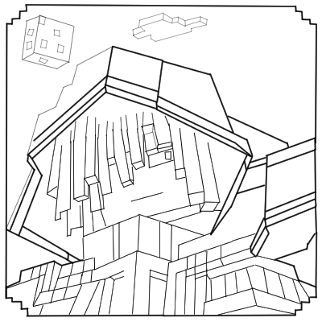

# 🌑 The Eminence in Shadow: Shadow Garden & Atomic — 公式Wiki (Japanese Wiki)

**『陰の実力者になりたくて！』Minecraft アクション＆RPG MOD (`v1.0.8` — Forge 1.20.1 / NeoForge 1.21.1) 公式攻略＆仕様Wikiへようこそ！**

🌐 **Language / 言語切替**: **🇯🇵 日本語 Wiki (現在)** ｜ **[🇺🇸 English Wiki (Switch to English)](Home-EN.md)**

---

## 1.0.8の更新内容

- **魔剣『血牙』 (`fenrir_katana`) 大太刀リファイン**: 刀身と反りの向きを修正し、身の丈超えの燃える血紅色大太刀（リーチ `+1.55`）へ刷新しました。
- **『ラムダの黒鞭』 (`lambda_whip`) ＆ イータ第6技「スライム剣・地裂落剣」実装**: ラムダの黒鞭（引き寄せ鞭槍＋出血・暗闇＆味方回復/強化）およびイータの新規技・ボスAI（地上スライム剣打ち上げ＋上空落剣）を追加し、アウロラの魔力オーブ生成数と発光輪を強化しました。
- **ディメンション移動時のマナ・外装維持修正**: ネザー／エンド往復やリスポーン後に最大MPが `1,000` に固定されたり `V` キーでの日常服偽装が効かなくなる不具合を解消しました。
- **HUD / 画面エフェクト全面刷新 ＆ 日英原作表記統一**: WCAG AAA 高コントラスト・GUIスケール/オフハンド/字幕と重ならない適応レイアウト・ソフトビネット化・チャット画面より手前への描画を実装し、日英翻訳を原作表記へ統一しました。

[導入環境](01-Getting-Started-and-Controls.md) ｜ [天頂アトミック](04-I-Am-Atomic.md) ｜ [武器の性能](05-Weapons-and-Artifacts.md) ｜ [ボス攻略](06-Bosses-and-Companions.md)

---

## 🧭 日本語 Wiki 全章インデックス（Japanese Chapters）

> 🇺🇸 For the English Wiki chapters, please visit **[English Wiki Home (`Home-EN.md`)](Home-EN.md)**.

| 章 | 日本語ページリンク (Japanese) | English Page Link | 収録内容 |
| :-: | :--- | :--- | :--- |
| **01** | **[導入・操作方法・推奨攻略チャート](01-Getting-Started-and-Controls.md)** | **[EN Chap. 01](01-Getting-Started-and-Controls-EN.md)** | インストール手順、全キーバインド詳細、**第七席イータから陰の実力者シャドウへ至る8ステップ攻略ガイド** |
| **02** | **[魔力（MP）・魔力伝導率99%・スライムスーツ](02-Mana-and-Slime-Bodysuit.md)** | **[EN Chap. 02](02-Mana-and-Slime-Bodysuit-EN.md)** | 魔力伝導率（`10% → 50% → 99%`）と実消費MPの数式、最大MP `7,000` 共鳴スケーリング、魔力変換シールド（`1 DMG = 10 MP`）、**`v1.0.6` 3D造形シャドウコート（3関節9パネル裾＆発光レイヤー）**＆日常服偽装（`V`） |
| **03** | **[アクション戦闘・パリィ・体勢崩し・7大刻印](03-Combat-Parry-and-Status-Marks.md)** | **[EN Chap. 03](03-Combat-Parry-and-Status-Marks-EN.md)** | スライムガード、ジャストガード・パリィ（`7 ticks`受付＆6大恩恵）、【体勢崩し（Posture Break）】倍率計算、高速移動（瞬駆/連閃）、7大刻印（**双牙・出血・鋼糸・業火・絶禍・堕落・魔力阻害**） |
| **04** | **[究極奥義『I am Atomic.』全形態＆空間消滅エンジン](04-I-Am-Atomic.md)** | **[EN Chap. 04](04-I-Am-Atomic-EN.md)** | 詠唱タイムライン＆中西演出（爆発前無音）、**発動姿勢による3形態（通常球体 / 第5話・指向性貫通ビーム / 第20話・天頂ドームと魔法陣）**、全5種Atomic比較表 |
| **05** | **[全30種 3D武器・魔道具・消費アイテム完全図鑑](05-Weapons-and-Artifacts.md)** | **[EN Chap. 05](05-Weapons-and-Artifacts-EN.md)** | シャドウ/シド系9種、**七陰専用武器7種（各5〜6スキル収録）**、三英雄・魔女・血の女王・妖狐・剣聖・教団幹部・ラムダ武器12種、ミツゴシ商会アイテム2種の全ステータス＆全スキル数値 |
| **06** | **[全26体 ボス攻略データ＆シャドウガーデンの盟約](06-Bosses-and-Companions.md)** | **[EN Chap. 06](06-Bosses-and-Companions-EN.md)** | **4段階覚醒ボス「シャドウ」**（半径44m結界ドーム）、**七陰7名**、**超精鋭「ジョン・スミス」**、**専用3D衣装＆発光モデル対応のカゲマス英雄＆教団幹部17体**のパラメータ・弱点、**仲間化（盟約）・AI戦術・模擬戦・ユニゾン連携** |
| **07** | **[全52種 クラフトレシピ完全一覧](07-Crafting-Recipes.md)** | **[EN Chap. 07](07-Crafting-Recipes-EN.md)** | スライムスーツ4部位、武器・魔道具・ミツゴシ食品22種、正典8ボス共鳴核、カゲマス＆教団18ボス共鳴核の3×3作業台レシピ一覧 |
| **08** | **[進捗13種・コマンド・コンフィグ＆最適化仕様](08-Commands-Config-and-Advancements.md)** | **[EN Chap. 08](08-Commands-Config-and-Advancements-EN.md)** | 進捗ツリー全13種、`/mana` コマンド構文、`eminence_shadow-common.toml` 全13項目リファレンス、**`v1.0.6` LUT＆ゼロアロケーション描画最適化**・非同期クレーター生成 |
| **📄** | **[1ファイル統合版マスター仕様書 (`WIKI_SPECIFICATION.md`)](../WIKI_SPECIFICATION.md)** | — | 全8章のデータを単一ファイルで検索・閲覧できるマスタードキュメント |

---

## 🗺️ システム全体アーキテクチャ（System Overview）

---

## 📊 コンテンツ収録数サマリー

| カテゴリ | 収録数 | 内訳・備考 |
| :--- | :---: | :--- |
| **専用3D武器・魔道具・消費アイテム** | **30種** | シャドウ/シド系9種 ＋ 七陰専用7種（各5〜6技） ＋ 三英雄・カゲマス・教団・ラムダ系12種 ＋ ミツゴシ食品2種 |
| **スライムスーツ防具** | **4部位** | フード・コート・タイツ・ブーツ（フル装備で伝導率99%＆`v1.0.6` 3D造形・発光シャドウコート変身＋カスタムアイテムアイコン） |
| **多段階覚醒ボスエンティティ** | **26体** | 4段階覚醒「シャドウ」 ＋ 七陰7名 ＋ ジョン・スミス ＋ **専用3D衣装＆発光モデル完備のカゲマス英雄・ナンバーズ14名＆教団幹部3体** |
| **仲間化（盟約）可能キャラクター** | **22名** | 教団幹部3体（フェンリル・ラグナロク・ネルソン）とシャドウ本人を除く全22名が仲間化＆模擬戦対応 |
| **ボス召喚用・共鳴核＆スポーンエッグ** | **各26種** | サバイバル用3D共鳴核26種（撃破後は味方直接召喚器としても機能）＋ クリエイティブ用スポーンエッグ26種 |
| **サバイバル・クラフトレシピ** | **52種** | レシピブック自動解放＆JEI完全対応 |
| **カスタム進捗（Advancements）** | **13種** | スライムスーツ着用から七陰全席制覇、シャドウ撃破、`I am Atomic.` 発動まで |
